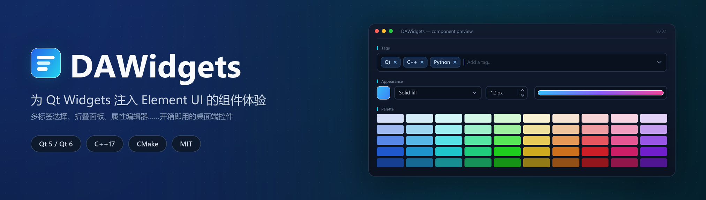
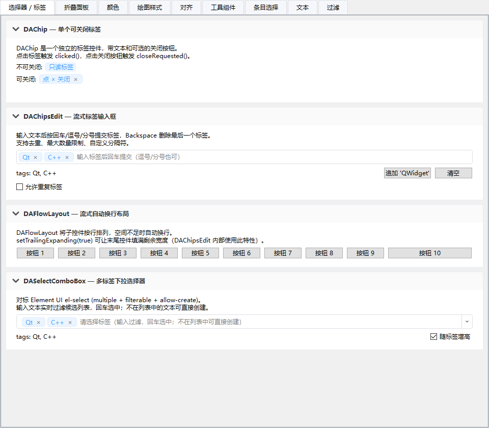
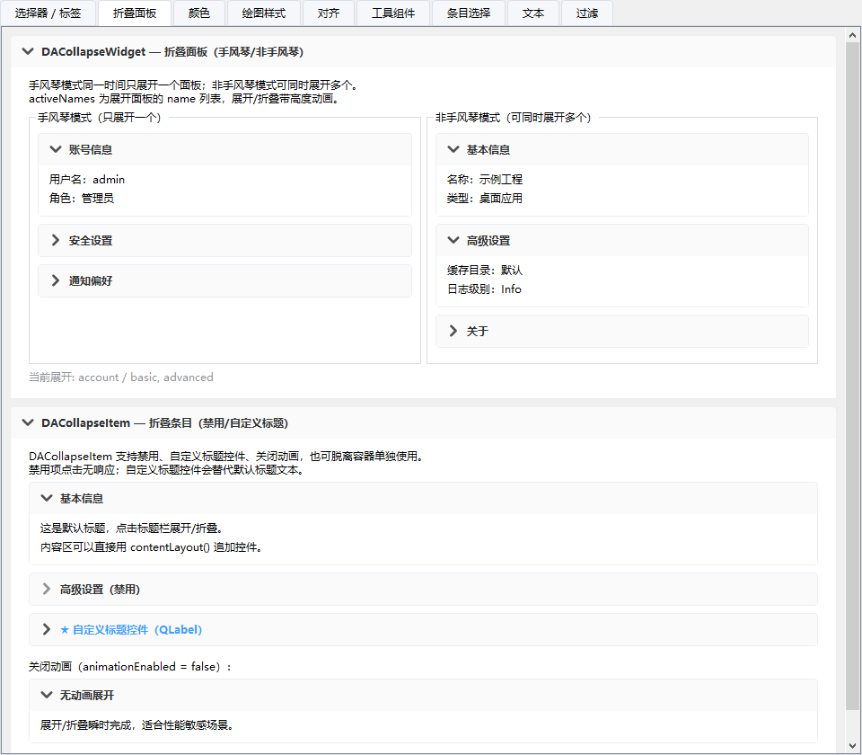
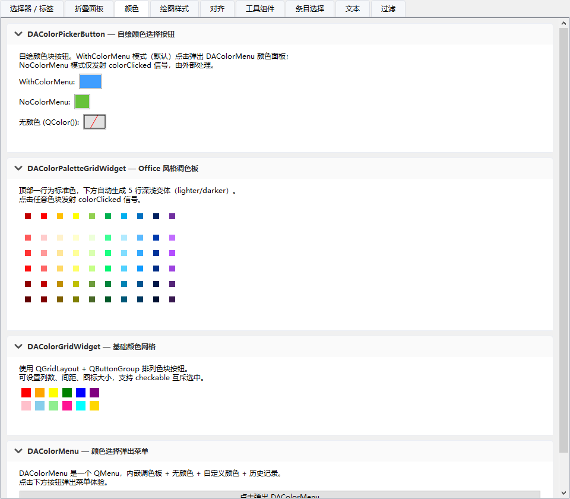
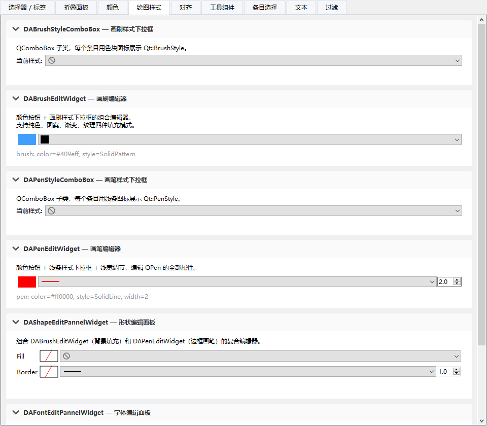
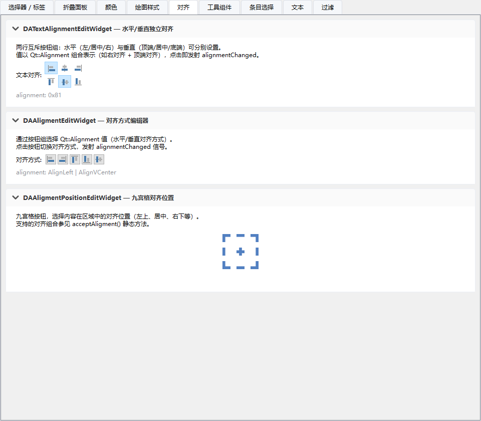
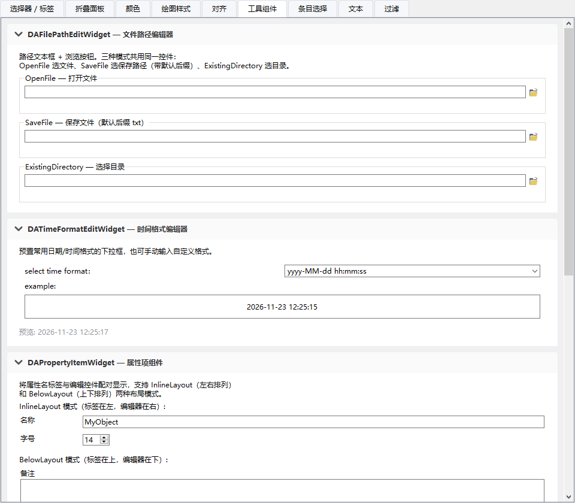
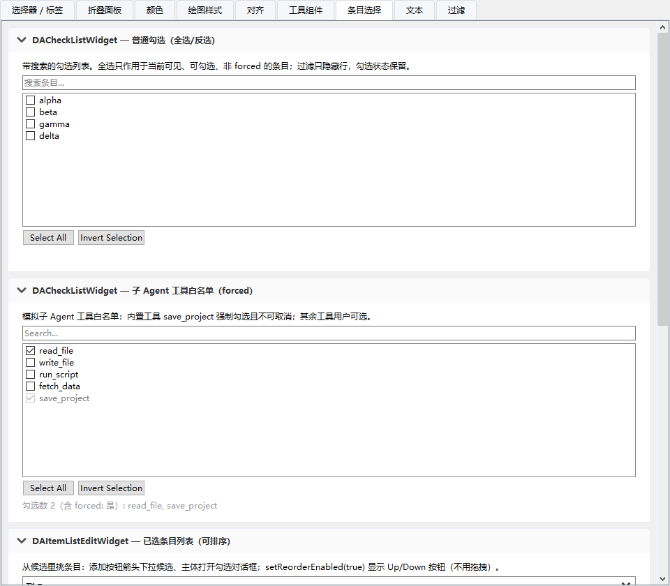
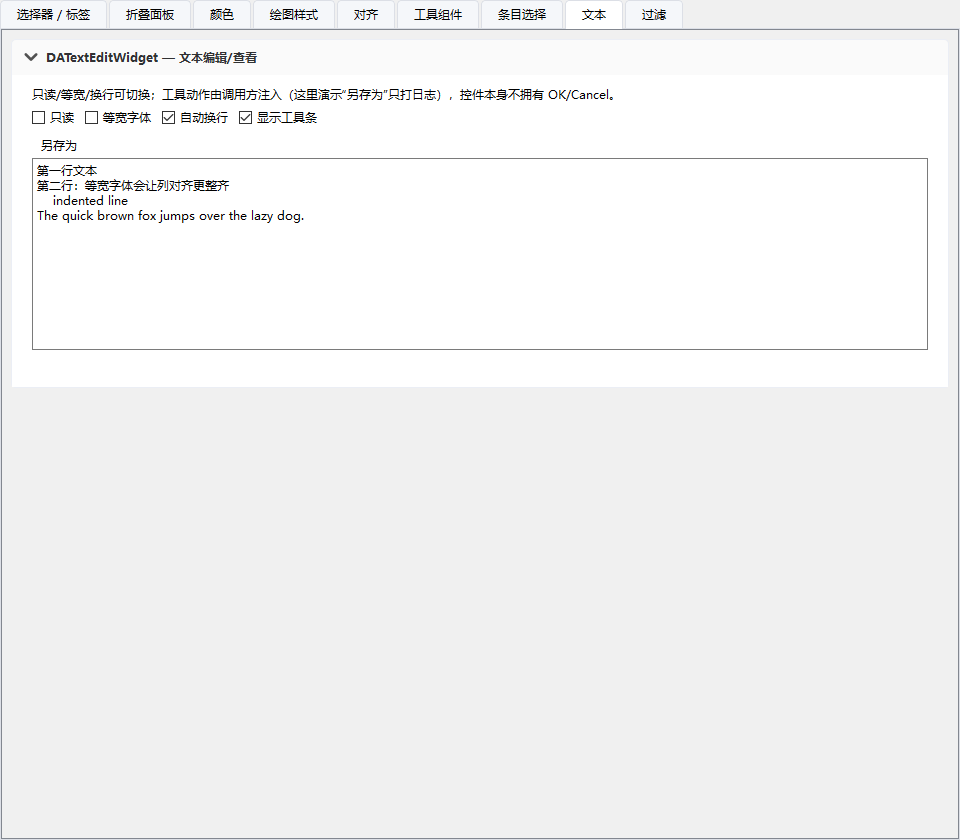
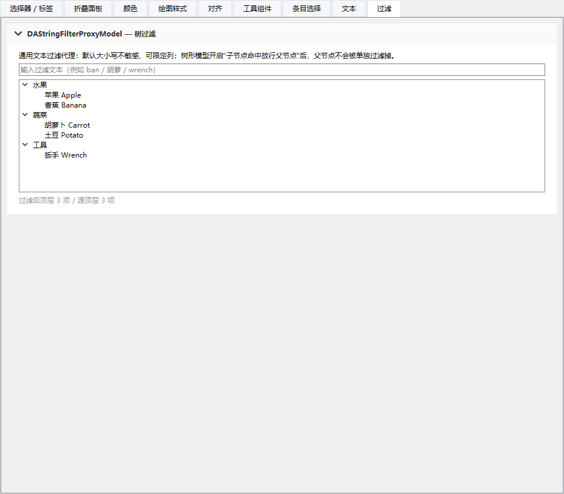

<div align="center">


<p><a href="./README.md">English</a> &nbsp;&middot;&nbsp; <b>简体中文</b></p>

<p>
<a href="https://github.com/czyt1988/DAWidgets/releases/latest"></a>
<a href="https://github.com/czyt1988/DAWidgets/actions/workflows/build.yml"></a>
<a href="https://github.com/czyt1988/DAWidgets/actions/workflows/page.yml"></a>
<a href="./LICENSE"></a>
</p>

<p>
<a href="https://www.qt.io/"></a>
<a href="https://en.cppreference.com/w/cpp/17"></a>
<a href="https://github.com/czyt1988/DAWidgets/stargazers"></a>
</p>

<h3>为 Qt Widgets 注入 Element UI 的组件体验</h3>
<p><sub>多标签选择、折叠面板、属性编辑器……开箱即用的桌面端控件。无需 QML，无额外运行时，MIT 许可。</sub></p>

<p><a href="https://czyt1988.github.io/DAWidgets/">中文文档</a> &nbsp;&middot;&nbsp; <a href="https://czyt1988.github.io/DAWidgets/en/"><b>Documentation</b></a> &nbsp;&middot;&nbsp; <a href="#快速开始">快速开始</a> &nbsp;&middot;&nbsp; <a href="#控件画廊">控件画廊</a> &nbsp;&middot;&nbsp; <a href="./CHANGELOG-CN.md">更新日志</a></p>
</div>

## 为什么选择 DAWidgets？

Qt Widgets 成熟稳定，却始终缺少 Web UI 库早已习以为常的交互形态：带删除标签与实时过滤的多选输入框、带动画的折叠面板、开箱即用的属性面板。这些控件手写一遍并不难，但反复重写与业务无关的界面代码，实在不是开发桌面应用该花的时间。

DAWidgets 用纯 `QWidget` 补齐这些空白，交互设计对标 [Element UI](https://element.eleme.io/)：能放进现有布局，不需要 Qt Quick/QML 运行时，除 Qt 本身外没有任何额外依赖。

- **即插即用的 `QWidget`。** 每个组件都是普通控件，可直接放进布局、停靠窗口、对话框或 `QMainWindow`；没有场景图、没有新的事件循环、不引入 QML 引擎。
- **Element UI 的交互模型。** `DASelectComboBox` 对标 `el-select` 的 `multiple + filterable + allow-create` 形态；`DACollapseWidget` 对标 `el-collapse`，带展开动画、手风琴模式与自定义标题。
- **成套的属性面板工具，而不是单个控件。** 颜色、调色板、画笔、画刷、字体、形状、对齐、时间格式、文件路径等编辑器，外加带搜索与勾选对话框的条目选择控件。
- **一套代码同时支持 Qt 5 与 Qt 6。** 用少量兼容层抹平 API 差异，已在 Qt 5.14.2 / Qt 6.7.3 验证，CI 同时覆盖 Windows（MSVC）与 Linux（GCC）。
- **MIT 许可，易于随项目分发。** 无 GPL/LGPL 义务，公开头文件保持 PIMPL 干净，控件支持 qss 定制；不想引入构建依赖时还有单文件合并版可用。

## 特性一览

| 分类 | 内容 |
|:-----|:-----|
| **选择器** | `DASelectComboBox`：多标签下拉选择，支持过滤、allow-create 与两种高度模式；`DAChipsEdit`：可独立使用的标签输入框；`DAChip`；`DAFlowLayout`。 |
| **折叠面板** | `DACollapseWidget` + `DACollapseItem`：`QPropertyAnimation` 展开/收起动画、手风琴或多面板同开、禁用状态、自定义标题与内容控件；`DACollapseLayout` 保证动画过程不抖动。 |
| **属性编辑** | 颜色拾取按钮与颜色菜单、Office 风格调色板、画笔/画刷样式下拉框与编辑器、字体与形状编辑面板、对齐与九宫格位置编辑器、时间格式与文件路径编辑器、属性行包装器、文本编辑器、RAII 光标守卫。 |
| **条目选择与预览** | `DAItemListEditWidget`（已选列表 + 添加菜单/勾选对话框 + 可选排序）、`DAItemListPickDialog`、`DACheckListWidget`（搜索、全选/反选、forced 条目）、`DAStringListEditWidget`、`DAItemEntry`、`DAColorScalePreviewWidget`、`DAStringFilterProxyModel`。 |
| **工具组件** | `DAUndoHistoryWidget`：撤销历史视图与撤销深度控制；`DAAbstractWidgetOverlay`：控件遮罩层基类。 |
| **通用能力** | Qt 5 / Qt 6 双兼容、公开类 PIMPL、手写静态/动态导出宏、qss 定制（`DA--ClassName` 选择器）、单文件合并、中英双语文档站、9 个标签页的演示程序与一键截图导出、12 套 QtTest 测试。 |

## 控件画廊

9 个标签页覆盖全部控件，点击图片可查看大图。

| | | |
|:---:|:---:|:---:|
| [](./docs/images/gallery/tabs/01-selector.png) | [](./docs/images/gallery/tabs/02-collapse.png) | [](./docs/images/gallery/tabs/03-color.png) |
| **选择器** — 多标签下拉、标签输入、流式布局 | **折叠面板** — 手风琴与动画面板 | **颜色** — 拾取按钮、调色板、颜色菜单 |
| [](./docs/images/gallery/tabs/04-drawing-style.png) | [](./docs/images/gallery/tabs/05-alignment.png) | [](./docs/images/gallery/tabs/06-utility.png) |
| **绘图样式** — 画笔/画刷编辑器与字体、形状面板 | **对齐** — 对齐方式、文本对齐、九宫格位置 | **工具组件** — 文件路径、时间格式、属性行、撤销 |
| [](./docs/images/gallery/tabs/07-item-selection.png) | [](./docs/images/gallery/tabs/08-text.png) | [](./docs/images/gallery/tabs/09-filter.png) |
| **条目选择** — 勾选列表、已选列表、勾选对话框 | **文本** — 只读、等宽、换行文本编辑器 | **过滤** — 支持父节点放行的文本过滤代理 |

所有截图都由演示程序自己导出 —— `dawidgets_all_widgets_demo --export-gallery docs/images/gallery` —— 控件改动后重新导出即可同步，不会过期。每个控件的特写与弹出层截图见 [控件画廊文档](./docs/gallery.md)。

## 环境要求

| 项目 | 要求 |
|:-----|:-----|
| Qt | Qt 5.12+ 或 Qt 6（已在 Qt 5.14.2、Qt 6.7.3 验证；CI 使用 Qt 6.8） |
| Qt 模块 | Qt Widgets 与 Qt Svg —— 属性编辑控件依赖 Qt Svg 渲染 SVG 图标 |
| 编译器 | C++17：MSVC 2019+（已验证 MSVC 19.29）、GCC 或 Clang |
| 构建系统 | CMake ≥ 3.16（也可以直接引入单文件合并版） |
| 平台 | Windows 已在本机以 MSVC 验证；Windows（MSVC）与 Linux（GCC）已在 CI 验证。macOS 暂未正式测试。 |

## 安装

### 方式一 —— 安装后用 `find_package`（推荐）

先构建安装 DAWidgets，再作为普通 CMake 包引入：

```bash
cmake -S . -B build -DCMAKE_PREFIX_PATH=<Qt 安装路径> -DDAWIDGETS_BUILD_SHARED=ON
cmake --build build --config Release
cmake --install build --config Release --prefix <安装前缀>
```

```cmake
find_package(DAWidgets REQUIRED)
target_link_libraries(my_app PRIVATE DA::DAWidgets)
```

安装的包配置会自动链接 Qt Widgets 与 Qt Svg，并加入安装后的头文件目录，因此 `#include "DASelectComboBox.h"` 可以直接使用。

### 方式二 —— `add_subdirectory`

适用于把 DAWidgets 作为子模块或直接复制源码引入的工程：

```cmake
set(DAWIDGETS_BUILD_DEMO OFF CACHE BOOL "" FORCE)
set(DAWIDGETS_BUILD_TESTS OFF CACHE BOOL "" FORCE)
add_subdirectory(path/to/DAWidgets)
target_link_libraries(my_app PRIVATE DA::DAWidgets)
```

配置顶层工程时传入 `-DCMAKE_PREFIX_PATH=<Qt 安装路径>`，CMake 的 Qt 自动探测与独立构建时一致。

### 方式三 —— 单文件合并版

`src-amalgamate/DAWidgets.h` 与 `src-amalgamate/DAWidgets.cpp` 就是整个库。不需要 DAWidgets 目标、不需要安装、也不需要 `find_package`：

```cmake
set(CMAKE_AUTOMOC ON)   # DAWidgets.h 里的 Q_OBJECT 类需要 moc

add_executable(my_app
    main.cpp
    path/to/src-amalgamate/DAWidgets.h      # 必须列进源文件，AUTOMOC 才会处理它
    path/to/src-amalgamate/DAWidgets.cpp
)
target_include_directories(my_app PRIVATE path/to/src-amalgamate)
target_compile_definitions(my_app PRIVATE DA_BUILT_AS_STATIC)   # 合并版不是 DLL
target_link_libraries(my_app PRIVATE Qt6::Widgets Qt6::Svg)     # Qt5 工程用 Qt5::Widgets Qt5::Svg
if(MSVC)
    target_compile_options(my_app PRIVATE /bigobj /utf-8)       # 单个大翻译单元 + UTF-8 源码
endif()
```

qmake 集成、资源说明、`pwsh -File tools/Amalgamate.ps1` 重新生成方式与使用限制见 [单文件合并文档](./docs/use-guide/amalgamate.md)。`examples/amalgamate_demo` 是完整的参考工程（`-DDAWIDGETS_BUILD_AMALGAMATE_DEMO=ON`）。

## 快速开始

### Hello, DAWidgets

```cpp
#include <QApplication>
#include "DASelectComboBox.h"

int main(int argc, char *argv[])
{
    QApplication app(argc, argv);

    DA::DASelectComboBox combo;
    combo.setPlaceholder(QStringLiteral("Pick or create tags"));
    combo.setOptions({ QStringLiteral("Qt"), QStringLiteral("C++"),
                       QStringLiteral("Python"), QStringLiteral("CMake") });
    combo.setTags({ QStringLiteral("Qt") });
    combo.setAllowCreate(true);
    combo.show();

    return app.exec();
}
```

### `DASelectComboBox` —— 多标签选择

```cpp
auto *combo = new DA::DASelectComboBox(this);
combo->setPlaceholder(QStringLiteral("文章标签"));
combo->setOptions({ QStringLiteral("Qt"), QStringLiteral("C++"),
                    QStringLiteral("Python"), QStringLiteral("QML") });
combo->setAllowCreate(true);    // 不在列表中也能回车创建
combo->setFilterable(true);     // 输入即过滤（默认开启）
combo->setTags({ QStringLiteral("Qt") });

// 高度随标签增长（默认），或固定行数、超出滚动。
combo->setHeightMode(DA::DASelectComboBox::HeightMode::FixedHeightScrollable);
combo->setFixedRowCount(2);

connect(combo, &DA::DASelectComboBox::tagsChanged,
        this, [](const QStringList &tags) { /* ... */ });
```

### `DACollapseWidget` —— 带动画的折叠面板

```cpp
auto *collapse = new DA::DACollapseWidget(this);
collapse->setAccordion(false);  // 非手风琴模式，可同时展开多个

DA::DACollapseItem *basic = collapse->addItem(QStringLiteral("基础设置"), QStringLiteral("basic"));
basic->contentLayout()->addWidget(new QLabel(QStringLiteral("名称：")));
basic->contentLayout()->addWidget(new QLineEdit);

DA::DACollapseItem *advanced = collapse->addItem(QStringLiteral("高级设置"), QStringLiteral("advanced"));
advanced->contentLayout()->addWidget(new QCheckBox(QStringLiteral("启用预览")));

collapse->setActiveNames({ QStringLiteral("basic") });

connect(collapse, &DA::DACollapseWidget::activeNamesChanged,
        this, [](const QStringList &names) { /* ... */ });
```

## 文档

完整文档使用 [MkDocs Material](https://squidfunk.github.io/mkdocs-material/) 构建，中英双语 —— 中文为默认站点，英文站点在 `/en/` 下：

- **中文文档** —— <https://czyt1988.github.io/DAWidgets/>
- **English documentation** —— <https://czyt1988.github.io/DAWidgets/en/>

常用入口：

| 主题 | 中文 | English |
|:-----|:-----|:--------|
| DAWidgets 简介 | <https://czyt1988.github.io/DAWidgets/introduction/> | <https://czyt1988.github.io/DAWidgets/en/introduction/> |
| 控件画廊 | <https://czyt1988.github.io/DAWidgets/gallery/> | <https://czyt1988.github.io/DAWidgets/en/gallery/> |
| 构建说明 | <https://czyt1988.github.io/DAWidgets/build-guide/build-instructions/> | <https://czyt1988.github.io/DAWidgets/en/build-guide/build-instructions/> |
| 单文件合并 | <https://czyt1988.github.io/DAWidgets/use-guide/amalgamate/> | <https://czyt1988.github.io/DAWidgets/en/use-guide/amalgamate/> |

文档源码位于 [`docs/`](./docs)：中文在根目录，英文在 [`docs/en/`](./docs/en)。本地预览：`pip install -r requirements-docs.txt` 后运行 `mkdocs serve`。

## 从源码构建

```bash
cmake -S . -B build -DCMAKE_PREFIX_PATH=<Qt 安装路径>
cmake --build build --config Release --parallel
```

CMake 自动探测 Qt 5 或 Qt 6（优先 Qt 6）。如需同时构建并运行测试：

```bash
cmake -S . -B build -DCMAKE_PREFIX_PATH=<Qt 安装路径> -DDAWIDGETS_BUILD_TESTS=ON
cmake --build build --config Release --parallel
ctest --test-dir build -C Release --output-on-failure
```

### CMake 选项

| 选项 | 默认值 | 说明 |
|:-----|:-------|:-----|
| `DAWIDGETS_BUILD_SHARED` | `ON` | `ON` 构建动态库（dll/so/dylib）；`OFF` 构建静态库。 |
| `DAWIDGETS_BUILD_DEMO` | `ON` | 构建 `examples/` 下的示例程序。 |
| `DAWIDGETS_BUILD_TESTS` | `OFF` | 构建 `tests/` 下的 QtTest 测试。 |
| `DAWIDGETS_BUILD_AMALGAMATE_DEMO` | `OFF` | 构建 `examples/amalgamate_demo`：把 `src-amalgamate/DAWidgets.{h,cpp}` 作为单一翻译单元编译，不链接库目标。 |

体验全部控件最快的方式是运行演示程序：`build/examples/all_widgets_demo/Release/dawidgets_all_widgets_demo`（Windows 下先把 Qt 的 `bin` 目录加入 `PATH`）。

## 项目结构

```text
DAWidgets/
├── src/                      # 库源码（平铺）+ src/resources/（SVG 图标与 .qrc）
├── src-amalgamate/           # 自动生成的单文件 DAWidgets.h / DAWidgets.cpp
├── examples/
│   ├── all_widgets_demo/     # 9 标签页演示程序；--export-gallery 重新生成文档截图
│   └── amalgamate_demo/      # 单文件合并方式的参考工程
├── tests/                    # QtTest 测试
├── docs/                     # MkDocs Material 文档源码：中文在根目录，英文在 docs/en
├── tools/                    # 单文件合并工具、模板与脚本
├── cmake/                    # find_package 配置模板
├── CMakeLists.txt
└── mkdocs.yml
```

## 参与贡献

- **欢迎提交 Issue 与 Pull Request。** 报告 Bug 时请附上 Qt 版本、编译器、平台与最小复现工程。
- **提交信息：** 使用 [Conventional Commits](https://www.conventionalcommits.org/) —— `feat(selector): ...`、`fix(collapse): ...`、`docs: ...`，并保持提交原子。
- **测试：** 提交 PR 前请先运行 `ctest --test-dir build -C Release --output-on-failure`；新增控件需在同一提交内补上 QtTest 测试。
- **新增控件：** 在 `examples/all_widgets_demo` 中加入可见入口，同步更新合并模板并重新生成 `src-amalgamate`，同时把文档页面注册到中英文导航。
- **Gitee**（<https://gitee.com/czyt1988/DAWidgets>）是只读镜像，每次发布自动同步；开发以 GitHub 为准。

## 更新日志

发布历史见 [CHANGELOG-CN.md](./CHANGELOG-CN.md)（英文版：[CHANGELOG.md](./CHANGELOG.md)）。版本号遵循 [语义化版本](https://semver.org/lang/zh-CN/)。

## 许可证

DAWidgets 使用 **MIT 许可证** 发布。完整条款见 [LICENSE](./LICENSE)。

---

<p align="center">
GitHub —— <a href="https://github.com/czyt1988/DAWidgets">github.com/czyt1988/DAWidgets</a>
&nbsp;&middot;&nbsp;
Gitee 镜像 —— <a href="https://gitee.com/czyt1988/DAWidgets">gitee.com/czyt1988/DAWidgets</a>
</p>
