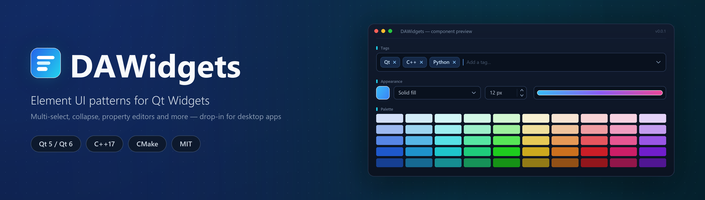
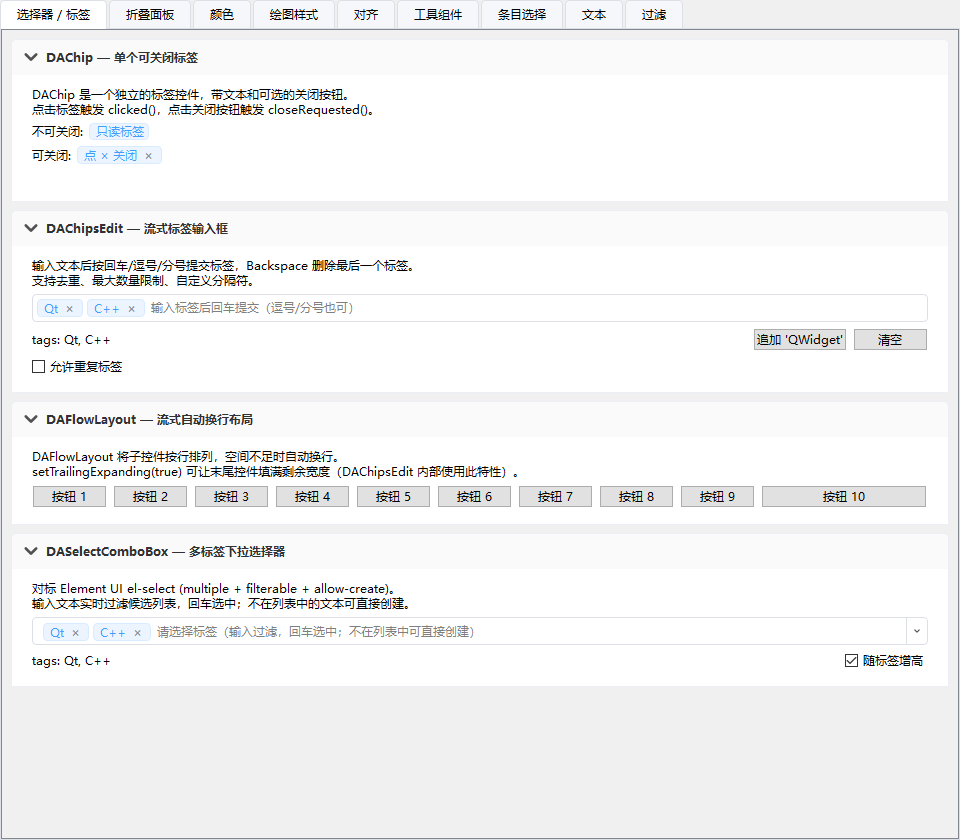
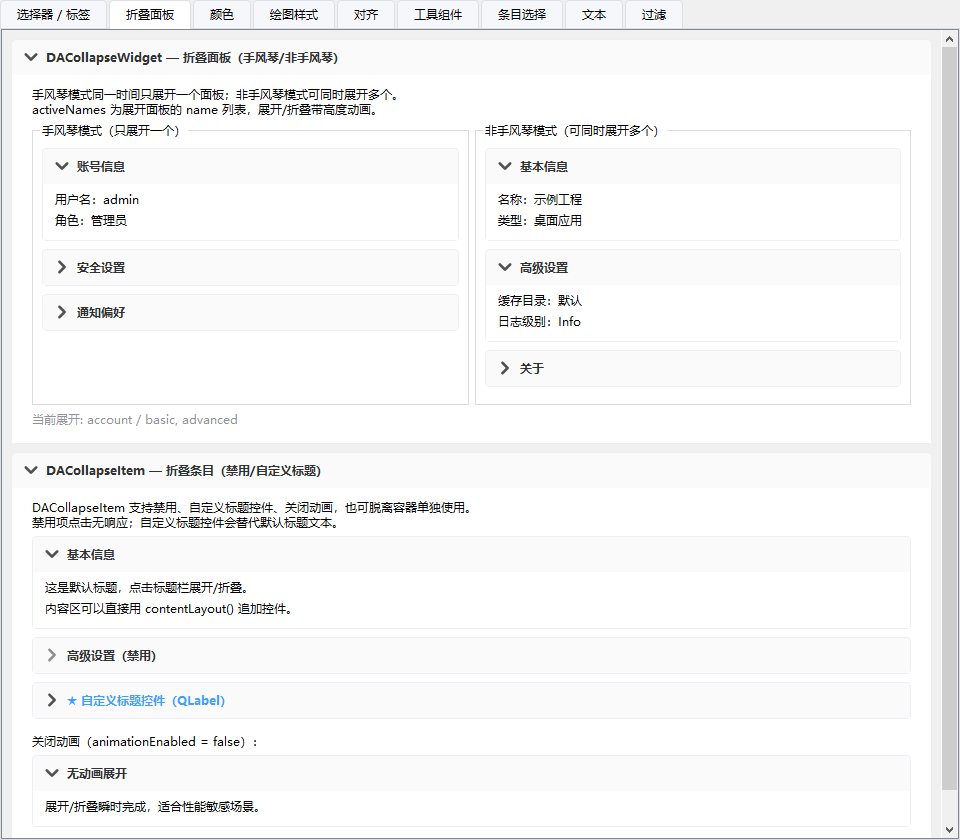
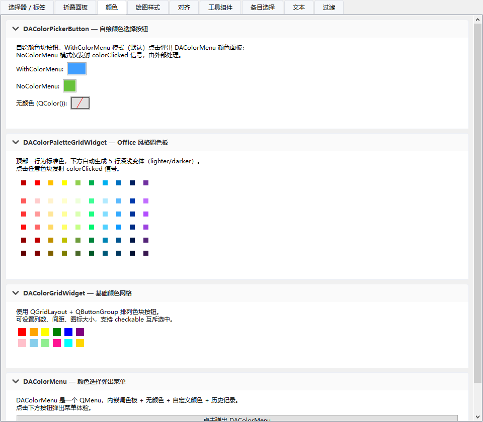
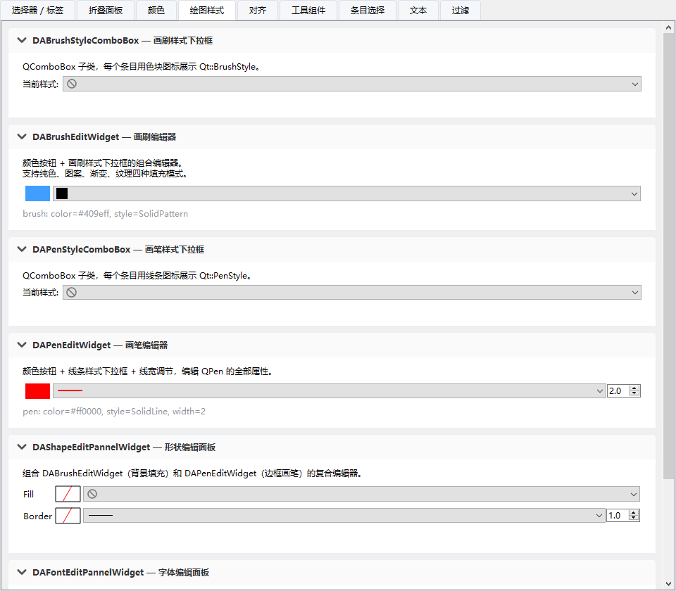
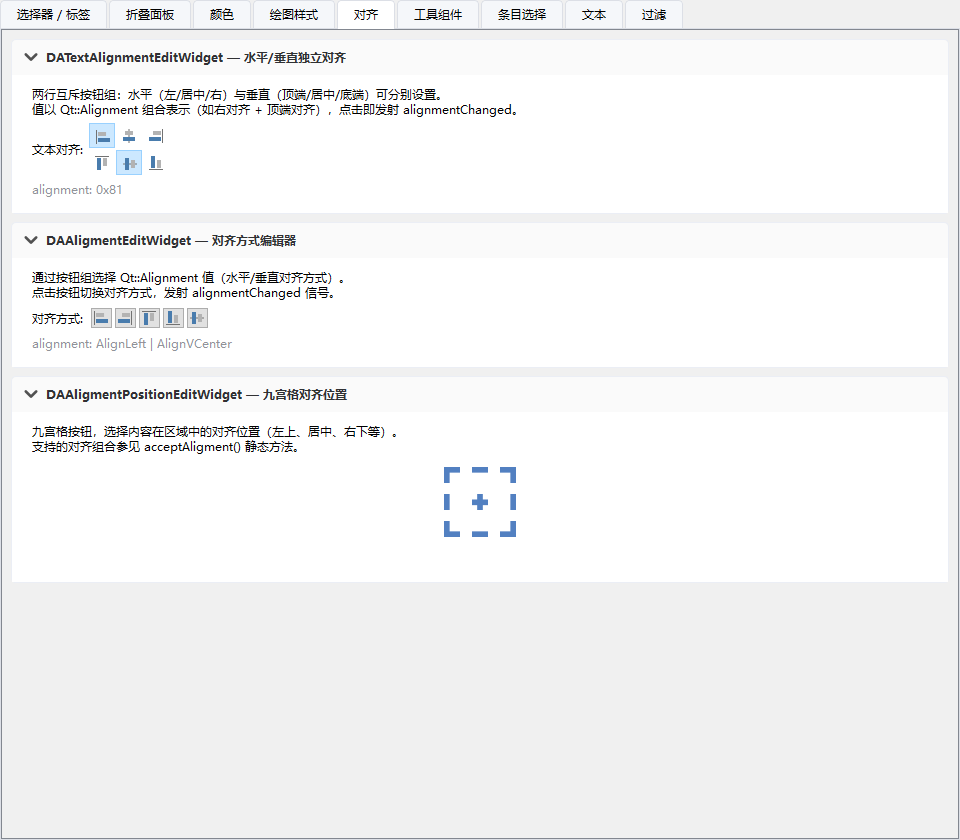
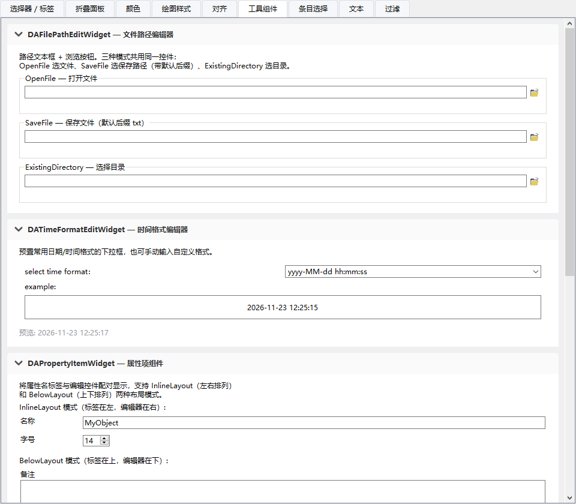
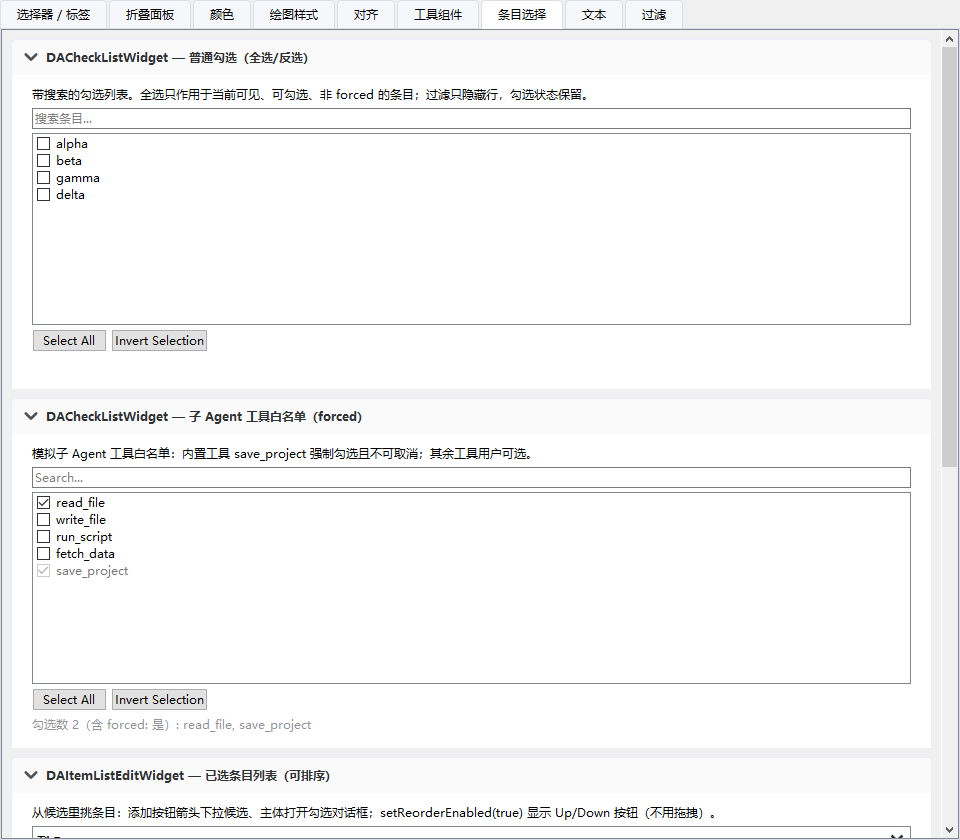
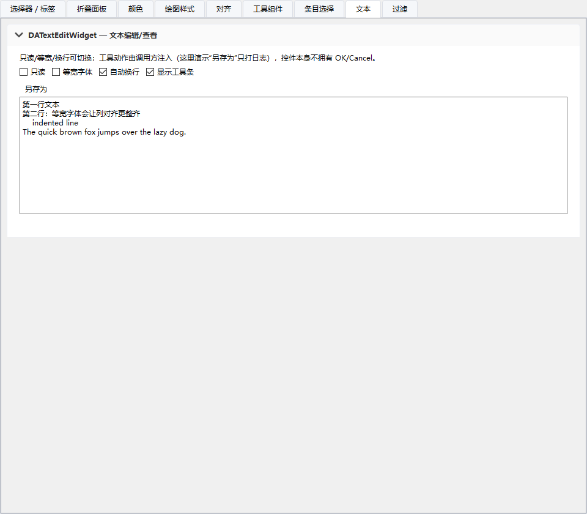
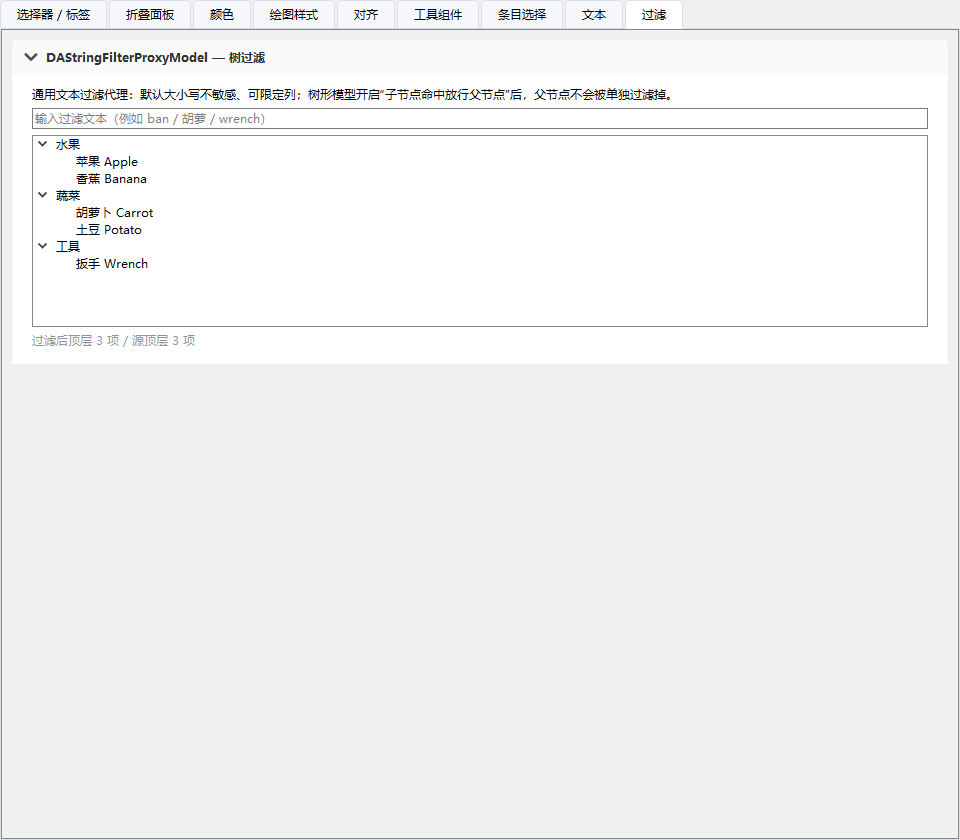

<div align="center">


<p><b>English</b> &nbsp;&middot;&nbsp; <a href="./README-CN.md">简体中文</a></p>

<p>
<a href="https://github.com/czyt1988/DAWidgets/releases/latest"></a>
<a href="https://github.com/czyt1988/DAWidgets/actions/workflows/build.yml"></a>
<a href="https://github.com/czyt1988/DAWidgets/actions/workflows/page.yml"></a>
<a href="./LICENSE"></a>
</p>

<p>
<a href="https://www.qt.io/"></a>
<a href="https://en.cppreference.com/w/cpp/17"></a>
<a href="https://github.com/czyt1988/DAWidgets/stargazers"></a>
</p>

<h3>Element UI patterns for Qt Widgets</h3>
<p><sub>Multi-select, collapse, property editors and more — drop-in widgets for Qt desktop applications. No QML, no extra runtime, MIT licensed.</sub></p>

<p><a href="https://czyt1988.github.io/DAWidgets/en/"><b>Documentation</b></a> &nbsp;&middot;&nbsp; <a href="https://czyt1988.github.io/DAWidgets/">中文文档</a> &nbsp;&middot;&nbsp; <a href="#quick-start">Quick start</a> &nbsp;&middot;&nbsp; <a href="#gallery">Gallery</a> &nbsp;&middot;&nbsp; <a href="./CHANGELOG.md">Changelog</a></p>
</div>

## Why DAWidgets?

Qt Widgets is mature and stable, but it never grew the interaction patterns that web UI libraries have taken for granted: a multi-select field with removable tags and live filtering, an animated accordion, a ready-made property panel. Rebuilding those controls by hand is repetitive work that has little to do with the application you are actually writing.

DAWidgets fills that gap with plain `QWidget` classes designed to feel like [Element UI](https://element.eleme.io/) components on the desktop — plugs into existing layouts, no Qt Quick/QML runtime, no extra dependency beyond Qt itself.

- **Drop-in `QWidget` classes.** Every component is a normal widget: put it in a layout, a dock, a dialog or a `QMainWindow`. No scene graph, no new event loop, no QML engine.
- **Element UI interaction model.** `DASelectComboBox` mirrors `el-select`'s `multiple + filterable + allow-create` form; `DACollapseWidget` mirrors `el-collapse` with animated panels, accordion mode and custom headers.
- **A property-panel toolkit, not a single widget.** Color, palette, pen, brush, font, shape, alignment, time-format and file-path editors, plus reusable item-selection widgets with search and pick dialogs.
- **One codebase for Qt 5 and Qt 6.** A small compatibility layer covers the API differences; verified with Qt 5.14.2 and Qt 6.7.3, and built in CI on Windows (MSVC) and Linux (GCC).
- **MIT and easy to vendor.** No GPL/LGPL obligations, PIMPL-clean public headers, qss-styleable controls, and a single-file amalgamation for projects that cannot integrate a build dependency.

## Feature highlights

| Area | What you get |
|:-----|:-------------|
| **Selector** | `DASelectComboBox` — multi-tag dropdown with filtering, allow-create and two height modes; `DAChipsEdit` — stand-alone tag input; `DAChip`; `DAFlowLayout`. |
| **Collapse** | `DACollapseWidget` + `DACollapseItem` with `QPropertyAnimation` expand/collapse, accordion or multi-open mode, disabled state, custom title and content widgets; `DACollapseLayout` keeps the animation jitter-free. |
| **Property editing** | Color picker button and color menu, Office-style palette grid, pen/brush style combos and editors, font and shape panels, alignment and 9-grid position editors, time-format and file-path editors, property row wrapper, text editor, RAII cursor guards. |
| **Item selection & preview** | `DAItemListEditWidget` (selected list with add menu, pick dialog and optional reorder), `DAItemListPickDialog`, `DACheckListWidget` (search, select-all/invert, forced entries), `DAStringListEditWidget`, `DAItemEntry`, `DAColorScalePreviewWidget`, `DAStringFilterProxyModel`. |
| **Utility** | `DAUndoHistoryWidget` — undo view plus history-depth control; `DAAbstractWidgetOverlay` — base class for widgets painted on top of another widget. |
| **Cross-cutting** | Qt 5 / Qt 6 dual support, PIMPL on public classes, hand-written static/shared export macros, qss styling (`DA--ClassName` selectors), single-file amalgamation, bilingual MkDocs site, a 9-tab demo with one-command screenshot export, and 12 QtTest suites. |

## Gallery

Nine tab screenshots cover the whole library. Click any image to open the full-size version.

| | | |
|:---:|:---:|:---:|
| [](./docs/images/gallery/tabs/01-selector.png) | [](./docs/images/gallery/tabs/02-collapse.png) | [](./docs/images/gallery/tabs/03-color.png) |
| **Selector** — multi-tag dropdown, chip input, flow layout | **Collapse** — accordion and animated panels | **Color** — picker button, palette, color menu |
| [](./docs/images/gallery/tabs/04-drawing-style.png) | [](./docs/images/gallery/tabs/05-alignment.png) | [](./docs/images/gallery/tabs/06-utility.png) |
| **Drawing style** — pen/brush editors and font/shape panels | **Alignment** — alignment, text alignment, 9-grid position | **Utility** — file path, time format, property row, undo |
| [](./docs/images/gallery/tabs/07-item-selection.png) | [](./docs/images/gallery/tabs/08-text.png) | [](./docs/images/gallery/tabs/09-filter.png) |
| **Item selection** — check list, selected list, pick dialog | **Text** — read-only, monospace and wrapped text editor | **Filter** — text filter proxy with parent pass-through |

Every screenshot is exported by the demo application itself — `dawidgets_all_widgets_demo --export-gallery docs/images/gallery` — so it never goes stale when widgets change. Per-widget close-ups and popup captures are in the [gallery guide](./docs/gallery.md).

## Requirements

| Requirement | Details |
|:------------|:--------|
| Qt | Qt 5.12+ or Qt 6 (verified with Qt 5.14.2 and Qt 6.7.3; CI uses Qt 6.8) |
| Qt modules | Qt Widgets and Qt Svg — Qt Svg renders the SVG icons used by the property editors |
| Compiler | C++17: MSVC 2019+ (MSVC 19.29 verified), GCC or Clang |
| Build system | CMake ≥ 3.16 (or drop in the amalgamated files) |
| Platforms | Windows verified locally with MSVC; Windows (MSVC) and Linux (GCC) verified in CI. macOS has not been officially tested. |

## Installation

### Option A — install and use `find_package` (recommended)

Build, install and consume DAWidgets as a normal CMake package:

```bash
cmake -S . -B build -DCMAKE_PREFIX_PATH=<Qt install path> -DDAWIDGETS_BUILD_SHARED=ON
cmake --build build --config Release
cmake --install build --config Release --prefix <install prefix>
```

```cmake
find_package(DAWidgets REQUIRED)
target_link_libraries(my_app PRIVATE DA::DAWidgets)
```

The installed package config links Qt Widgets and Qt Svg for you and adds the installed include directory, so `#include "DASelectComboBox.h"` works as-is.

### Option B — `add_subdirectory`

For projects that vendor DAWidgets as a submodule or a plain copy:

```cmake
set(DAWIDGETS_BUILD_DEMO OFF CACHE BOOL "" FORCE)
set(DAWIDGETS_BUILD_TESTS OFF CACHE BOOL "" FORCE)
add_subdirectory(path/to/DAWidgets)
target_link_libraries(my_app PRIVATE DA::DAWidgets)
```

Configure your top-level project with `-DCMAKE_PREFIX_PATH=<Qt install path>`; CMake's Qt auto-detection works the same way as for a standalone build.

### Option C — single-file amalgamation

`src-amalgamate/DAWidgets.h` and `src-amalgamate/DAWidgets.cpp` contain the whole library. No DAWidgets target, no install step, no `find_package`:

```cmake
set(CMAKE_AUTOMOC ON)   # the Q_OBJECT classes in DAWidgets.h need moc

add_executable(my_app
    main.cpp
    path/to/src-amalgamate/DAWidgets.h      # must be listed so AUTOMOC mocs it
    path/to/src-amalgamate/DAWidgets.cpp
)
target_include_directories(my_app PRIVATE path/to/src-amalgamate)
target_compile_definitions(my_app PRIVATE DA_BUILT_AS_STATIC)   # the amalgamation is not a DLL
target_link_libraries(my_app PRIVATE Qt6::Widgets Qt6::Svg)     # Qt5::Widgets Qt5::Svg on Qt 5
if(MSVC)
    target_compile_options(my_app PRIVATE /bigobj /utf-8)       # one huge translation unit + UTF-8 sources
endif()
```

See the [single-file amalgamation guide](./docs/en/use-guide/amalgamate.md) for qmake integration, the resource story, regeneration with `pwsh -File tools/Amalgamate.ps1` and the limitations. `examples/amalgamate_demo` is a complete reference project (`-DDAWIDGETS_BUILD_AMALGAMATE_DEMO=ON`).

## Quick Start

### Hello, DAWidgets

```cpp
#include <QApplication>
#include "DASelectComboBox.h"

int main(int argc, char *argv[])
{
    QApplication app(argc, argv);

    DA::DASelectComboBox combo;
    combo.setPlaceholder(QStringLiteral("Pick or create tags"));
    combo.setOptions({ QStringLiteral("Qt"), QStringLiteral("C++"),
                       QStringLiteral("Python"), QStringLiteral("CMake") });
    combo.setTags({ QStringLiteral("Qt") });
    combo.setAllowCreate(true);
    combo.show();

    return app.exec();
}
```

### `DASelectComboBox` — multi-tag select

```cpp
auto *combo = new DA::DASelectComboBox(this);
combo->setPlaceholder(QStringLiteral("Article tags"));
combo->setOptions({ QStringLiteral("Qt"), QStringLiteral("C++"),
                    QStringLiteral("Python"), QStringLiteral("QML") });
combo->setAllowCreate(true);    // commit a tag that is not in the list
combo->setFilterable(true);     // filter the popup while typing (default)
combo->setTags({ QStringLiteral("Qt") });

// Grow with the tags (default), or keep a fixed number of rows and scroll.
combo->setHeightMode(DA::DASelectComboBox::HeightMode::FixedHeightScrollable);
combo->setFixedRowCount(2);

connect(combo, &DA::DASelectComboBox::tagsChanged,
        this, [](const QStringList &tags) { /* ... */ });
```

### `DACollapseWidget` — animated collapse panels

```cpp
auto *collapse = new DA::DACollapseWidget(this);
collapse->setAccordion(false);  // allow several panels open at once

DA::DACollapseItem *basic = collapse->addItem(QStringLiteral("Basic"), QStringLiteral("basic"));
basic->contentLayout()->addWidget(new QLabel(QStringLiteral("Name:")));
basic->contentLayout()->addWidget(new QLineEdit);

DA::DACollapseItem *advanced = collapse->addItem(QStringLiteral("Advanced"), QStringLiteral("advanced"));
advanced->contentLayout()->addWidget(new QCheckBox(QStringLiteral("Enable preview")));

collapse->setActiveNames({ QStringLiteral("basic") });

connect(collapse, &DA::DACollapseWidget::activeNamesChanged,
        this, [](const QStringList &names) { /* ... */ });
```

## Documentation

The full documentation is built with [MkDocs Material](https://squidfunk.github.io/mkdocs-material/) and is bilingual — Chinese is the default site, English lives under `/en/`:

- **中文文档** — <https://czyt1988.github.io/DAWidgets/>
- **English documentation** — <https://czyt1988.github.io/DAWidgets/en/>

Useful starting points:

| Topic | English | 中文 |
|:------|:--------|:-----|
| Introduction | <https://czyt1988.github.io/DAWidgets/en/introduction/> | <https://czyt1988.github.io/DAWidgets/introduction/> |
| Gallery | <https://czyt1988.github.io/DAWidgets/en/gallery/> | <https://czyt1988.github.io/DAWidgets/gallery/> |
| Build instructions | <https://czyt1988.github.io/DAWidgets/en/build-guide/build-instructions/> | <https://czyt1988.github.io/DAWidgets/build-guide/build-instructions/> |
| Single-file amalgamation | <https://czyt1988.github.io/DAWidgets/en/use-guide/amalgamate/> | <https://czyt1988.github.io/DAWidgets/use-guide/amalgamate/> |

The documentation sources live in [`docs/`](./docs) — Chinese at the root, English under [`docs/en/`](./docs/en). Build the site locally with `pip install -r requirements-docs.txt` and `mkdocs serve`.

## Building from source

```bash
cmake -S . -B build -DCMAKE_PREFIX_PATH=<Qt install path>
cmake --build build --config Release --parallel
```

CMake auto-detects Qt 5 or Qt 6 (Qt 6 preferred). To build and run the tests as well:

```bash
cmake -S . -B build -DCMAKE_PREFIX_PATH=<Qt install path> -DDAWIDGETS_BUILD_TESTS=ON
cmake --build build --config Release --parallel
ctest --test-dir build -C Release --output-on-failure
```

### CMake options

| Option | Default | Description |
|:-------|:--------|:------------|
| `DAWIDGETS_BUILD_SHARED` | `ON` | `ON` builds a shared library (dll/so/dylib); `OFF` builds a static library. |
| `DAWIDGETS_BUILD_DEMO` | `ON` | Build the example applications under `examples/`. |
| `DAWIDGETS_BUILD_TESTS` | `OFF` | Build the QtTest suites under `tests/`. |
| `DAWIDGETS_BUILD_AMALGAMATE_DEMO` | `OFF` | Build `examples/amalgamate_demo` — compiles `src-amalgamate/DAWidgets.{h,cpp}` as one translation unit without linking the library. |

The demo is the fastest way to see every widget in action: run `build/examples/all_widgets_demo/Release/dawidgets_all_widgets_demo` (on Windows, add Qt's `bin` directory to `PATH` first).

## Project layout

```text
DAWidgets/
├── src/                      # library sources (flat) + src/resources/ (SVG icons, .qrc)
├── src-amalgamate/           # generated single-file DAWidgets.h / DAWidgets.cpp
├── examples/
│   ├── all_widgets_demo/     # 9-tab demo; --export-gallery regenerates the doc screenshots
│   └── amalgamate_demo/      # reference project for the single-file build
├── tests/                    # QtTest suites
├── docs/                     # MkDocs Material sources: Chinese at root, English under docs/en
├── tools/                    # amalgamation tool, templates and scripts
├── cmake/                    # find_package config template
├── CMakeLists.txt
└── mkdocs.yml
```

## Contributing

- **Issues and pull requests are welcome.** For a bug report, please include the Qt version, compiler, platform and a minimal reproducer.
- **Commit style:** [Conventional Commits](https://www.conventionalcommits.org/) — `feat(selector): ...`, `fix(collapse): ...`, `docs: ...`. Keep commits atomic.
- **Tests:** run `ctest --test-dir build -C Release --output-on-failure` before opening a pull request; a new widget needs its QtTest suite in the same commit.
- **New widgets:** add a visible entry to `examples/all_widgets_demo`, update the amalgamation templates and regenerate `src-amalgamate`, and register the docs page in both the Chinese and English navigation.
- **Gitee** (<https://gitee.com/czyt1988/DAWidgets>) is a read-only mirror synced automatically on every release — development happens on GitHub.

## Changelog

See [CHANGELOG.md](./CHANGELOG.md) for the release history (Chinese: [CHANGELOG-CN.md](./CHANGELOG-CN.md)). Releases follow [Semantic Versioning](https://semver.org/).

## License

DAWidgets is distributed under the **MIT License**. See [LICENSE](./LICENSE) for the full text.

---

<p align="center">
GitHub — <a href="https://github.com/czyt1988/DAWidgets">github.com/czyt1988/DAWidgets</a>
&nbsp;&middot;&nbsp;
Gitee mirror — <a href="https://gitee.com/czyt1988/DAWidgets">gitee.com/czyt1988/DAWidgets</a>
</p>
