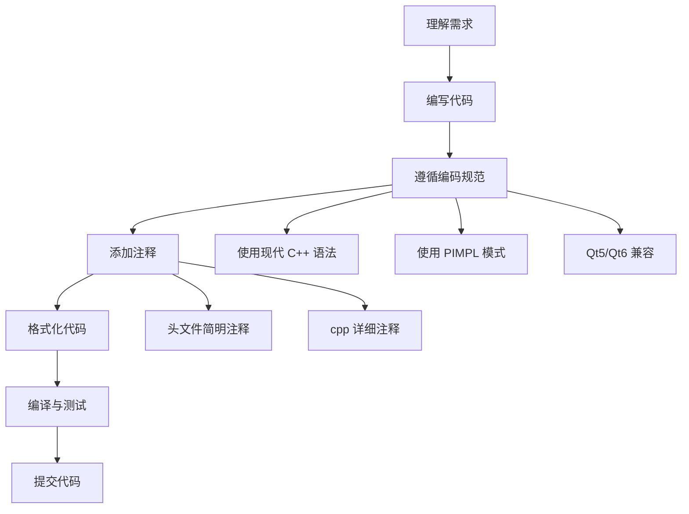

# 开发指引

本章节为 DAWidgets 项目开发者提供详细的开发规范和设计模式指引，确保代码质量和风格一致性。

## 文档概览

| 文档 | 说明 |
|------|------|
| [编码规范](coding-standards.md) | 代码格式化、现代 C++ 语法、命名约定等 |
| [注释规范](comment-standards.md) | Doxygen 注释格式、注释放置规则等 |
| [PIMPL 模式](pimpl-pattern.md) | PIMPL 设计模式的使用和宏定义 |
| [Qt5/Qt6 兼容](qt5-qt6-compat.md) | Qt5/Qt6 差异兼容宏的使用 |
| [文档编写指南](../doc-writing-guide.md) | 文档结构、内容、图表规范 |

## 开发流程概览

## 快速开始

### 1. 环境搭建

确保开发环境满足以下要求：

- **Qt 版本**：Qt 5.14+ 或 Qt 6.x
- **C++ 标准**：C++17
- **构建系统**：CMake 3.16+
- **编译器**：支持 C++17 的编译器（验证环境：MSVC 19.29 / VS2019）

### 2. 核心编码规范

开发前请阅读 [编码规范](coding-standards.md)。核心要点：

- 使用 `Q_SIGNALS` / `Q_SLOTS` 而非小写 `signals` / `slots`
- 使用 `override` / `final` 关键字
- 使用 `nullptr` 替代 `NULL`
- 使用 `static_cast` 替代 C 风格转换

### 3. 核心注释规范

所有新代码必须遵循 [注释规范](comment-standards.md)：

- 使用 Doxygen 中文注释格式
- 头文件放置简明注释，cpp 文件放置详细注释
- 类注释含用法示例

### 4. PIMPL 模式

新类推荐使用 PIMPL 模式。详见 [PIMPL 模式指引](pimpl-pattern.md)：

- 使用 `DA_DECLARE_PRIVATE` 宏声明私有指针
- 使用 `DA_PIMPL_CONSTRUCT` 宏初始化
- 使用 `DA_D` / `DA_DC` 宏访问私有数据

### 5. Qt5/Qt6 兼容

使用 `DAQt5Qt6Compat.h` 中的兼容宏处理版本差异。详见 [Qt5/Qt6 兼容指引](qt5-qt6-compat.md)。

## 开发规范检查清单

提交代码前，请逐项验证：

- [ ] 代码已通过 clang-format 格式化
- [ ] 使用现代 C++ 语法（override、nullptr、using）
- [ ] 使用 `Q_SIGNALS` / `Q_SLOTS`（非小写 `signals` / `slots`）
- [ ] 新类使用 PIMPL 模式
- [ ] 函数有 Doxygen 注释
- [ ] 头文件保持简洁，详细注释在 cpp 文件
- [ ] 代码编译无警告
- [ ] Qt5/Qt6 双兼容
- [ ] 示例程序正常运行
