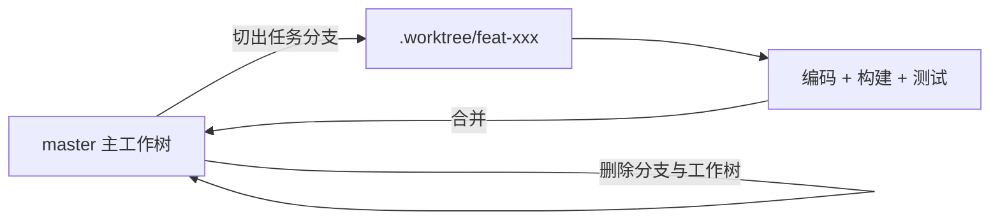

# 多工作树并行开发

> 每个编码任务一个 git 工作树；主工作树只负责集成。

本页说明 DAWidgets 仓库的多工作树（`git worktree`）开发规范：任务在哪里做、构建目录怎么来、完成后如何合并回 `master` 并清理。规则同样写在仓库根目录 `AGENTS.md` 的 “Branch & Parallel Development” 章节，本页是面向开发者的完整说明。

## 为什么需要工作树

DAWidgets 的开发经常同时有多个 agent 会话或多人并行。所有任务挤在同一个工作区会互相污染：

- 切分支会带走别人未提交的改动；
- 暂存区只有一个，`git add` 容易把别人的改动带进提交；
- 同一份 `build/` 被多个任务交替编译，构建产物与 CMake 缓存互相覆盖；
- 出问题时要在一堆混合改动里猜哪些属于当前任务。

工作树让每个任务拥有独立的分支检出与独立构建目录，主工作树保持 `master` 干净，随时可以集成已完成的分支。

## 分支模型

- `master` 是唯一集成分支。本仓库没有独立的 `dev`：data-workbench 的 `dev` 已经承担集成分支角色，而本仓库是它的子模块。
- 任务分支短命：`feat/<域>-<主题>`、`fix/<主题>`、`docs/<主题>`、`chore/<主题>`，合并回 `master` 后删除。
- 工作树固定落在 `<主工作树>/.worktree/<分支名把 / 换成 ->`，该目录已加入 `.gitignore`。



## 创建工作树

```powershell
# 从任意工作树调用均可：目录固定落在主工作树的 .worktree/ 下
pwsh -File scripts\worktree-add.ps1 feat/table-column-picker
pwsh -File scripts\worktree-add.ps1 fix/collapse-jitter master   # 指定基线
pwsh -File scripts\worktree-add.ps1 -List                        # 列出工作树
pwsh -File scripts\worktree-add.ps1 -Remove feat-table-column-picker
```

如果 PowerShell 执行策略阻止脚本，改用：

```powershell
powershell -NoProfile -ExecutionPolicy Bypass -File scripts\worktree-add.ps1 feat/table-column-picker
```

| 参数 | 说明 |
|------|------|
| `<分支>` | 必填。分支已存在则直接检出；否则从基线切出 |
| `[基线]` | 可选，默认 `master` |
| `-FromBase <目录>` | 指定作为配置模板的构建目录（如 `build-tests`、`build-qt5`） |
| `-NoConfigure` | 只建工作树，不预配置 `build/` |
| `-List` | 列出全部工作树（`*` 标记主工作树） |
| `-Remove <目录名>` | 删除工作树，保留分支 |
| `-Help` | 打印用法 |

脚本不只是 `git worktree add`，它还做四件事：

1. **定位主工作树**：无论从主工作树还是任务工作树里调用，新工作树都落在主工作树的 `.worktree/` 下，不会在工作树里再嵌套。
2. **预配置构建目录**：读取主工作树已有 `build*/CMakeCache.txt` 的生成器、VS 实例、`CMAKE_PREFIX_PATH` 与 `DAWIDGETS_BUILD_*`，在新工作树里配置 `build/`；优先选择 `DAWIDGETS_BUILD_TESTS=ON` 的缓存，保证 `ctest` 开箱即用。
3. **拒绝子模块检出**：在 data-workbench 的 `src/3rdparty/DAWidgets` 里运行时直接报错——那里要按 data-workbench 的四步流程处理。
4. **安全删除**：Windows 上构建产物可能被占用，`git worktree remove` 失败后目录会变成“git 已注销但删不掉”的空壳；`-Remove` 确认 git 侧已注销后再重试删除，并拒绝删除主工作树或未注册的普通目录。

!!! info "首次构建"
    新工作树没有可复用的构建目录，第一次构建是全量；之后的构建是增量。

!!! note "非 Windows 平台"
    本脚本按本仓库的验证环境（MSVC/Windows）编写。Linux/macOS 上安装了 PowerShell 7 可直接使用；否则手工执行等价操作：

    ```bash
    git worktree add -b feat/xxx .worktree/feat-xxx master
    cmake -S .worktree/feat-xxx -B .worktree/feat-xxx/build \
          -DCMAKE_PREFIX_PATH=<Qt 路径> -DDAWIDGETS_BUILD_TESTS=ON
    ```

    删除时用 `git worktree remove --force .worktree/feat-xxx`。

## 在工作树里开发

构建、测试、示例与主工作树完全一致（脚本会打印继承来的构建目录）：

```powershell
cmake --build .worktree\feat-table-column-picker\build --config Release --parallel
ctest --test-dir .worktree\feat-table-column-picker\build -C Release --output-on-failure
.\.worktree\feat-table-column-picker\build\examples\all_widgets_demo\Release\dawidgets_all_widgets_demo.exe
```

预配置的 `build/` 只继承一套 Qt 与选项。需要在同一任务里同时验证 Qt5 与 Qt6 时，手动再加一个构建目录：

```powershell
cmake -S . -B build-qt5 -DCMAKE_PREFIX_PATH="C:/Qt/Qt5.14.2/5.14.2/msvc2017_64" -DDAWIDGETS_BUILD_TESTS=ON
```

!!! warning "不要在工作树里执行 cmake --install"
    安装前缀是共享/全局的，不属于某个任务。需要安装（例如供 data-workbench 的 3rdparty 使用）时回主工作树执行。

## 收尾：合并回 master 并清理

1. 开工时和收尾前各合并一次最新 `master`，让冲突尽早暴露。
2. 在任务工作树里重新构建并跑模块测试——这是交付门槛。
3. 回主工作树合并：`git -C <主工作树> merge feat/table-column-picker`。若 `master` 已被其它工作树占用且有在途改动，另开临时工作树合并，不要切走或清理别人的树。
4. 删除分支与工作树：

```powershell
git branch -d feat/table-column-picker
pwsh -File scripts\worktree-add.ps1 -Remove feat-table-column-picker
```

**“任务完成”包含“已合并回 `master` 且工作树已清理”**，不要把冲突、分叉或孤儿工作树留给下一个任务。

## 与 data-workbench 的关系

在 data-workbench 里改 DAWidgets（`src/3rdparty/DAWidgets`）时，遵循 data-workbench 的规则：在它的**主工作树**里改子模块、提交、重编 3rdparty 并 `cmake --install`。不要在那个子模块检出里再建工作树；本仓库的脚本会直接拒绝。

## 常见问题

| 现象 | 原因与处理 |
|------|-----------|
| `-Remove` 提示“不是已注册的工作树” | 目录不是工作树，或上次删除后只剩空壳；空目录会被自动清理，非空则手工确认 |
| 工作树目录删不掉 | 编辑器/终端/MSBuild 还停在里面；关闭后重试，git 侧通常已注销 |
| 新工作树 `ctest` 没有用例 | 配置模板的 `DAWIDGETS_BUILD_TESTS` 为 `OFF`；用 `-FromBase build-tests`，或手动加 `-DDAWIDGETS_BUILD_TESTS=ON` |
| CMake 找不到 Qt | 模板选错或 Qt 已卸载；用 `-FromBase <正确的构建目录>`，或手动传 `-DCMAKE_PREFIX_PATH` |
| 在子模块里运行被拒绝 | 这是 data-workbench 的流程；请在其主工作树里按四步流程操作 |

## 参考

- 仓库根目录 `AGENTS.md` 的 “Branch & Parallel Development (Git Worktrees)” 章节
- 工作树脚本：`scripts/worktree-add.ps1`
- data-workbench 的多工作树实践（其 `scripts/worktree-add.sh`）
