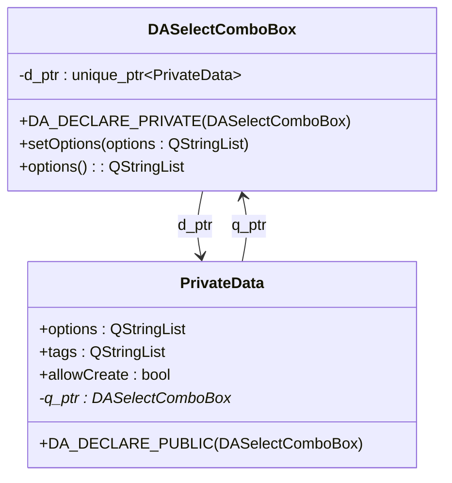

# PIMPL 模式指引

本文档介绍 DAWidgets 项目中 PIMPL（Pointer to Implementation）模式的使用方法，帮助开发者正确使用项目提供的宏定义。

## 核心特性

**特性**

- ✅ **隐藏实现细节**：私有成员和数据隐藏在实现类中
- ✅ **减少头文件依赖**：降低编译依赖，加快构建速度
- ✅ **二进制兼容**：实现变更不影响二进制兼容性
- ✅ **统一宏**：项目提供标准宏简化实现
- ✅ **与 data-workbench 一致**：宏定义逐字一致，submodule 引入无冲突

## 什么是 PIMPL 模式

PIMPL（Pointer to Implementation）是 C++ 设计模式，又称"编译防火墙"模式。

### 传统方式的缺点

```cpp
// 传统方式 — 所有私有成员暴露在头文件
class MyClass : public QObject
{
    Q_OBJECT
private:
    QString m_title;          // 暴露在头文件
    int m_value;              // 任何修改都需要重新编译所有依赖
    QVector<double> m_data;   // 头文件依赖 QVector
};
```

### PIMPL 模式的优势

```cpp
// PIMPL 方式 — 头文件只暴露指针
class MyClass : public QObject
{
    Q_OBJECT
    DA_DECLARE_PRIVATE(MyClass)  // 自动生成私有数据指针
public:
    MyClass();
private:
    // 所有私有成员隐藏在 MyClass::PrivateData 中
};
```

!!! tip "PIMPL 模式优势"
    - **构建速度**：修改私有成员只需重编译单个 cpp 文件
    - **二进制兼容**：私有成员变更不影响 ABI 兼容性
    - **头文件干净**：头文件只包含公共接口声明

## DAWidgets PIMPL 宏

项目在 `src/DAWidgetsGlobals.h` 中定义以下宏：

| 宏 | 用途 | 使用位置 |
|----|------|---------|
| `DA_DECLARE_PRIVATE(Class)` | 声明私有数据指针 | 类声明中 |
| `DA_DECLARE_PUBLIC(Class)` | 声明宿主指针 | PrivateData 类中 |
| `DA_PIMPL_CONSTRUCT` | 初始化私有数据指针 | 构造函数初始化列表 |
| `DA_D(name)` | 获取私有数据指针（非 const） | 成员函数中 |
| `DA_DC(name)` | 获取私有数据指针（const） | const 成员函数中 |
| `DA_Q(class, name)` | 获取宿主指针（非 const） | PrivateData 方法中 |
| `DA_QC(class, name)` | 获取宿主指针（const） | PrivateData const 方法中 |

!!! info "维护契约"
    `DAWidgetsGlobals.h` 中的宏定义必须与 data-workbench 项目的 `DAGlobals.h` 中对应宏**逐字一致**。两侧均以 `#ifndef` 守卫，任一翻译单元先 include 谁都安全（first-include-wins）。

## 实现步骤

### 第一步：在头文件中声明私有指针

```cpp
// DASelectComboBox.h
#include "DAWidgetsGlobals.h"

namespace DA
{
class DASelectComboBox : public QComboBox
{
    Q_OBJECT
    DA_DECLARE_PRIVATE(DASelectComboBox)  // 添加此宏

public:
    explicit DASelectComboBox(QWidget* parent = nullptr);
    ~DASelectComboBox();

    void setOptions(const QStringList& options);
    QStringList options() const;

private:
    // 私有成员不再在此声明
};
}  // namespace DA
```

### 第二步：在 cpp 文件中定义 PrivateData 类

```cpp
// DASelectComboBox.cpp
#include "DASelectComboBox.h"

namespace DA
{
// 定义私有数据类
class DASelectComboBox::PrivateData
{
    DA_DECLARE_PUBLIC(DASelectComboBox)  // 自动生成 q_ptr 指针

public:
    PrivateData(DASelectComboBox* p);

    QStringList options;
    QStringList tags;
    bool allowCreate;
    bool filterable;
};

DASelectComboBox::PrivateData::PrivateData(DASelectComboBox* p)
    : q_ptr(p)
    , allowCreate(false)
    , filterable(true)
{
}
}  // namespace DA
```

### 第三步：构造函数初始化

```cpp
/**
 * @brief 构造函数
 * @param parent 父控件指针
 */
DASelectComboBox::DASelectComboBox(QWidget* parent)
    : QComboBox(parent)
    , DA_PIMPL_CONSTRUCT  // 初始化 d_ptr 指针
{
    init();
}
```

!!! info "宏展开"
    `DA_PIMPL_CONSTRUCT` 展开为：`d_ptr(std::make_unique<PrivateData>(this))`

### 第四步：在成员函数中访问私有数据

```cpp
/**
 * @brief 设置候选选项列表
 * @param options 候选选项字符串列表
 */
void DASelectComboBox::setOptions(const QStringList& options)
{
    DA_D(d);           // 获取私有数据指针
    d->options = options;
}

/**
 * @brief 获取候选选项列表
 * @return 当前的候选选项列表
 */
QStringList DASelectComboBox::options() const
{
    DA_DC(d);          // const 函数使用 DA_DC
    return d->options;
}
```

## 完整示例



## 最佳实践

### 何时使用 PIMPL 模式

!!! tip "推荐场景"
    - 类有较多私有成员或私有方法
    - 头文件有较多依赖，希望降低编译依赖
    - 需要维护二进制兼容（如库的公共 API）
    - 私有成员可能频繁变更

### 重要注意事项

!!! warning "重要提醒"
    1. **构造函数必须初始化**：使用 `DA_PIMPL_CONSTRUCT` 或手动初始化 `d_ptr`
    2. **const 函数用 DA_DC**：确保 const 正确性
    3. **PrivateData 构造参数**：必须接受宿主指针以初始化 `q_ptr`
    4. **PrivateData 不要暴露在头文件**：PrivateData 类定义只存在于 cpp 文件

## 宏展开详情

| 宏 | 展开 |
|----|------|
| `DA_DECLARE_PRIVATE(Class)` | `class PrivateData;` + `friend` + `unique_ptr<PrivateData> d_ptr;` + `d_func()` |
| `DA_DECLARE_PUBLIC(Class)` | `friend` + `Class* q_ptr;` + `q_func()` |
| `DA_PIMPL_CONSTRUCT` | `d_ptr(std::make_unique<PrivateData>(this))` |
| `DA_D(name)` | `PrivateData* name = d_func();` |
| `DA_DC(name)` | `const PrivateData* name = d_func();` |

## 相关文档

- [编码规范](coding-standards.md)
- [注释规范](comment-standards.md)
- [Qt5/Qt6 兼容](qt5-qt6-compat.md)
