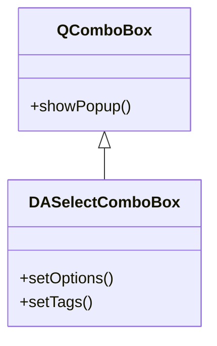
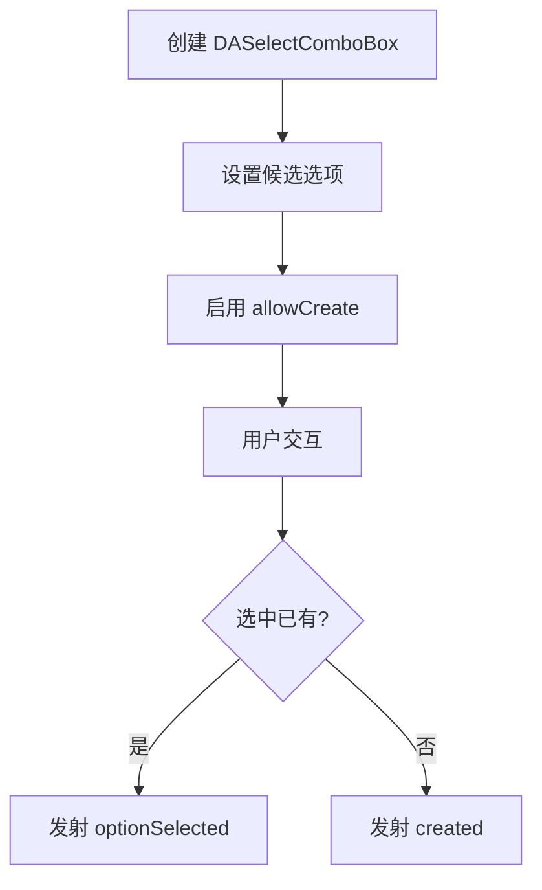

# 文档编写指南

本指南为 DAWidgets 项目文档编写提供规范，确保文档风格一致、内容完整、易于阅读。

项目文档使用 MkDocs 搭建，采用 [mkdocs-material](https://squidfunk.github.io/mkdocs-material/getting-started/) 主题。编写时可使用 Material 相关语法扩展。

项目文档图表主要使用 `mermaid`。

## 文档结构

### 1. 标题层级

```markdown
# 类名 / 功能名
## 核心特性
## 用法
### 子功能模块
#### 具体功能点
## 注意事项
## 参考
```

### 2. 必需章节

每个功能文档必须包含以下章节：

| 章节 | 必需 | 说明 |
|------|------|------|
| 功能概述 | 必需 | 开头一句话描述类的用途和特性 |
| 核心特性 | 必需 | 列出核心功能，以 ✅ 标记 |
| 用法 | 必需 | 详细使用步骤和代码示例 |
| 注意事项 | 推荐 | 使用 !!! 格式突出重要信息 |
| 参考 | 可选 | 相关文档和示例路径链接 |

## 内容编写原则

### 1. 文字说明要求

- **每个代码块前后都要有文字说明**：解释代码的目的、关键步骤和输出
- **避免纯代码堆砌**：代码不应占据文档主导，文字说明应占 60% 以上
- **渐进式引导**：按"是什么 → 为什么 → 怎么用"的逻辑顺序组织

### 2. 特性介绍格式

使用特性列表格式，每个特性以 ✅ 标记：

```markdown
**特性**

- ✅ **特性名**：简要描述
- ✅ **另一特性**：简要描述
```

### 3. 代码示例标准

代码示例必须包含：

1. **注释说明**：关键行必须有注释
2. **完整可运行**：示例代码应可直接运行（含必要的头文件包含）
3. **效果描述**：代码后描述运行效果

```cpp
// 创建选择框
auto *combo = new DA::DASelectComboBox(parent);
combo->setOptions({ "选项一", "选项二" });  // 设置候选列表
combo->setAllowCreate(true);                // 允许创建新标签

// 效果：显示下拉选择框，用户可选择或创建标签
```

### 4. 概念解释要求

对于复杂概念，使用以下方式辅助解释：

- **Mermaid UML 图**：展示类关系和继承层次
- **Mermaid 流程图**：展示工作流程
- **ASCII 结构图**：展示结构图
- **截图**：实际效果截图

### 5. 注意事项格式

使用 Markdown 扩展语法突出重要信息：

```markdown
!!! warning "重要警告"
    可能导致严重问题的信息

!!! info "提示"
    补充信息

!!! tip "技巧"
    使用技巧和建议

!!! example "示例"
    示例代码路径：`examples/xxx`
```

### 6. 属性/方法说明格式

使用表格格式展示核心属性和方法：

```markdown
### 核心方法

| 方法 | 参数 | 说明 |
|------|------|------|
| `setOptions(QStringList)` | 选项列表 | 设置候选选项 |
| `tags()` | 无 | 返回已选标签列表 |
```

## 图表使用标准

### 1. Mermaid 类图

展示类继承和组合关系：



### 2. Mermaid 流程图

展示使用流程：



## 多语言文档

DAWidgets 文档支持中英文双语：

- **中文文档**（默认语言）：位于 `docs/` 根目录
- **英文文档**：位于 `docs/en/` 目录

两套文档目录结构完全镜像。使用 mkdocs-static-i18n 的 folder 模式自动路由。

!!! info "中文优先"
    中文为默认语言。编写新文档时先写中文版，再翻译英文版。

## 文档模板

```markdown
# 功能名称

一句话描述类的用途和特性。

## 核心特性

**特性**

- ✅ **特性 1**：描述
- ✅ **特性 2**：描述

## 基本概念

### 核心概念解释

[文字说明]

```mermaid
classDiagram
    [类关系图]
```

## 用法

对应的示例位于：`examples/xxx`。

### 1. 基本用法

[文字说明]

```cpp
[代码示例]
```

[效果描述]

### 2. 高级配置

[文字说明]

| 方法 | 说明 |
|------|------|
| 方法 1 | 说明 |
| 方法 2 | 说明 |

!!! warning "注意"
    重要提醒

## 参考

- [编码规范](dev-guide/coding-standards.md)
- 示例路径：`examples/xxx`
```
