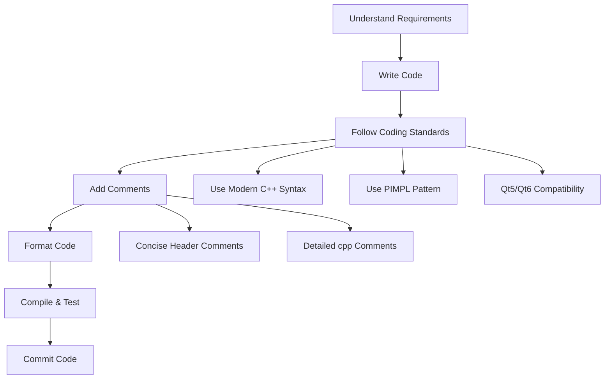

# Development Guide

This section provides DAWidgets project contributors with detailed development standards and design pattern guidelines to ensure code quality and stylistic consistency.

## Document Overview

| Document | Description |
|----------|-------------|
| [Coding Standards](coding-standards.md) | Code formatting, modern C++ syntax, naming conventions, etc. |
| [Comment Standards](comment-standards.md) | Doxygen comment format, comment placement rules, etc. |
| [PIMPL Pattern](pimpl-pattern.md) | Usage of the PIMPL design pattern and its macro definitions |
| [Qt5/Qt6 Compatibility](qt5-qt6-compat.md) | Usage of Qt5/Qt6 compatibility macros |
| [Documentation Writing Guide](../doc-writing-guide.md) | Document structure, content, and chart conventions |

## Development Workflow Overview

## Quick Start

### 1. Environment Setup

Ensure your development environment meets the following requirements:

- **Qt Version**: Qt 5.14+ or Qt 6.x
- **C++ Standard**: C++17
- **Build System**: CMake 3.16+
- **Compiler**: A C++17-capable compiler (verified environment: MSVC 19.29 / VS2019)

### 2. Core Coding Standards

Read the [Coding Standards](coding-standards.md) before development. Key points:

- Use `Q_SIGNALS` / `Q_SLOTS` instead of lowercase `signals` / `slots`
- Use `override` / `final` keywords
- Use `nullptr` instead of `NULL`
- Use `static_cast` instead of C-style casts

### 3. Core Comment Standards

All new code must follow the [Comment Standards](comment-standards.md):

- Use Doxygen comment format (comments are written in Chinese — see the comment standards page for rationale)
- Concise comments in header files, detailed comments in cpp files
- Class comments include usage examples

### 4. PIMPL Pattern

New classes are recommended to use the PIMPL pattern. See the [PIMPL Pattern Guide](pimpl-pattern.md):

- Use the `DA_DECLARE_PRIVATE` macro to declare the private data pointer
- Use the `DA_PIMPL_CONSTRUCT` macro for initialization
- Use the `DA_D` / `DA_DC` macros to access private data

### 5. Qt5/Qt6 Compatibility

Use the compatibility macros in `DAQt5Qt6Compat.h` to handle version differences. See the [Qt5/Qt6 Compatibility Guide](qt5-qt6-compat.md).

## Development Standards Checklist

Verify each item before committing code:

- [ ] Code has been formatted with clang-format
- [ ] Modern C++ syntax used (override, nullptr, using)
- [ ] `Q_SIGNALS` / `Q_SLOTS` used (not lowercase `signals` / `slots`)
- [ ] New classes use the PIMPL pattern
- [ ] Functions have Doxygen comments
- [ ] Headers kept concise; detailed comments in cpp files
- [ ] Code compiles without warnings
- [ ] Qt5/Qt6 dual-compatible
- [ ] Example programs run correctly
