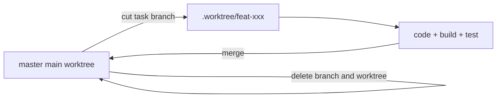

# Multi-Worktree Development

> One git worktree per coding task; the main worktree only integrates.

This page describes the multi-worktree (`git worktree`) workflow used in the DAWidgets repository: where a task is carried out, where its build directory comes from, and how the finished branch is merged back to `master` and cleaned up. The same rules live in the "Branch & Parallel Development" section of `AGENTS.md`; this page is the developer-facing explanation.

## Why worktrees

DAWidgets is often developed by several agent sessions or people in parallel. Sharing one working tree makes tasks pollute each other:

- switching branches carries away other people's uncommitted changes;
- there is only one staging area, so `git add` easily picks up unrelated edits;
- a single `build/` is rebuilt by different tasks, so artifacts and the CMake cache overwrite each other;
- debugging means guessing which of the mixed edits belong to the current task.

A worktree gives every task its own branch checkout and build directory, while the main worktree stays on `master` and is always ready to integrate a finished branch.

## Branch model

- `master` is the integration branch. There is no separate `dev` here: data-workbench's `dev` already plays that role and consumes this repository as a submodule.
- Task branches are short-lived: `feat/<domain>-<topic>`, `fix/<topic>`, `docs/<topic>`, `chore/<topic>`; delete them after merging back to `master`.
- A worktree always lives at `<main worktree>/.worktree/<branch with / replaced by ->`, which is git-ignored.



## Create a worktree

```powershell
# Works from any worktree: the directory always lands under the main worktree's .worktree/
pwsh -File scripts\worktree-add.ps1 feat/table-column-picker
pwsh -File scripts\worktree-add.ps1 fix/collapse-jitter master   # explicit base branch
pwsh -File scripts\worktree-add.ps1 -List                        # list worktrees
pwsh -File scripts\worktree-add.ps1 -Remove feat-table-column-picker
```

If the PowerShell execution policy blocks the script, use:

```powershell
powershell -NoProfile -ExecutionPolicy Bypass -File scripts\worktree-add.ps1 feat/table-column-picker
```

| Parameter | Description |
|-----------|-------------|
| `<branch>` | Required. Checked out if it already exists, otherwise created from the base branch |
| `[base]` | Optional, defaults to `master` |
| `-FromBase <dir>` | Build directory used as the configuration template (e.g. `build-tests`, `build-qt5`) |
| `-NoConfigure` | Create the worktree only, without preconfiguring `build/` |
| `-List` | List all worktrees (`*` marks the main worktree) |
| `-Remove <dir-name>` | Remove a worktree and keep its branch |
| `-Help` | Print usage |

The script does more than `git worktree add`:

1. **Resolves the main worktree** from wherever it is called, so new worktrees always land under the main worktree's `.worktree/` and never nest inside another worktree.
2. **Preconfigures the build directory** by reading the generator, VS instance, `CMAKE_PREFIX_PATH` and `DAWIDGETS_BUILD_*` values from the main worktree's `build*/CMakeCache.txt`; caches with `DAWIDGETS_BUILD_TESTS=ON` are preferred so `ctest` works out of the box.
3. **Refuses submodule checkouts**: running it in data-workbench's `src/3rdparty/DAWidgets` fails immediately — that path must follow data-workbench's four-step flow.
4. **Removes safely**: on Windows, build artifacts may be locked, and a failed `git worktree remove` leaves a de-registered shell directory; `-Remove` confirms git has de-registered the tree before retrying and refuses to delete the main worktree or unregistered directories.

!!! info "First build"
    A new worktree has no reusable build directory, so the first build is a full build; later builds are incremental.

!!! note "Non-Windows platforms"
    The script targets this repository's verified environment (MSVC/Windows). It works on Linux/macOS with PowerShell 7 installed; otherwise perform the equivalent steps by hand:

    ```bash
    git worktree add -b feat/xxx .worktree/feat-xxx master
    cmake -S .worktree/feat-xxx -B .worktree/feat-xxx/build \
          -DCMAKE_PREFIX_PATH=<Qt path> -DDAWIDGETS_BUILD_TESTS=ON
    ```

    Remove it with `git worktree remove --force .worktree/feat-xxx`.

## Work inside the worktree

Build, test and run the demo exactly as in the main worktree (the script prints the inherited build directory):

```powershell
cmake --build .worktree\feat-table-column-picker\build --config Release --parallel
ctest --test-dir .worktree\feat-table-column-picker\build -C Release --output-on-failure
.\.worktree\feat-table-column-picker\build\examples\all_widgets_demo\Release\dawidgets_all_widgets_demo.exe
```

The preconfigured `build/` inherits one Qt/option set. To verify both Qt5 and Qt6 in the same task, add another build directory by hand:

```powershell
cmake -S . -B build-qt5 -DCMAKE_PREFIX_PATH="C:/Qt/Qt5.14.2/5.14.2/msvc2017_64" -DDAWIDGETS_BUILD_TESTS=ON
```

!!! warning "Do not run cmake --install from a worktree"
    The install prefix is shared/global and not owned by a task. Install from the main worktree when needed (for example, for data-workbench's 3rdparty tree).

## Finish: merge back and clean up

1. Merge the latest `master` into the task branch when starting and again before finishing, so conflicts surface early.
2. Rebuild and rerun the module tests in the task worktree — they are the quality gate.
3. Merge from the main worktree: `git -C <main worktree> merge feat/table-column-picker`. If `master` is checked out in another worktree with in-flight edits, use a temporary worktree; never switch away from or clean someone else's tree.
4. Delete the branch and the worktree:

```powershell
git branch -d feat/table-column-picker
pwsh -File scripts\worktree-add.ps1 -Remove feat-table-column-picker
```

**"Task done" includes "merged back to `master` and the worktree removed."** Do not leave conflicts, diverged branches or orphan worktrees for the next task.

## Relationship to data-workbench

When DAWidgets is changed from inside data-workbench (`src/3rdparty/DAWidgets`), that project's rules win: edit the submodule in its **main worktree**, commit it, rebuild 3rdparty and `cmake --install` there. Do not create a nested worktree inside that submodule checkout; this repository's script refuses to.

## Troubleshooting

| Symptom | Cause and handling |
|---------|--------------------|
| `-Remove` says "not a registered worktree" | The directory is not a worktree, or a previous removal left a shell; empty directories are cleaned automatically, non-empty ones need manual review |
| The worktree directory cannot be deleted | An editor/terminal/MSBuild still has it as its current directory; close it and retry — git has usually de-registered the tree already |
| `ctest` finds no tests in the new worktree | The template cache has `DAWIDGETS_BUILD_TESTS=OFF`; use `-FromBase build-tests` or add `-DDAWIDGETS_BUILD_TESTS=ON` manually |
| CMake cannot find Qt | Wrong template or Qt was uninstalled; use `-FromBase <correct build dir>` or pass `-DCMAKE_PREFIX_PATH` manually |
| The script refuses to run in a submodule | That is data-workbench's flow; follow its four-step workflow in the main worktree |

## References

- The "Branch & Parallel Development (Git Worktrees)" section in the repository's `AGENTS.md`
- Worktree script: `scripts/worktree-add.ps1`
- data-workbench's multi-worktree practice (its `scripts/worktree-add.sh`)
