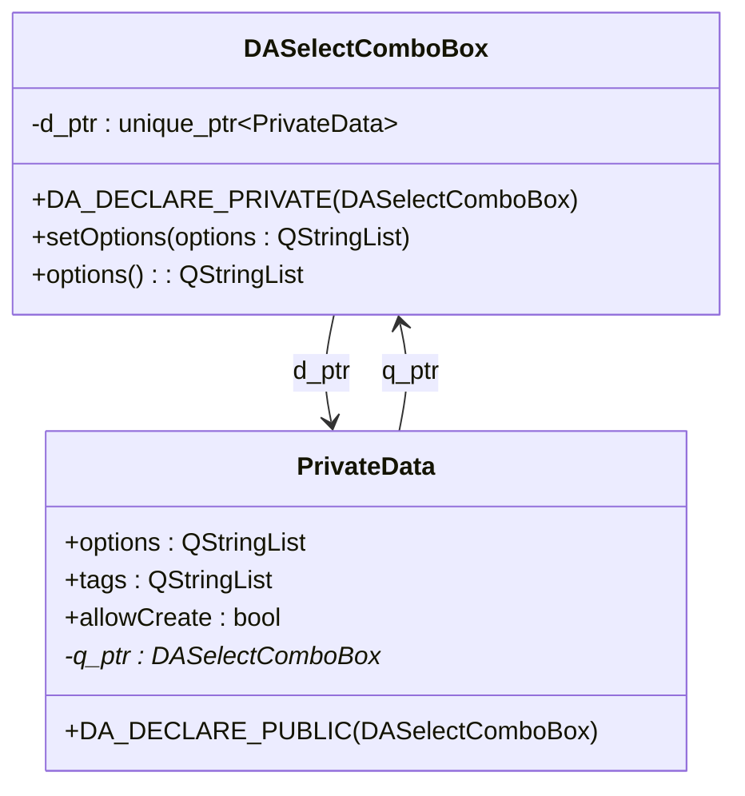

# PIMPL Pattern Guide

This document introduces the usage of the PIMPL (Pointer to Implementation) pattern in the DAWidgets project, helping developers correctly use the macro definitions provided by the project.

## Core Features

**Features**

- ✅ **Hide Implementation Details**: Private members and data are hidden in the implementation class
- ✅ **Reduce Header Dependencies**: Lower compilation dependencies, faster builds
- ✅ **Binary Compatibility**: Implementation changes do not affect binary compatibility
- ✅ **Unified Macros**: The project provides standard macros to simplify implementation
- ✅ **Consistent with data-workbench**: Macro definitions are verbatim identical, submodule integration without conflicts

## What Is the PIMPL Pattern

PIMPL (Pointer to Implementation) is a C++ design pattern, also known as the "compilation firewall" pattern.

### Drawbacks of the Traditional Approach

```cpp
// Traditional approach — all private members exposed in the header
class MyClass : public QObject
{
    Q_OBJECT
private:
    QString m_title;          // Exposed in header
    int m_value;              // Any modification requires recompiling all dependents
    QVector<double> m_data;   // Header depends on QVector
};
```

### Advantages of the PIMPL Pattern

```cpp
// PIMPL approach — header only exposes a pointer
class MyClass : public QObject
{
    Q_OBJECT
    DA_DECLARE_PRIVATE(MyClass)  // Automatically generates private data pointer
public:
    MyClass();
private:
    // All private members are hidden in MyClass::PrivateData
};
```

!!! tip "PIMPL Pattern Advantages"
    - **Build Speed**: Modifying private members only requires recompiling a single cpp file
    - **Binary Compatibility**: Private member changes do not affect ABI compatibility
    - **Clean Headers**: Headers contain only public interface declarations

## DAWidgets PIMPL Macros

The project defines the following macros in `src/DAWidgetsGlobals.h`:

| Macro | Purpose | Usage Location |
|-------|---------|----------------|
| `DA_DECLARE_PRIVATE(Class)` | Declare the private data pointer | Inside class declaration |
| `DA_DECLARE_PUBLIC(Class)` | Declare the host pointer | Inside PrivateData class |
| `DA_PIMPL_CONSTRUCT` | Initialize the private data pointer | Constructor initializer list |
| `DA_D(name)` | Get private data pointer (non-const) | In member functions |
| `DA_DC(name)` | Get private data pointer (const) | In const member functions |
| `DA_Q(class, name)` | Get host pointer (non-const) | In PrivateData methods |
| `DA_QC(class, name)` | Get host pointer (const) | In PrivateData const methods |

!!! info "Maintenance Contract"
    The macro definitions in `DAWidgetsGlobals.h` must be **verbatim identical** to the corresponding macros in the data-workbench project's `DAGlobals.h`. Both sides are guarded by `#ifndef`, so whichever header is included first in any translation unit is safe (first-include-wins).

## Implementation Steps

### Step 1: Declare the Private Pointer in the Header

```cpp
// DASelectComboBox.h
#include "DAWidgetsGlobals.h"

namespace DA
{
class DASelectComboBox : public QComboBox
{
    Q_OBJECT
    DA_DECLARE_PRIVATE(DASelectComboBox)  // Add this macro

public:
    explicit DASelectComboBox(QWidget* parent = nullptr);
    ~DASelectComboBox();

    void setOptions(const QStringList& options);
    QStringList options() const;

private:
    // Private members are no longer declared here
};
}  // namespace DA
```

### Step 2: Define the PrivateData Class in the cpp File

```cpp
// DASelectComboBox.cpp
#include "DASelectComboBox.h"

namespace DA
{
// Define the private data class
class DASelectComboBox::PrivateData
{
    DA_DECLARE_PUBLIC(DASelectComboBox)  // Automatically generates q_ptr pointer

public:
    PrivateData(DASelectComboBox* p);

    QStringList options;
    QStringList tags;
    bool allowCreate;
    bool filterable;
};

DASelectComboBox::PrivateData::PrivateData(DASelectComboBox* p)
    : q_ptr(p)
    , allowCreate(false)
    , filterable(true)
{
}
}  // namespace DA
```

### Step 3: Constructor Initialization

```cpp
/**
 * @brief 构造函数
 * @param parent 父控件指针
 */
DASelectComboBox::DASelectComboBox(QWidget* parent)
    : QComboBox(parent)
    , DA_PIMPL_CONSTRUCT  // Initialize d_ptr pointer
{
    init();
}
```

!!! info "Macro Expansion"
    `DA_PIMPL_CONSTRUCT` expands to: `d_ptr(std::make_unique<PrivateData>(this))`

### Step 4: Access Private Data in Member Functions

```cpp
/**
 * @brief 设置候选选项列表
 * @param options 候选选项字符串列表
 */
void DASelectComboBox::setOptions(const QStringList& options)
{
    DA_D(d);           // Get private data pointer
    d->options = options;
}

/**
 * @brief 获取候选选项列表
 * @return 当前的候选选项列表
 */
QStringList DASelectComboBox::options() const
{
    DA_DC(d);          // Use DA_DC in const functions
    return d->options;
}
```

## Complete Example



## Best Practices

### When to Use the PIMPL Pattern

!!! tip "Recommended Scenarios"
    - The class has many private members or private methods
    - The header has many dependencies and you want to reduce compilation coupling
    - You need to maintain binary compatibility (e.g. for a library's public API)
    - Private members may change frequently

### Important Notes

!!! warning "Important Reminders"
    1. **Constructor must initialize**: Use `DA_PIMPL_CONSTRUCT` or manually initialize `d_ptr`
    2. **Use DA_DC in const functions**: Ensures const correctness
    3. **PrivateData constructor parameter**: Must accept the host pointer to initialize `q_ptr`
    4. **PrivateData must not be exposed in headers**: The PrivateData class definition only exists in the cpp file

## Macro Expansion Details

| Macro | Expansion |
|-------|-----------|
| `DA_DECLARE_PRIVATE(Class)` | `class PrivateData;` + `friend` + `unique_ptr<PrivateData> d_ptr;` + `d_func()` |
| `DA_DECLARE_PUBLIC(Class)` | `friend` + `Class* q_ptr;` + `q_func()` |
| `DA_PIMPL_CONSTRUCT` | `d_ptr(std::make_unique<PrivateData>(this))` |
| `DA_D(name)` | `PrivateData* name = d_func();` |
| `DA_DC(name)` | `const PrivateData* name = d_func();` |

## Related Documents

- [Coding Standards](coding-standards.md)
- [Comment Standards](comment-standards.md)
- [Qt5/Qt6 Compatibility](qt5-qt6-compat.md)
