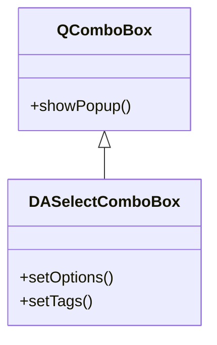
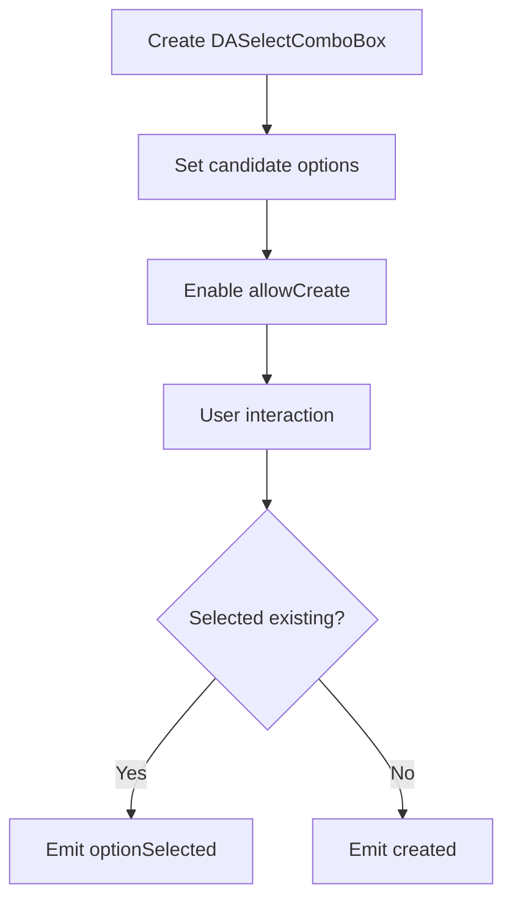

# Documentation Writing Guide

This guide provides standards for writing documentation in the DAWidgets project, ensuring consistent style, complete content, and readability.

The project documentation is built with MkDocs using the [mkdocs-material](https://squidfunk.github.io/mkdocs-material/getting-started/) theme. Material-specific syntax extensions may be used when writing.

Project documentation charts primarily use `mermaid`.

## Multilingual Documentation

DAWidgets documentation supports both Chinese and English:

- **Chinese documentation** (default language): located in the `docs/` root directory
- **English documentation**: located in the `docs/en/` directory

Both directory structures are exact mirrors of each other. Routing is handled automatically by mkdocs-static-i18n in folder mode.

!!! info "Chinese-First Policy"
    Chinese is the default and primary language. When writing new documentation, write the Chinese version first, then translate it to English.

    The English documentation in `docs/en/` is a translation of the Chinese source. When the two versions diverge, the Chinese version is authoritative. Keep both versions in sync — if you update one, update the other.

    Note: In-source code comments remain in Chinese regardless of language (see [Comment Standards](dev-guide/comment-standards.md)). The code examples in the English documentation retain their original Chinese inline comments to match the actual source code.

## Document Structure

### 1. Heading Hierarchy

```markdown
# Class Name / Feature Name
## Core Features
## Usage
### Sub-feature Module
#### Specific Feature Point
## Notes
## References
```

### 2. Required Sections

Each feature document must include the following sections:

| Section | Required | Description |
|---------|----------|-------------|
| Feature Overview | Required | Opening sentence describing the class's purpose and features |
| Core Features | Required | List core features, marked with ✅ |
| Usage | Required | Detailed usage steps and code examples |
| Notes | Recommended | Use !!! format to highlight important information |
| References | Optional | Links to related documents and example paths |

## Content Writing Principles

### 1. Text Explanation Requirements

- **Text before and after every code block**: Explain the code's purpose, key steps, and output
- **Avoid pure code dumps**: Code should not dominate the document; text explanations should account for 60%+ of content
- **Progressive guidance**: Organize in a "what → why → how" logical order

### 2. Feature Introduction Format

Use a feature list format, each feature marked with ✅:

```markdown
**Features**

- ✅ **Feature Name**: Brief description
- ✅ **Another Feature**: Brief description
```

### 3. Code Example Standards

Code examples must include:

1. **Comment annotations**: Key lines must have comments
2. **Complete and runnable**: Example code should be directly runnable (with necessary includes)
3. **Effect description**: Describe the runtime effect after the code

```cpp
// Create the selector
auto *combo = new DA::DASelectComboBox(parent);
combo->setOptions({ "选项一", "选项二" });  // Set candidate list
combo->setAllowCreate(true);                // Allow creating new tags

// Effect: Displays a dropdown selector; user can select or create tags
```

### 4. Concept Explanation Requirements

For complex concepts, use the following to aid explanation:

- **Mermaid UML diagrams**: Show class relationships and inheritance hierarchies
- **Mermaid flowcharts**: Show workflows
- **ASCII structure diagrams**: Show structural diagrams
- **Screenshots**: Actual effect screenshots

### 5. Note Format

Use Markdown extension syntax to highlight important information:

```markdown
!!! warning "Important Warning"
    Information that may cause serious problems

!!! info "Tip"
    Supplementary information

!!! tip "Technique"
    Usage tips and suggestions

!!! example "Example"
    Example code path: `examples/xxx`
```

### 6. Property/Method Description Format

Use table format to show core properties and methods:

```markdown
### Core Methods

| Method | Parameters | Description |
|--------|------------|-------------|
| `setOptions(QStringList)` | Options list | Set candidate options |
| `tags()` | None | Return the list of selected tags |
```

## Chart Usage Standards

### 1. Mermaid Class Diagrams

Show class inheritance and composition relationships:



### 2. Mermaid Flowcharts

Show usage flow:



## Document Template

```markdown
# Feature Name

One sentence describing the class's purpose and features.

## Core Features

**Features**

- ✅ **Feature 1**: Description
- ✅ **Feature 2**: Description

## Basic Concepts

### Core Concept Explanation

[Text explanation]

```mermaid
classDiagram
    [Class relationship diagram]
```

## Usage

The corresponding example is located at: `examples/xxx`.

### 1. Basic Usage

[Text explanation]

```cpp
[Code example]
```

[Effect description]

### 2. Advanced Configuration

[Text explanation]

| Method | Description |
|--------|-------------|
| Method 1 | Description |
| Method 2 | Description |

!!! warning "Note"
    Important reminder

## References

- [Coding Standards](dev-guide/coding-standards.md)
- Example path: `examples/xxx`
```
