# Gallery

This page collects every screenshot of the demo window. They are not maintained by hand: the example `examples/all_widgets_demo` exports all of them with a single command, so re-running it after a widget or layout change keeps the docs in sync.

!!! note "Demo language"
    The demo's UI text is Chinese; the widgets themselves contain no hard-coded copy and can be translated by the integrator.

```bash
# Run from the repository root (on Windows, make sure Qt's bin directory is on PATH)
dawidgets_all_widgets_demo --export-gallery docs/images/gallery
```

The command writes four kinds of images:

| Directory | Content |
|-----------|---------|
| `all-widgets-demo.png` | Main window, first tab |
| `tabs/NN-<slug>.png` | One screenshot per tab |
| `widgets/<scene-id>.png` | One screenshot per widget scene (used by docs) |
| `widgets/*-popup.png` | Popup, color menu, and item-pick dialog close-ups |

## Main Window

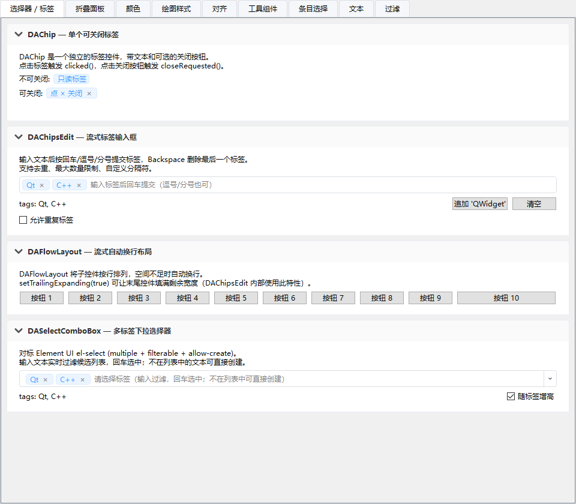

Nine tabs gather every public widget in one window, and each tab is further organized with `DACollapseWidget` sections — convenient both for trying widgets out and for screenshot archiving.

## Selector / Tags


- [DAChip](use-guide/chip.md) / [close-up](use-guide/chip.md#preview)
- [DAChipsEdit](use-guide/chips-edit.md) / [close-up](use-guide/chips-edit.md#preview)
- [DAFlowLayout](use-guide/flow-layout.md) / [close-up](use-guide/flow-layout.md#preview)
- [DASelectComboBox](use-guide/select-combobox.md) / [close-up](use-guide/select-combobox.md#preview)

## Collapse

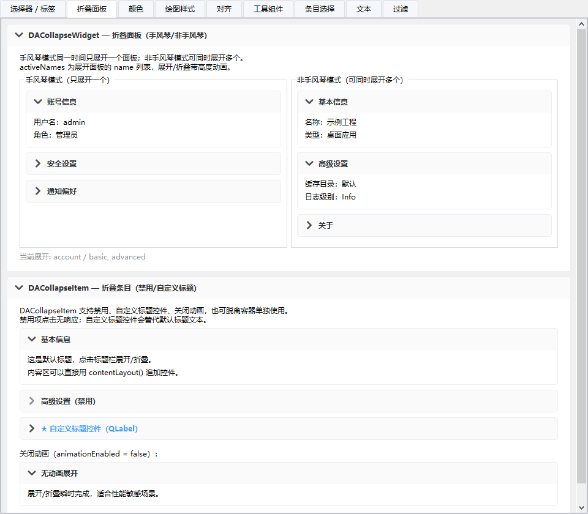

- [DACollapseWidget](use-guide/collapse.md) / [close-up](use-guide/collapse.md#preview)
- [DACollapseItem](use-guide/collapse-item.md) / [close-up](use-guide/collapse-item.md#preview)

## Color

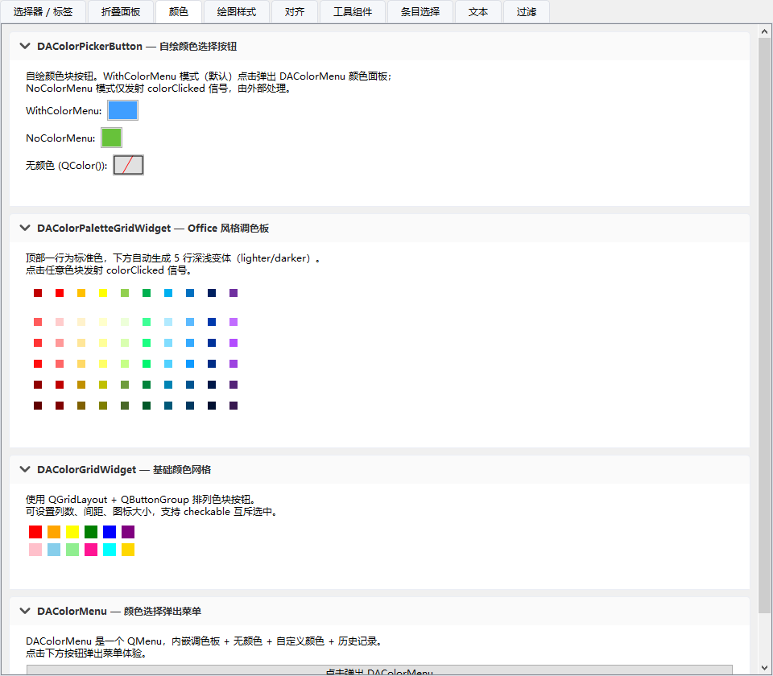

- [DAColorPickerButton](use-guide/color-menu.md#dacolorpickerbutton) / [close-up](use-guide/color-menu.md#dacolorpickerbutton)
- [DAColorPaletteGridWidget](use-guide/color-grid.md#dacolorpalettegridwidget) / [close-up](use-guide/color-grid.md#dacolorpalettegridwidget)
- [DAColorGridWidget](use-guide/color-grid.md#dacolorgridwidget) / [close-up](use-guide/color-grid.md#dacolorgridwidget)
- [DAColorMenu](use-guide/color-menu.md#dacolormenu) / [close-up](use-guide/color-menu.md#dacolormenu)

## Drawing Style

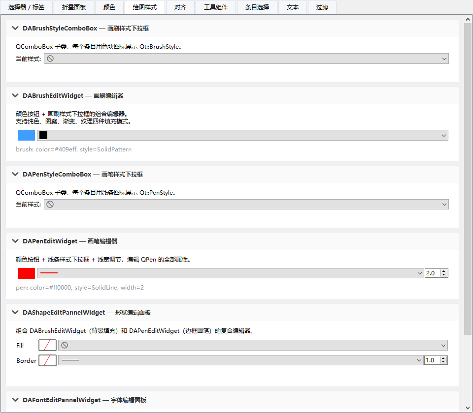

- [DABrushStyleComboBox](use-guide/brush-edit.md#dabrushstylecombobox) / [close-up](use-guide/brush-edit.md#dabrushstylecombobox)
- [DABrushEditWidget](use-guide/brush-edit.md#dabrusheditwidget) / [close-up](use-guide/brush-edit.md#dabrusheditwidget)
- [DAPenStyleComboBox](use-guide/pen-edit.md#dapenstylecombobox) / [close-up](use-guide/pen-edit.md#dapenstylecombobox)
- [DAPenEditWidget](use-guide/pen-edit.md#dapeneditwidget) / [close-up](use-guide/pen-edit.md#dapeneditwidget)
- [DAShapeEditPannelWidget](use-guide/shape-edit.md) / [close-up](use-guide/shape-edit.md#preview)
- [DAFontEditPannelWidget](use-guide/font-edit.md) / [close-up](use-guide/font-edit.md#preview)

## Alignment

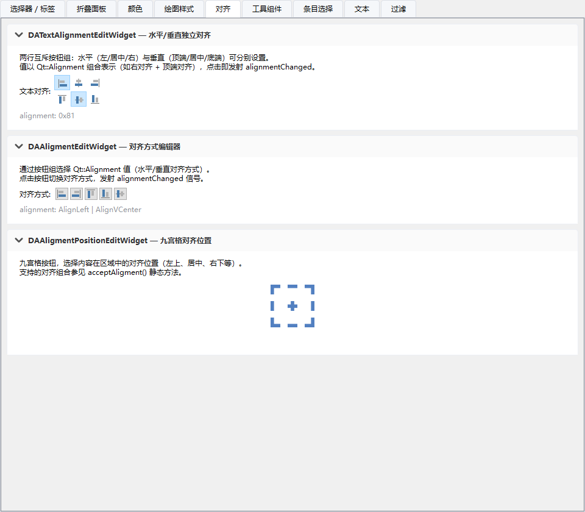

- [DATextAlignmentEditWidget](use-guide/alignment-edit.md#datextalignmenteditwidget) / [close-up](use-guide/alignment-edit.md#datextalignmenteditwidget)
- [DAAligmentEditWidget](use-guide/alignment-edit.md#daaligmenteditwidget) / [close-up](use-guide/alignment-edit.md#daaligmenteditwidget)
- [DAAligmentPositionEditWidget](use-guide/alignment-edit.md#daaligmentpositioneditwidget) / [close-up](use-guide/alignment-edit.md#daaligmentpositioneditwidget)

## Utility

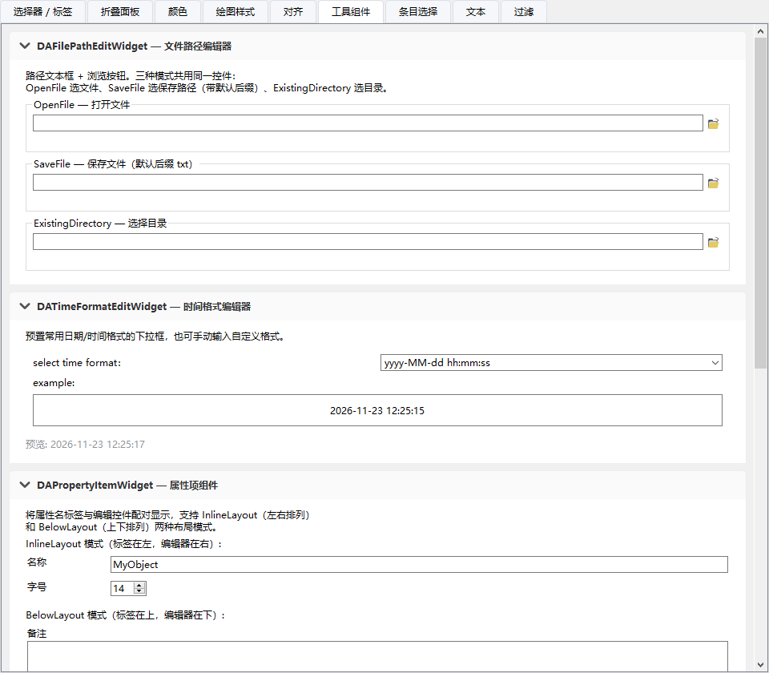

- [DAFilePathEditWidget](use-guide/file-path-edit.md) / [close-up](use-guide/file-path-edit.md#preview)
- [DATimeFormatEditWidget](use-guide/time-format-edit.md) / [close-up](use-guide/time-format-edit.md#preview)
- [DAPropertyItemWidget](use-guide/property-item.md) / [close-up](use-guide/property-item.md#preview)
- [DAUndoHistoryWidget](use-guide/undo-overlay.md#daundohistorywidget) / [close-up](use-guide/undo-overlay.md#daundohistorywidget)
- [DAAbstractWidgetOverlay](use-guide/undo-overlay.md#daabstractwidgetoverlay) / [close-up](use-guide/undo-overlay.md#daabstractwidgetoverlay)
- `DAWaitCursorScoped`: a wait cursor is an interaction state and cannot be captured statically; see [Cursor Guards](use-guide/cursor-scoped.md)

## Item Selection

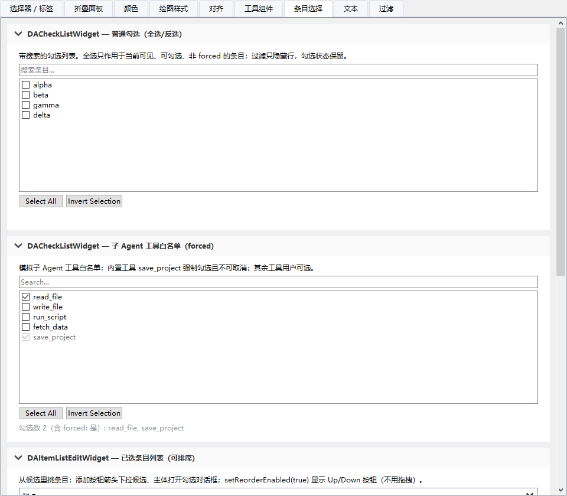

- [DACheckListWidget](use-guide/item-selection.md#dachecklistwidget) / [close-up](use-guide/item-selection.md#dachecklistwidget)
- [DAItemListEditWidget](use-guide/item-selection.md#daitemlisteditwidget) / [close-up](use-guide/item-selection.md#daitemlisteditwidget)
- [DAItemListPickDialog](use-guide/item-selection.md#daitemlistpickdialog) / [close-up](use-guide/item-selection.md#daitemlistpickdialog)
- [DAStringListEditWidget](use-guide/item-selection.md#dastringlisteditwidget) / [close-up](use-guide/item-selection.md#dastringlisteditwidget)
- [DAColorScalePreviewWidget](use-guide/item-selection.md#dacolorscalepreviewwidget) / [close-up](use-guide/item-selection.md#dacolorscalepreviewwidget)

## Text

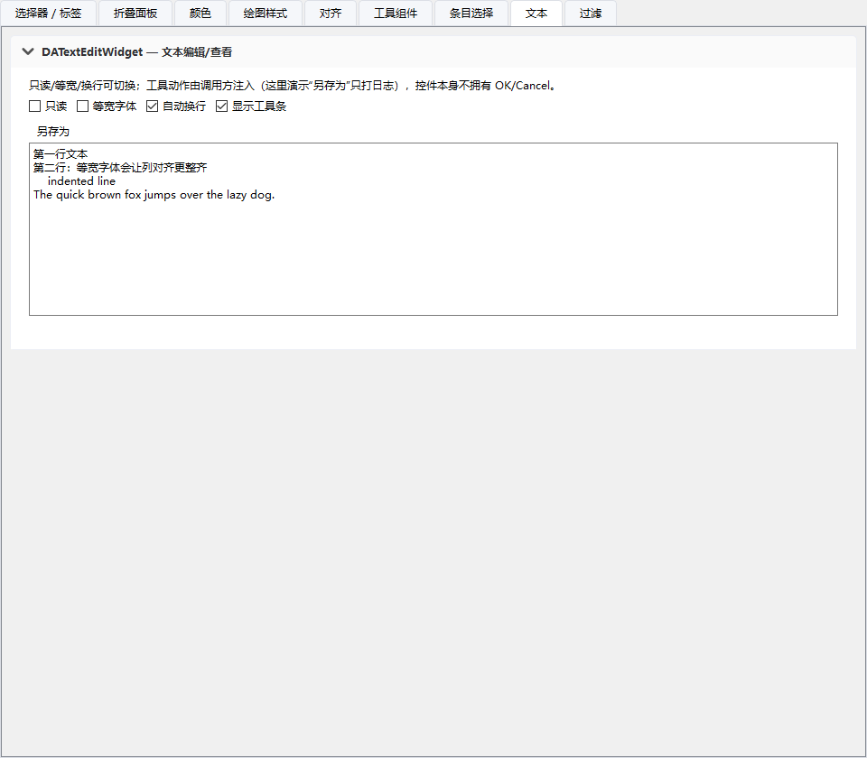

- [DATextEditWidget](use-guide/text-edit.md) / [close-up](use-guide/text-edit.md#preview)

## Filtering

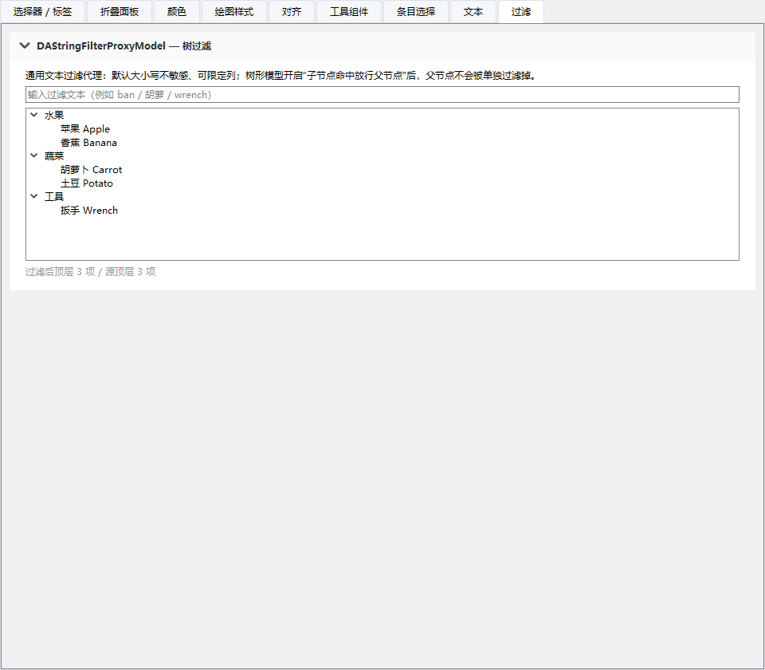

- [DAStringFilterProxyModel](use-guide/filter-proxy.md) / [close-up](use-guide/filter-proxy.md#preview)

## Popup Close-ups

Some key states live in popups, so they are exported separately:

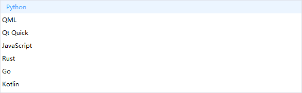

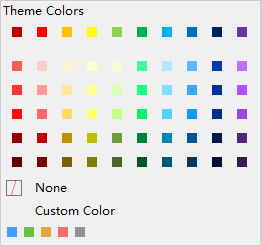

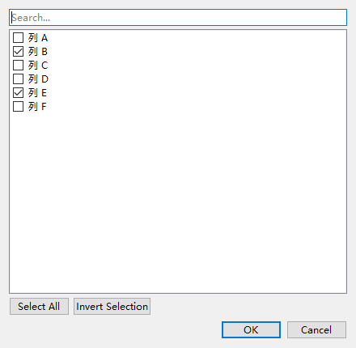

## Regenerating the Screenshots

```bash
# Windows (PowerShell): add Qt's bin directory to PATH, then run
$env:Path = "D:/Qt/6.7.3/msvc2019_64/bin;$env:Path"
./build/examples/all_widgets_demo/Release/dawidgets_all_widgets_demo.exe --export-gallery docs/images/gallery
```

`--export-gallery` walks every scene in `demoTabs()`, writes `widgets/<id>.png`, and then exports each tab plus the main window. When adding a widget, append one `DemoScene` to the matching `*Scenes()` list in `Tab*.cpp`; the demo window and the screenshots update together.
