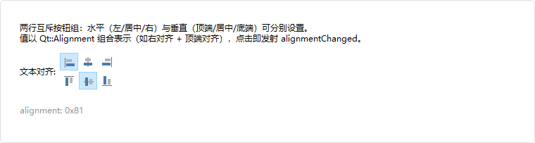
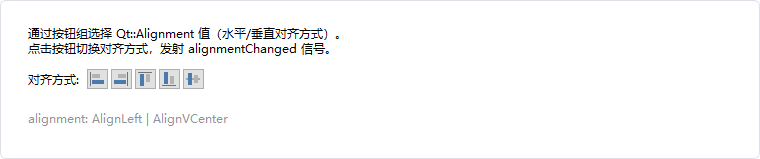

# Alignment Editor

`DATextAlignmentEditWidget`, `DAAligmentEditWidget` and `DAAligmentPositionEditWidget` provide alignment editing controls. `DATextAlignmentEditWidget` uses two independent exclusive button rows (horizontal / vertical); `DAAligmentEditWidget` selects horizontal/vertical alignment via a single button group; `DAAligmentPositionEditWidget` selects an alignment position via a 9-grid layout.

## DATextAlignmentEditWidget



Two independent exclusive button rows: horizontal (left/center/right) and vertical (top/middle/bottom) can be set separately. The label on the right shows the combined `Qt::Alignment` value.

### Key Features

- ✅ Horizontal row (Left / Center / Right) + vertical row (Top / Middle / Bottom), independent exclusive groups
- ✅ Value is a `Qt::Alignment` combination (e.g. "Align Right + Align Top")
- ✅ Signal notification: `alignmentChanged(Qt::Alignment)`; not emitted when the value does not change
- ✅ Defaults to `AlignLeft | AlignVCenter`

### Usage

```cpp
#include "DATextAlignmentEditWidget.h"

auto *edit = new DA::DATextAlignmentEditWidget(parent);

// Set the current alignment (a missing horizontal/vertical bit keeps the current half)
edit->setAlignment(Qt::AlignRight | Qt::AlignTop);

// Listen for changes
QObject::connect(edit, &DA::DATextAlignmentEditWidget::alignmentChanged,
    [](Qt::Alignment align) {
        qDebug() << "Alignment:" << align;
    });
```

Difference from `DAAligmentEditWidget`: the latter is single-selection (horizontal and vertical share one button group); this widget splits the two axes so they can be set independently.

## DAAligmentEditWidget



This button group merges horizontal and vertical alignment into one single-selection semantic: clicking "Center" centers on both axes. It suits panels that only care about one overall alignment direction.

### Key Features

- ✅ Horizontal alignment: Left / Right / Center
- ✅ Vertical alignment: Top / Bottom / Center
- ✅ Signal notification: `alignmentChanged(Qt::Alignment)`

### Usage

```cpp
#include "DAAligmentEditWidget.h"

auto *alignEdit = new DA::DAAligmentEditWidget(parent);

// Set the current alignment
alignEdit->setCurrentAlignment(Qt::AlignLeft | Qt::AlignVCenter);

// Listen for changes
QObject::connect(alignEdit, &DA::DAAligmentEditWidget::alignmentChanged,
    [](Qt::Alignment align) {
        qDebug() << "Alignment:" << align;
    });
```

## DAAligmentPositionEditWidget


The 9-grid selector maps its nine buttons to top-left through bottom-right; each click returns a combined `Qt::Alignment`.

### Key Features

- ✅ 9-grid position selection
- ✅ Static method `acceptAligment()` to check whether an alignment is accepted
- ✅ Signal notification: `aligmentPositionChanged()`

### Usage

```cpp
#include "DAAligmentPositionEditWidget.h"

auto *posEdit = new DA::DAAligmentPositionEditWidget(parent);

// Set the current position
posEdit->setAligmentPosition(Qt::AlignTop | Qt::AlignLeft);

// Listen for changes
QObject::connect(posEdit, &DA::DAAligmentPositionEditWidget::aligmentPositionChanged,
    [](Qt::Alignment align) {
        qDebug() << "Position alignment:" << align;
    });
```

!!! info "Two Editors"
    `DAAligmentEditWidget` uses separate horizontal and vertical button groups — useful when you need independent axis control. `DAAligmentPositionEditWidget` uses a 9-grid — useful when you need a single combined position selection.

## Core Properties & Methods

### DAAligmentEditWidget

| Method | Description |
|--------|-------------|
| `getCurrentAlignment()` | Get the current alignment |
| `setCurrentAlignment(Qt::Alignment)` | Set the alignment |

### DAAligmentPositionEditWidget

| Method | Description |
|--------|-------------|
| `getAligmentPosition()` | Get the current position |
| `setAligmentPosition(Qt::Alignment)` | Set the position |
| `acceptAligment(Qt::Alignment)` | Static method — check whether the alignment is accepted |

## References

- [DAPropertyItemWidget](property-item.md)
