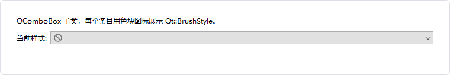
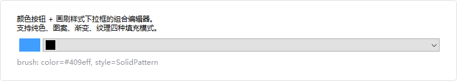

# Brush Style Editor

`DABrushStyleComboBox` is a `Qt::BrushStyle` selection combo box, and `DABrushEditWidget` combines color + style into a complete brush editor, supporting four modes: solid, pattern, gradient, and texture.

## DABrushStyleComboBox



The dropdown uses swatch icons to preview every `Qt::BrushStyle`. Use `setBrushColor()` to tint the icons and `setShowNoBrushStyle(false)` to hide the `NoBrush` entry.

### Key Features

- ✅ **All fill styles**: Solid and various patterns (`Qt::BDiagPattern`, etc.)
- ✅ **Icon preview**: Dropdown items include fill style icons
- ✅ **NoBrush option**: Can be hidden via `setShowNoBrushStyle(false)`

### Usage

```cpp
#include "DABrushStyleComboBox.h"

auto *combo = new DA::DABrushStyleComboBox(parent);
combo->setBrushColor(Qt::blue);  // Set the icon color

combo->setCurrentBrushStyle(Qt::Dense4Pattern);
Qt::BrushStyle style = combo->getCurrentBrushStyle();
```

## DABrushEditWidget



The brush editor combines a color button with a style dropdown to describe a `QBrush`, supporting solid, pattern, gradient, and texture fills; changes emit `brushChanged`.

### Key Features

- ✅ **Four modes**: Solid / Pattern / Gradient / Texture
- ✅ **Gradient types**: Linear / Radial / Conical
- ✅ **Texture loading**: Set a texture brush from a QPixmap

### Usage

```cpp
#include "DABrushEditWidget.h"

auto *brushEdit = new DA::DABrushEditWidget(parent);

// Solid mode
brushEdit->setCurrentBrush(QBrush(Qt::red, Qt::SolidPattern));

// Pattern mode
brushEdit->setCurrentBrush(QBrush(Qt::green, Qt::Dense3Pattern));

// Gradient mode
QLinearGradient gradient(0, 0, 100, 100);
gradient.setColorAt(0, Qt::red);
gradient.setColorAt(1, Qt::blue);
brushEdit->setCurrentBrush(QBrush(gradient));

// Get the current brush
QBrush brush = brushEdit->getCurrentBrush();

// Listen for changes
QObject::connect(brushEdit, &DA::DABrushEditWidget::brushChanged,
    [](const QBrush& brush) {
        qDebug() << "Brush:" << brush.color() << brush.style();
    });
```

!!! info "Mode Detection"
    Use `isColorBrush()` on the style combo box to check whether the current selection is a solid color. The brush edit widget automatically adapts its UI based on the brush style — gradient brushes show gradient controls, texture brushes show a texture picker.

## Core Properties & Methods

### DABrushStyleComboBox

| Method | Description |
|--------|-------------|
| `getCurrentBrushStyle()` | Get the current brush style |
| `setBrushColor(QColor)` | Set the icon color |
| `isColorBrush()` | Whether the current style is a solid color |
| `setShowNoBrushStyle(bool)` | Whether to show the NoBrush option |
| `setStyleTextVisible(bool)` | Style text visibility |
| `generateBrushStyleIcon(...)` | Generate a brush style icon (static) |

### DABrushEditWidget

| Method | Description |
|--------|-------------|
| `getCurrentBrush()` | Get the current brush |
| `setCurrentBrush(QBrush)` | Set the brush |
| `getCurrentBrushStyle()` | Get the brush style |
| `getCurrentBrushColor()` | Get the brush color |
| `setStyleTextVisible(bool)` | Style text visibility |

## References

- [Pen Style Editor](pen-edit.md)
- [Shape Edit Panel](shape-edit.md)
