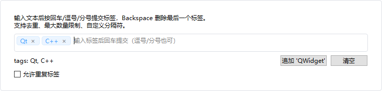
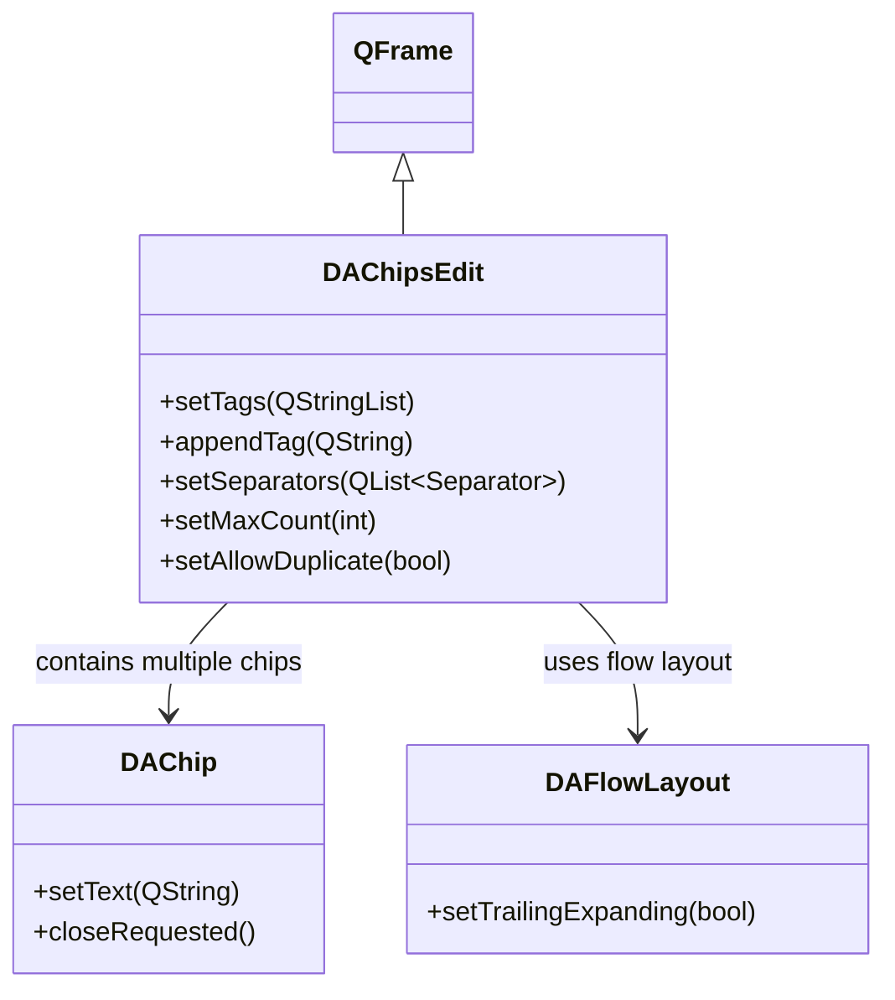

# DAChipsEdit

`DAChipsEdit` is a flow-layout multi-tag input box that can be used independently. Users commit tags via Enter or separator characters, and Backspace removes the last tag. It supports deduplication, count limits, and custom separators.

## Preview



The committed `Qt` and `C++` tags flow in order, and the trailing input fills the remaining width thanks to `DAFlowLayout`'s trailing expansion. Type and press Enter/comma/semicolon to append more tags; below are the `tagsChanged` echo and duplicate/count controls, followed by a second input that explicitly enables batch paste splitting, long-tag elision and the count badge.

## Key Features

- ✅ **Flow layout**: Tags wrap automatically
- ✅ **Multi-separator commit**: Comma, semicolon, space, Enter, Tab (enum + string overloads)
- ✅ **Deduplication control**: Can disallow duplicate tags
- ✅ **Count limit**: Configurable maximum tag count
- ✅ **Independently usable**: Works without DASelectComboBox
- ✅ **Extension points**: Exposes `inputTextChanged` / `inputFocusChanged` / `inputKeyEvent` for external consumers
- ✅ **Batch paste splitting** (optional): One paste creates multiple tags by separator
- ✅ **Long-tag elision** (optional): Caps chip width, ends with `…` and shows the full text in a tooltip
- ✅ **Tag count badge** (optional): Shows `n / maxCount` at the bottom-right

## Class Relationships



## Usage

The corresponding example is located at: `examples/all_widgets_demo` (Selector/Tags tab).

### 1. Basic Usage

```cpp
#include "DAChipsEdit.h"

auto *edit = new DA::DAChipsEdit(parent);

// Set placeholder text
edit->setPlaceholder("Type a tag and press Enter...");

// Pre-set tags
edit->setTags({ "C++", "Qt", "Widgets" });

// Disallow duplicates
edit->setAllowDuplicate(false);

// Limit to at most 5 tags
edit->setMaxCount(5);
```

### 2. Custom Separators

`DAChipsEdit` provides two ways to set separators: an enum overload (compile-time type safety) and a string overload (runtime configuration).

```cpp
using namespace DA;

// Method 1: Enum overload (recommended for C++ usage)
edit->setSeparators({
    DAChipsEdit::Separator::Comma,
    DAChipsEdit::Separator::Enter,
    DAChipsEdit::Separator::Semicolon
});

// Method 2: String overload (suitable for runtime configuration)
edit->setSeparators(",;\n");  // Comma, semicolon, newline
```

| Enum Value | Character | Description |
|------------|-----------|-------------|
| `Comma` | `,` | Comma |
| `Semicolon` | `;` | Semicolon |
| `Space` | ` ` | Space |
| `Enter` | `\n` | Enter / newline |
| `Tab` | `\t` | Tab key |

### 3. Signal Handling

```cpp
// Tag added
QObject::connect(edit, &DA::DAChipsEdit::tagAdded,
    [](const QString& tag) {
        qDebug() << "Tag added:" << tag;
    });

// Tag removed
QObject::connect(edit, &DA::DAChipsEdit::tagRemoved,
    [](const QString& tag) {
        qDebug() << "Tag removed:" << tag;
    });

// Tag list changed
QObject::connect(edit, &DA::DAChipsEdit::tagsChanged,
    [](const QStringList& tags) {
        qDebug() << "Current tags:" << tags;
    });
```

### 4. Extension Points

`DAChipsEdit` exposes three extension points for external consumers such as `DASelectComboBox`:

```cpp
// Input field text changed
QObject::connect(edit, &DA::DAChipsEdit::inputTextChanged,
    [](const QString& text) {
        // Can be used to implement filtering logic
    });

// Input field focus changed
QObject::connect(edit, &DA::DAChipsEdit::inputFocusChanged,
    [](bool focused) {
        // Can be used to control popup visibility
    });

// Key event interception
QObject::connect(edit, &DA::DAChipsEdit::inputKeyEvent,
    [](QKeyEvent* event, bool* handled) {
        // Intercept specific keys; set *handled = true to prevent default handling
    });
```

### 5. Batch Paste Splitting

Disabled by default. When enabled, `Ctrl+V` / `Shift+Insert` (Cmd+V on macOS) splits the clipboard text by the current separator set into multiple tags; `Enter` means newline, so a whole column copied from a spreadsheet can be pasted directly.

```cpp
using namespace DA;

edit->setPasteSplitEnabled(true);
edit->setSeparators({
    DAChipsEdit::Separator::Comma,
    DAChipsEdit::Separator::Semicolon,
    DAChipsEdit::Separator::Enter
});

// The shortcut, demo buttons and unit tests all use this single entry point
edit->pasteText("red, green; blue\nyellow");  // -> 4 tags
```

- Deduplication and `maxCount` still apply. Only items rejected by the limit emit `pasteRejected("maxCount")`; an unreadable clipboard emits `pasteRejected("clipboard")`.
- One paste emits exactly one `pasteSplit(QStringList)`, carrying the tokens before deduplication (trimmed, empty tokens dropped).
- With `allowCreate == false`, paste degrades to a plain insertion: no splitting, no signals.
- When disabled, `pasteText()` is equivalent to inserting the text into the embedded line edit, and `Ctrl+V` is not intercepted.

### 6. Long-Tag Elision

```cpp
edit->setTagElideWidth(96);   // 0 (default) = no elision
```

Tags wider than 96 px end with `…` and show the full text in a tooltip; `DAChip::text()` and `tags()` always return the full text. Keep the width at 64 px or more, otherwise the close button gets squeezed. While elision is enabled the widget owns the tooltip (it overrides any tooltip set by the caller).

### 7. Tag Count Badge

```cpp
edit->setShowCount(true);   // default false
edit->setMaxCount(5);       // shows "3 / 5" when 3 tags are selected
```

With `maxCount == -1` only the current count is shown (e.g. `3`). The badge is a private child at the bottom-right and does not participate in the flow layout, so the trailing input still fills the remaining width; do not treat it as a layout item.

## Core Properties & Methods

### Q_PROPERTY

| Property | Type | Description |
|----------|------|-------------|
| `tags` | `QStringList` | Tag list |
| `placeholder` | `QString` | Placeholder text |
| `allowCreate` | `bool` | Whether creating new tags is allowed |
| `allowDuplicate` | `bool` | Whether duplicate tags are allowed |
| `maxCount` | `int` | Maximum tag count (-1 = unlimited) |

### Core Methods

| Method | Description |
|--------|-------------|
| `setTags(QStringList)` | Set the tag list |
| `appendTag(QString)` | Append a single tag |
| `insertTag(int, QString)` | Insert a tag at the given index |
| `removeTag(QString)` | Remove a tag by text |
| `removeAt(int)` | Remove a tag by index |
| `clear()` | Clear all tags |
| `setSeparators(QList<Separator>)` | Set separators via enum |
| `setSeparators(QString)` | Set separators via string |
| `inputText()` | Get current input field text |
| `clearInput()` | Clear the input field |
| `setPasteSplitEnabled(bool)` | Enable/disable batch paste splitting (default `false`) |
| `pasteText(QString)` | Single paste entry point shared by shortcuts, buttons and tests |
| `setTagElideWidth(int)` | Maximum chip width in px; `0` = no elision (default) |
| `setShowCount(bool)` | Show `n / maxCount` at the bottom-right (default `false`) |

## References

- [DASelectComboBox](select-combobox.md)
- [DAChip](chip.md)
- [DAFlowLayout](flow-layout.md)
- Example path: `examples/all_widgets_demo` (Selector/Tags tab)
