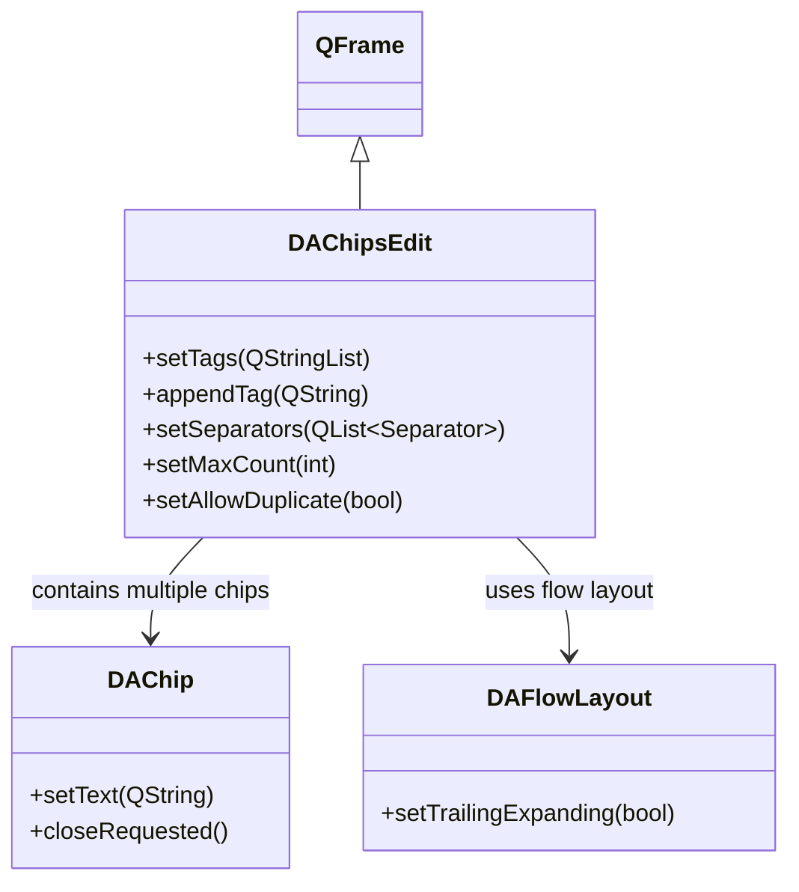

# DAChipsEdit

`DAChipsEdit` is a flow-layout multi-tag input box that can be used independently. Users commit tags via Enter or separator characters, and Backspace removes the last tag. It supports deduplication, count limits, and custom separators.

## Key Features

- ✅ **Flow layout**: Tags wrap automatically
- ✅ **Multi-separator commit**: Comma, semicolon, space, Enter, Tab (enum + string overloads)
- ✅ **Deduplication control**: Can disallow duplicate tags
- ✅ **Count limit**: Configurable maximum tag count
- ✅ **Independently usable**: Works without DASelectComboBox
- ✅ **Extension points**: Exposes `inputTextChanged` / `inputFocusChanged` / `inputKeyEvent` for external consumers

## Class Relationships



## Usage

The corresponding example is located at: `examples/chipsedit_demo`.

### 1. Basic Usage

```cpp
#include "DAChipsEdit.h"

auto *edit = new DA::DAChipsEdit(parent);

// Set placeholder text
edit->setPlaceholder("Type a tag and press Enter...");

// Pre-set tags
edit->setTags({ "C++", "Qt", "Widgets" });

// Disallow duplicates
edit->setAllowDuplicate(false);

// Limit to at most 5 tags
edit->setMaxCount(5);
```

### 2. Custom Separators

`DAChipsEdit` provides two ways to set separators: an enum overload (compile-time type safety) and a string overload (runtime configuration).

```cpp
using namespace DA;

// Method 1: Enum overload (recommended for C++ usage)
edit->setSeparators({
    DAChipsEdit::Separator::Comma,
    DAChipsEdit::Separator::Enter,
    DAChipsEdit::Separator::Semicolon
});

// Method 2: String overload (suitable for runtime configuration)
edit->setSeparators(",;\n");  // Comma, semicolon, newline
```

| Enum Value | Character | Description |
|------------|-----------|-------------|
| `Comma` | `,` | Comma |
| `Semicolon` | `;` | Semicolon |
| `Space` | ` ` | Space |
| `Enter` | `\n` | Enter / newline |
| `Tab` | `\t` | Tab key |

### 3. Signal Handling

```cpp
// Tag added
QObject::connect(edit, &DA::DAChipsEdit::tagAdded,
    [](const QString& tag) {
        qDebug() << "Tag added:" << tag;
    });

// Tag removed
QObject::connect(edit, &DA::DAChipsEdit::tagRemoved,
    [](const QString& tag) {
        qDebug() << "Tag removed:" << tag;
    });

// Tag list changed
QObject::connect(edit, &DA::DAChipsEdit::tagsChanged,
    [](const QStringList& tags) {
        qDebug() << "Current tags:" << tags;
    });
```

### 4. Extension Points

`DAChipsEdit` exposes three extension points for external consumers such as `DASelectComboBox`:

```cpp
// Input field text changed
QObject::connect(edit, &DA::DAChipsEdit::inputTextChanged,
    [](const QString& text) {
        // Can be used to implement filtering logic
    });

// Input field focus changed
QObject::connect(edit, &DA::DAChipsEdit::inputFocusChanged,
    [](bool focused) {
        // Can be used to control popup visibility
    });

// Key event interception
QObject::connect(edit, &DA::DAChipsEdit::inputKeyEvent,
    [](QKeyEvent* event, bool* handled) {
        // Intercept specific keys; set *handled = true to prevent default handling
    });
```

## Core Properties & Methods

### Q_PROPERTY

| Property | Type | Description |
|----------|------|-------------|
| `tags` | `QStringList` | Tag list |
| `placeholder` | `QString` | Placeholder text |
| `allowCreate` | `bool` | Whether creating new tags is allowed |
| `allowDuplicate` | `bool` | Whether duplicate tags are allowed |
| `maxCount` | `int` | Maximum tag count (0 = unlimited) |

### Core Methods

| Method | Description |
|--------|-------------|
| `setTags(QStringList)` | Set the tag list |
| `appendTag(QString)` | Append a single tag |
| `insertTag(int, QString)` | Insert a tag at the given index |
| `removeTag(QString)` | Remove a tag by text |
| `removeAt(int)` | Remove a tag by index |
| `clear()` | Clear all tags |
| `setSeparators(QList<Separator>)` | Set separators via enum |
| `setSeparators(QString)` | Set separators via string |
| `inputText()` | Get current input field text |
| `clearInput()` | Clear the input field |

## References

- [DASelectComboBox](select-combobox.md)
- [DAChip](chip.md)
- [DAFlowLayout](flow-layout.md)
- Example path: `examples/chipsedit_demo`
