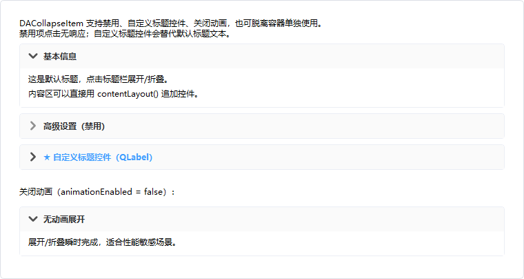

# DACollapseItem

`DACollapseItem` is a collapsible item that mirrors Element UI's `el-collapse-item`. It consists of a title bar and a content area. Clicking the title bar toggles between expanded and collapsed states, with optional animation.

## Preview



The screenshot walks through four forms: a default expanded item, a grayed-out disabled item that ignores clicks, a blue custom title installed via `setTitleWidget()`, and an item that expands instantly with animation disabled. `contentLayout()` accepts arbitrary widgets.

## Key Features

- ✅ **Animated expand/collapse**: Content area animates from 0 height to its natural height
- ✅ **Animation toggle**: Can be disabled via `setAnimationEnabled(false)`
- ✅ **Custom title**: `setTitleWidget()` replaces the default title text with any widget
- ✅ **Custom content**: `setContentWidget()` or `contentLayout()` to manage content
- ✅ **Disabled state**: `setDisabled(true)` prevents expand/collapse
- ✅ **Keyboard reachable**: with the container's `setKeyboardNavigation(true)`, headers are tabbable and Enter/Space toggles them
- ✅ **Lazy-load signal**: `contentRequested()` fires before the first expansion of an empty item
- ✅ **Async height refresh**: `refreshContentHeight()` fixes the height after content arrives
- ✅ **qss customizable**: Full sub-control qss selectors

## Usage

### 1. Basic Usage

```cpp
#include "DACollapseItem.h"

auto *item = new DA::DACollapseItem("Settings", parent);

// Add widgets to the content area
item->contentLayout()->addWidget(new QLabel("Content 1"));
item->contentLayout()->addWidget(new QPushButton("Button"));

// Expand
item->setExpanded(true);
```

### 2. Custom Title

```cpp
auto *item = new DA::DACollapseItem(parent);

// Replace the default title text with a custom widget
auto *headerWidget = new QWidget;
auto *headerLayout = new QHBoxLayout(headerWidget);
headerLayout->addWidget(new QLabel(QString::fromUtf8("\u2699")));  // gear icon
headerLayout->addWidget(new QLabel("Advanced Settings"));
headerLayout->addStretch();
item->setTitleWidget(headerWidget);

item->setTitle("Advanced Settings");  // Still useful for qss and accessibility
```

### 3. Animation Control

```cpp
// Disable animation (for scenarios requiring instant toggle)
item->setAnimationEnabled(false);

// Programmatic expand/collapse
item->setExpanded(true);   // Expand
item->setExpanded(false);  // Collapse

// Query current state
if (item->expanded()) {
    // ...
}
```

!!! warning "Animation Pitfall"
    The animation is implemented via the `maximumHeight` property. The `QWIDGETSIZE_MAX` sentinel value (65535) is a known trap — the collapse animation's start value may be the sentinel, causing a dead animation, and the expand animation must correctly set the target height. DAWidgets handles these edge cases internally.

### 4. Disabled State

```cpp
// Prevent the user from clicking to expand/collapse
item->setDisabled(true);

// Visually grayed out (via qss [disabled="true"] selector)
```

### 5. Signal Handling

```cpp
QObject::connect(item, &DA::DACollapseItem::expandChanged,
    [](bool expanded) {
        qDebug() << (expanded ? "Expanded" : "Collapsed");
    });

// Fired once before the first expansion of an empty content area
QObject::connect(item, &DA::DACollapseItem::contentRequested,
    [item]() {
        item->setContentWidget(new QLabel("Created on first expansion"));
        // Once async content is ready:
        // item->refreshContentHeight();
    });
```

`contentRequested()` fires at most once per item and never when the content area is non-empty. `refreshContentHeight()` returns immediately while collapsed; while expanded it updates the animation end value during a running animation, otherwise it corrects `maximumHeight`.

## qss Sub-control Selectors

| Selector / objectName | Description |
|-----------------------|-------------|
| `DA--DACollapseItem` | Item outer frame |
| `DA--DACollapseItem #header` | Title bar area (objectName — use `#header`) |
| `#DACollapseItemTitle` | Title text QLabel |
| `#DACollapseItemArrow` | Arrow icon QLabel |
| `DA--DACollapseItem[disabled="true"]` | Disabled state |
| `DA--DACollapseItem[expanded="true"]` | Expanded state |

## Core Properties & Methods

### Q_PROPERTY

| Property | Type | Description |
|----------|------|-------------|
| `title` | `QString` | Title text |
| `name` | `QString` | Unique identifier (for DACollapse management) |
| `disabled` | `bool` | Disabled state |
| `expanded` | `bool` | Expand/collapse state |
| `animationEnabled` | `bool` | Animation toggle (default on) |

### Core Methods

| Method | Description |
|--------|-------------|
| `title()` / `setTitle(QString)` | Get/set title text |
| `name()` / `setName(QString)` | Get/set unique name |
| `disabled()` / `setDisabled(bool)` | Get/set disabled state |
| `expanded()` / `setExpanded(bool)` | Get/set expanded state |
| `animationEnabled()` / `setAnimationEnabled(bool)` | Get/set animation toggle |
| `setTitleWidget(QWidget*)` | Set a custom title widget |
| `titleWidget()` | Get the current title widget |
| `setContentWidget(QWidget*)` | Set the content widget |
| `contentWidget()` | Get the current content widget |
| `contentLayout()` | Get the content area layout (QVBoxLayout*) |
| `headerWidget()` | Get the header widget (for keyboard navigation/custom styling) |
| `refreshContentHeight()` | Refresh the expanded height after content arrives |

## References

- [DACollapseWidget](collapse.md)
- Example path: `examples/all_widgets_demo` (`DACollapseWidget` is used as a per-section collapsible organizer within each tab)
