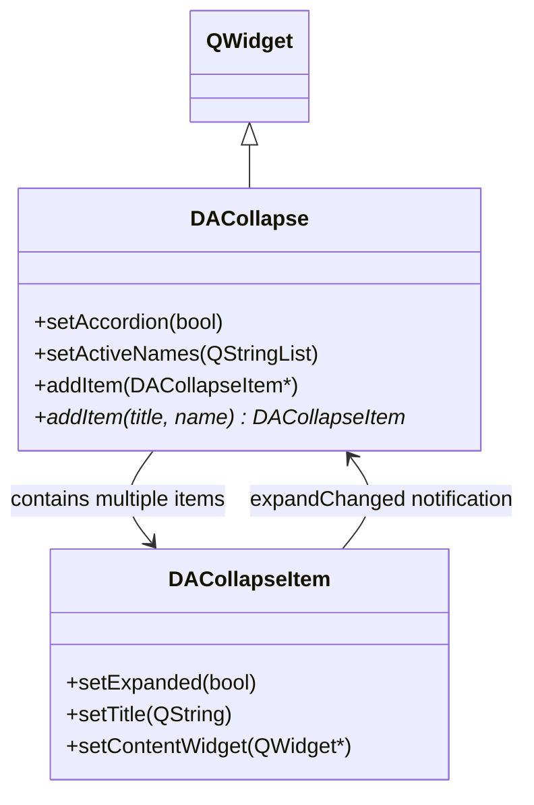

# DACollapse

`DACollapse` is a collapsible panel container that mirrors Element UI's `el-collapse`. It vertically arranges multiple `DACollapseItem` instances, coordinating expand/collapse states, and supports both accordion mode and multi-expand mode.

## Key Features

- ✅ **Accordion mode**: Only one panel can be expanded at a time
- ✅ **Multi-expand mode**: Default mode — multiple panels can be expanded simultaneously
- ✅ **activeNames management**: Control active state via a name list
- ✅ **Convenience API**: `addItem(title, name)` creates an item in one step

## Class Relationships



## Usage

The corresponding example is located at: `examples/all_widgets_demo` (`DACollapseWidget` is used as a per-section collapsible organizer within each tab).

### 1. Basic Usage

```cpp
#include "DACollapse.h"
#include "DACollapseItem.h"

auto *collapse = new DA::DACollapse(parent);

// Create items with the convenience API
auto *item1 = collapse->addItem("Consistency", "1");
auto *item2 = collapse->addItem("Feedback", "2");
auto *item3 = collapse->addItem("Efficiency", "3");

// Add content to items
item1->contentLayout()->addWidget(new QLabel("Consistency content"));
item2->contentLayout()->addWidget(new QLabel("Feedback content"));

// Expand the first item by default
collapse->setActiveNames({ "1" });
```

### 2. Accordion Mode

```cpp
// Enable accordion mode — only one panel can be expanded at a time
collapse->setAccordion(true);

// Expand a specific panel (in accordion mode, only the first takes effect)
collapse->setActiveNames({ "2" });
```

| Mode | Description |
|------|-------------|
| Non-accordion (default) | Multiple panels can be expanded simultaneously; `activeNames` is the full list |
| Accordion | Only one panel expanded at a time; expanding a new one auto-collapses the rest; `activeNames` takes the first |

### 3. Signal Handling

```cpp
// Active panels changed
QObject::connect(collapse, &DA::DACollapse::activeNamesChanged,
    [](const QStringList& names) {
        qDebug() << "Currently active:" << names;
    });

// Accordion mode toggled
QObject::connect(collapse, &DA::DACollapse::accordionChanged,
    [](bool on) {
        qDebug() << "Accordion mode:" << (on ? "on" : "off");
    });
```

### 4. qss Styling

```css
DACollapse {
    border: none;
}
DACollapseItem {
    border: 1px solid #ebeef5;
    border-radius: 4px;
    margin-bottom: 4px;
}
DACollapseItem::header {
    background: #fafafa;
    padding: 8px 12px;
}
DACollapseItem::header:hover {
    background: #f5f7fa;
}
QLabel#DACollapseItemTitle {
    color: #303133;
    font-weight: bold;
}
QLabel#DACollapseItemArrow {
    color: #909399;
}
```

!!! tip "qss Selectors"
    `DACollapseItem` exposes sub-controls via `::header`, and child labels via objectName `DACollapseItemTitle` and `DACollapseItemArrow`. State-based selectors `[expanded="true"]` and `[disabled="true"]` are also available.

## Core Properties & Methods

### Q_PROPERTY

| Property | Type | Description |
|----------|------|-------------|
| `accordion` | `bool` | Accordion mode |
| `activeNames` | `QStringList` | List of active panel names |

### Core Methods

| Method | Description |
|--------|-------------|
| `setAccordion(bool)` | Enable/disable accordion mode |
| `activeNames()` / `setActiveNames(QStringList)` | Get/set active panels |
| `addItem(DACollapseItem*)` | Add an existing item (takes ownership) |
| `addItem(title, name)` | Convenience method to create and add an item |
| `item(name)` | Find an item by name |
| `items()` | Get all items |
| `removeItem(DACollapseItem*)` | Remove and destroy an item |
| `clear()` | Clear all items |

## References

- [DACollapseItem](collapse-item.md)
- Example path: `examples/all_widgets_demo` (`DACollapseWidget` is used as a per-section collapsible organizer within each tab)
