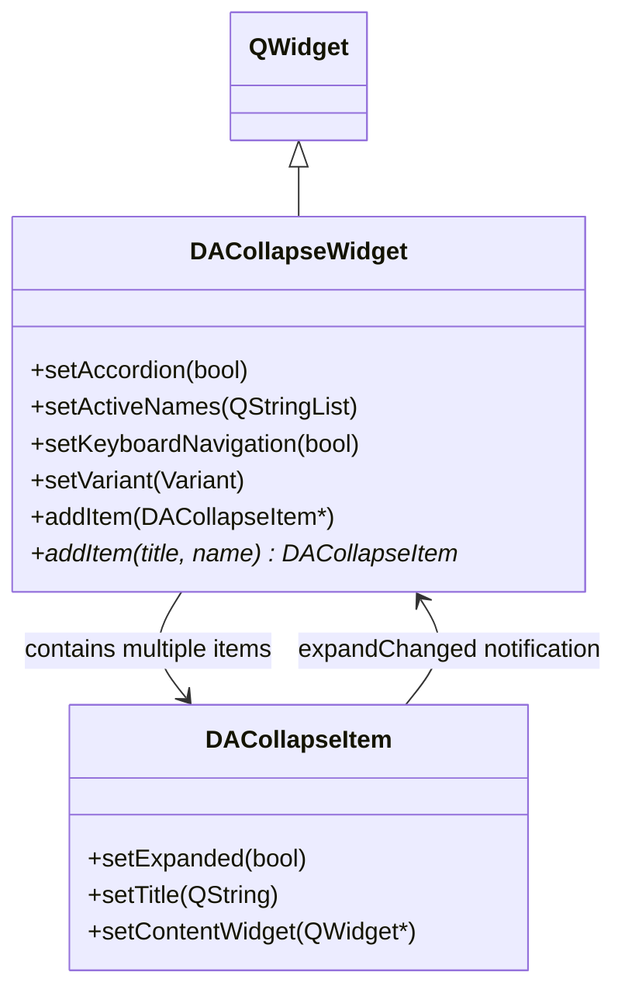

# DACollapseWidget

`DACollapseWidget` is a collapsible panel container that mirrors Element UI's `el-collapse`. It vertically arranges multiple `DACollapseItem` instances, coordinating expand/collapse states, and supports both accordion mode and multi-expand mode.

## Preview


The left panel is in accordion mode (expanding "Account" collapses the others); the middle panel is non-accordion, keeping "Basic" and "Advanced" open at the same time; the right column demonstrates keyboard navigation, `expandRequested` lazy loading and the three visual variants. Every toggle animates the height while `activeNames` stays in sync.

## Key Features

- ✅ **Accordion mode**: Only one panel can be expanded at a time
- ✅ **Multi-expand mode**: Default mode — multiple panels can be expanded simultaneously
- ✅ **activeNames management**: Control active state via a name list
- ✅ **Convenience API**: `addItem(title, name)` creates an item in one step
- ✅ **Keyboard navigation** (optional): Tab to focus, ↑/↓ to move, Enter/Space to toggle
- ✅ **Lazy-load hook**: `expandRequested` fires before the first expansion
- ✅ **Visual variants**: `Default` / `Borderless` / `Card` spacing and padding

## Class Relationships



## Usage

The corresponding example is located at: `examples/all_widgets_demo` (`DACollapseWidget` is used as a per-section collapsible organizer within each tab).

### 1. Basic Usage

```cpp
#include "DACollapseWidget.h"
#include "DACollapseItem.h"

auto *collapse = new DA::DACollapseWidget(parent);

// Create items with the convenience API
auto *item1 = collapse->addItem("Consistency", "1");
auto *item2 = collapse->addItem("Feedback", "2");
auto *item3 = collapse->addItem("Efficiency", "3");

// Add content to items
item1->contentLayout()->addWidget(new QLabel("Consistency content"));
item2->contentLayout()->addWidget(new QLabel("Feedback content"));

// Expand the first item by default
collapse->setActiveNames({ "1" });
```

### 2. Accordion Mode

```cpp
// Enable accordion mode — only one panel can be expanded at a time
collapse->setAccordion(true);

// Expand a specific panel (in accordion mode, only the first takes effect)
collapse->setActiveNames({ "2" });
```

| Mode | Description |
|------|-------------|
| Non-accordion (default) | Multiple panels can be expanded simultaneously; `activeNames` is the full list |
| Accordion | Only one panel expanded at a time; expanding a new one auto-collapses the rest; `activeNames` takes the first |

### 3. Signal Handling

```cpp
// Active panels changed
QObject::connect(collapse, &DA::DACollapseWidget::activeNamesChanged,
    [](const QStringList& names) {
        qDebug() << "Currently active:" << names;
    });

// Accordion mode toggled
QObject::connect(collapse, &DA::DACollapseWidget::accordionChanged,
    [](bool on) {
        qDebug() << "Accordion mode:" << (on ? "on" : "off");
    });
```

### 4. qss Styling

```css
DA--DACollapseWidget {
    border: none;
}
DA--DACollapseItem {
    border: 1px solid #ebeef5;
    border-radius: 4px;
}
DA--DACollapseItem #header {
    background: #fafafa;
    padding: 8px 12px;
}
DA--DACollapseItem #header:hover {
    background: #f5f7fa;
}
QLabel#DACollapseItemTitle {
    color: #303133;
    font-weight: bold;
}
QLabel#DACollapseItemArrow {
    color: #909399;
}
```

!!! tip "qss Selectors"
    `header` is the header's objectName, so it must be matched with `#header`; Qt has no `QStyle::SubControl` named `header`, which makes `::header` invalid. Child labels are addressable via `QLabel#DACollapseItemTitle` and `QLabel#DACollapseItemArrow`. State-based selectors `[expanded="true"]` and `[disabled="true"]` are also available.

### 5. Keyboard Navigation

```cpp
collapse->setKeyboardNavigation(true);  // default false
```

| Key | Behavior |
|-----|----------|
| Tab | Focus each header in order (only when keyboard navigation is on) |
| ↑ / ↓ | Move focus to the previous/next panel, skipping disabled items; no wrap-around |
| Enter / Space | Expand/collapse the focused panel |

When disabled (the default) headers stay out of the Tab order and mouse/programmatic behavior is unchanged. The focused header draws a 2 px translucent blue focus ring. If a custom header contains focusable widgets, they consume the keys first (expected).

### 6. Lazy Content (expandRequested)

```cpp
auto *item = collapse->addItem("Large table", "table");

QObject::connect(collapse, &DA::DACollapseWidget::expandRequested,
    [item](const QString &name) {
        // Provide content synchronously, before the animation starts
        item->setContentWidget(buildTable());
    });
```

- The signal fires **before** the expand animation starts, once per item (only when the content area is empty on first expansion).
- Providing content synchronously in the slot makes the expanded height equal the natural height.
- For asynchronous loading, insert a placeholder first and refresh the height later:

```cpp
QTimer::singleShot(400, item, [item] {
    item->setContentWidget(buildTable());
    item->refreshContentHeight();  // updates the animation end, or maximumHeight when idle
});
```

- One `setActiveNames()` call may trigger requests for several items; the slot must be idempotent.
- There is no built-in skeleton; with permanently empty content the expanded height only covers the content padding.

### 7. Visual Variants (Variant)

```cpp
collapse->setVariant(DA::DACollapseWidget::Variant::Card);
```

| Variant | Item spacing | Header padding | Content padding | Library draws border |
|---------|--------------|----------------|-----------------|----------------------|
| `Default` | 0 | 12 / 10 | 12 / 8 / 12 / 12 | No |
| `Borderless` | 0 | 0 / 8 | 0 / 4 / 0 / 8 | No |
| `Card` | 8 | 12 / 10 | 12 / 8 / 12 / 12 | No (caller qss) |

`Card` borders are supplied by the caller:

```css
DA--DACollapseItem[daVariant="card"] {
    border: 1px solid #EBEEF5;
    border-radius: 4px;
}
```

The `daVariant` dynamic property is set on the container and on every item (`default` / `borderless` / `card`); items added later inherit the current variant. Variants only change spacing and padding, never `accordion` or `activeNames`.

## Core Properties & Methods

### Q_PROPERTY

| Property | Type | Description |
|----------|------|-------------|
| `accordion` | `bool` | Accordion mode |
| `activeNames` | `QStringList` | List of active panel names |

### Core Methods

| Method | Description |
|--------|-------------|
| `setAccordion(bool)` | Enable/disable accordion mode |
| `setKeyboardNavigation(bool)` | Enable/disable keyboard navigation (default `false`) |
| `isKeyboardNavigation()` | Whether keyboard navigation is on |
| `setVariant(Variant)` | Set the visual variant (default `Default`) |
| `variant()` | Current visual variant |
| `activeNames()` / `setActiveNames(QStringList)` | Get/set active panels |
| `addItem(DACollapseItem*)` | Add an existing item (takes ownership) |
| `addItem(title, name)` | Convenience method to create and add an item |
| `item(name)` | Find an item by name |
| `items()` | Get all items |
| `removeItem(DACollapseItem*)` | Remove and destroy an item |
| `clear()` | Clear all items |

## References

- [DACollapseItem](collapse-item.md)
- Example path: `examples/all_widgets_demo` (`DACollapseWidget` is used as a per-section collapsible organizer within each tab)
