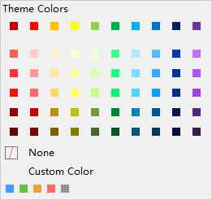
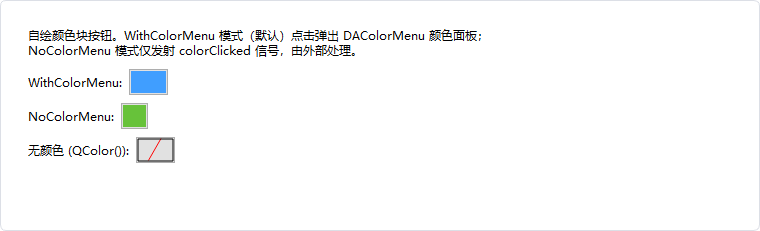

# Color Menu & Picker

`DAColorMenu` provides a color selection menu (theme palette + custom colors + None), and `DAColorPickerButton` is a self-drawing color picker button.

## DAColorMenu



The open menu shows the theme palette on top, followed by `None`, `Custom Color`, and the recent custom color row. Choosing a color closes the menu and emits `selectedColor`; `Custom Color` opens `QColorDialog`.

### Key Features

- ✅ **Complete menu structure**: Title → theme palette → "None" action → "Custom Color" action → custom color grid
- ✅ **None color**: `enableNoneColorAction` controls the None option
- ✅ **Custom color management**: Up to 10 custom colors, FIFO eviction
- ✅ **Opacity** (optional): In-menu alpha slider with checkerboard preview, off by default
- ✅ **Recent colors** (optional): Latest 5, deduplicated, newest first, arrow-key reachable, off by default
- ✅ **Restore default** (optional): `setDefaultColor()` inserts an action, absent by default
- ✅ **Exposed sub-controls**: `colorPaletteGridWidget()`, `customColorsWidget()` can be accessed directly

### Usage

```cpp
#include "DAColorMenu.h"

auto *menu = new DA::DAColorMenu(parent);

// Enable the None color option
menu->enableNoneColorAction(true);

// Listen for color selection
QObject::connect(menu, &DA::DAColorMenu::selectedColor,
    [](const QColor& color) {
        if (color.isValid()) {
            qDebug() << "Selected color:" << color.name();
        } else {
            qDebug() << "Selected None";
        }
    });

// Show the menu
menu->exec(QCursor::pos());
```

### Opacity (alpha)

```cpp
menu->setAlphaEnabled(true);   // default false: no slider, selected colors stay bit-identical
menu->setAlpha(200);           // 0–255, kept in sync with the slider and alpha()
QObject::connect(menu, &DA::DAColorMenu::alphaChanged,
    [](int a) { qDebug() << "alpha" << a; });
```

- When enabled, an "Opacity" row appears at the end of the menu: slider (0–255), percentage and a checkerboard preview. Picking any color writes the current alpha into it.
- `alphaChanged` fires only when the value changes (during drag or via `setAlpha()`); it is not the "done" signal — `selectedColor` remains the only confirmation.
- The slider is an independent entry point and does not rely on `QColorDialog`'s alpha channel (native dialogs on some platforms hide it); an alpha returned by the dialog is written back to the slider.
- With the switch off, `selectedColor` carries exactly the same color as before (no forced 255, no alpha rewrite).

### Recent Colors & Keyboard Navigation

```cpp
menu->setRecentColors({ QColor(64,158,255), QColor(103,194,58),
                        QColor(245,108,108), QColor(230,162,60) });
// Subsequent picks: newest first, deduplicated, at most 5
```

- Calling `setRecentColors()` switches the old "10-entry FIFO custom colors" to "latest 5, newest first, deduplicated"; without the call the old behavior is unchanged.
- Swatches are keyboard-reachable: arrow keys move inside the current grid (±1 / ±columns, stopping at edges), `Enter` picks, `Space` is handled by `QToolButton`. Up/down does not cross between the main-color row and the shade rows.
- Swatch icons support a checkerboard background (`DAColorGridWidget::setAlphaBackgroundEnabled(true)`) so translucent colors look transparent; the recent-color grid enables it automatically.

### Restoring the Default Color

```cpp
menu->setDefaultColor(QColor("#409EFF"));  // brand color
menu->setDefaultColor(QColor());           // invalid color = remove the entry
```

- Once set, a `Restore Default` action is inserted; clicking it emits that color with **alpha 255** and does not add anything to the recent-color list.
- Without the call, the menu's action count and order are identical to before.

## DAColorPickerButton



Three states are shown: a blue swatch with a menu, a green swatch without a menu, and an invalid `QColor()` rendered as a red slash. The first two differ only in click behavior; the invalid state uses the same "none color" painting as `paintNoneColor()`.

### Key Features

- ✅ **Self-drawing color block**: Draws the current color on the button
- ✅ **Invalid color display**: An invalid color (`QColor()`) shows a red slash
- ✅ **Two modes**: `WithColorMenu` (built-in color menu) / `NoColorMenu` (display only)
- ✅ **Static method**: `paintNoneColor()` can be used by other widgets to draw a None color block

### Usage

```cpp
#include "DAColorPickerButton.h"

// Method 1: With built-in color menu
auto *btn = new DA::DAColorPickerButton(parent);
btn->setColorToolButtonStyle(DA::DAColorPickerButton::ColorToolButtonStyle::WithColorMenu);
btn->setColor(Qt::red);

// Listen for color changes
QObject::connect(btn, &DA::DAColorPickerButton::colorChanged,
    [](const QColor& color) {
        qDebug() << "Color changed:" << color.name();
    });

// Method 2: Display only (no menu popup)
auto *display = new DA::DAColorPickerButton(parent);
display->setColorToolButtonStyle(DA::DAColorPickerButton::ColorToolButtonStyle::NoColorMenu);
display->setColor(Qt::blue);
```

### Custom Color Menu

```cpp
auto *btn = new DA::DAColorPickerButton(parent);

// Get or create the color menu
DA::DAColorMenu *menu = btn->colorMenu();
if (!menu) {
    menu = btn->createColorMenu();
}

// Customize the theme palette
menu->colorPaletteGridWidget()->setColorList({
    QColor("#FF6B6B"), QColor("#4ECDC4"), QColor("#45B7D1"),
    QColor("#FFA07A"), QColor("#98D8C8"), QColor("#F7DC6F")
});
```

!!! tip "Custom Color FIFO"
    When the user picks a custom color, it is added to the custom color grid. The grid holds at most 10 entries — when full, the oldest entry is evicted (FIFO). This mirrors the behavior of Office color pickers.

## Core Properties & Methods

### DAColorMenu

| Method | Description |
|--------|-------------|
| `enableNoneColorAction(bool)` | Enable/disable the None option |
| `setAlphaEnabled(bool)` / `isAlphaEnabled()` | Opacity row switch (default off) |
| `alpha()` / `setAlpha(int)` | Current alpha (0–255) |
| `alphaChanged(int)` | Alpha-changed signal (fires during dragging) |
| `setRecentColors(QList<QColor>)` / `recentColors()` | Enable recent-color strategy (newest first, deduplicated, max 5) |
| `setDefaultColor(QColor)` / `defaultColor()` | Set/remove the restore-default entry |
| `colorPaletteGridWidget()` | Get the theme palette widget |
| `customColorsWidget()` | Get the custom color grid widget |

### DAColorPickerButton

| Method | Description |
|--------|-------------|
| `color()` / `setColor(QColor)` | Get/set the color |
| `setColorToolButtonStyle(Style)` | Set the button mode |
| `colorMenu()` | Get the color menu (may be null) |
| `createColorMenu()` | Create a color menu |
| `margins` | Color block margins |
| `paintNoneColor(QPainter, rect)` | Static method — paint a None color block |

## References

- [Color Grid & Palette](color-grid.md)
- [Pen Style Editor](pen-edit.md)
