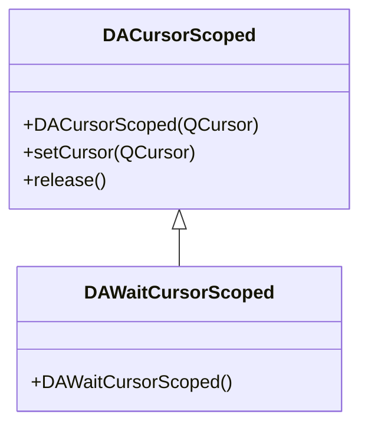

# Cursor Guard Classes

`DACursorScoped` and `DAWaitCursorScoped` are RAII-style cursor management classes that ensure automatic cursor restoration at scope exit, even if an exception is thrown.

## Key Features

- ✅ **RAII guard**: Automatically restores the cursor when the scope ends
- ✅ **Exception safe**: Correctly restores even if an exception is thrown mid-operation
- ✅ **Convenience macro**: `DA_WAIT_CURSOR_SCOPED()` enables the wait cursor in one line
- ✅ **Custom cursor**: `DACursorScoped` supports any `QCursor`

## Class Relationships



## Usage

### 1. Wait Cursor (Most Common)

Use the macro to display a wait cursor during a long-running operation:

```cpp
#include "DAWaitCursorScoped.h"

void MyWidget::doHeavyWork()
{
    DA_WAIT_CURSOR_SCOPED();  // Enter wait cursor scope

    // Long-running operations...
    performCalculation();
    loadData();

    // The cursor is automatically restored when the function returns,
    // even if an exception is thrown.
}
```

### 2. Custom Cursor

```cpp
#include "DACursorScoped.h"

void MyWidget::doWork()
{
    // Use a custom cursor
    DA::DACursorScoped guard(Qt::PointingHandCursor);

    // ... operations ...

    // Automatically restored at scope end
}
```

### 3. Manual Release

```cpp
DA::DAWaitCursorScoped guard;

// First half of operations...

guard.release();  // Manually release — restore cursor early

// Second half of operations (cursor already restored)
```

!!! info "RAII Guarantee"
    The destructor of `DACursorScoped` restores the previous cursor. If you call `release()` before the destructor runs, the destructor becomes a no-op, giving you manual control over when restoration happens.

## Core Properties & Methods

### DACursorScoped

| Method | Description |
|--------|-------------|
| `DACursorScoped(QCursor)` | Sets the cursor on construction |
| `setCursor(QCursor)` | Change the cursor |
| `release()` | Manually release — restore cursor early |

### DAWaitCursorScoped

| Method / Macro | Description |
|-----------------|-------------|
| `DAWaitCursorScoped()` | Constructs with `Qt::WaitCursor` |
| `DA_WAIT_CURSOR_SCOPED()` | Convenience macro — creates an anonymous instance |

## References

- Header files: `src/DACursorScoped.h`, `src/DAWaitCursorScoped.h`
