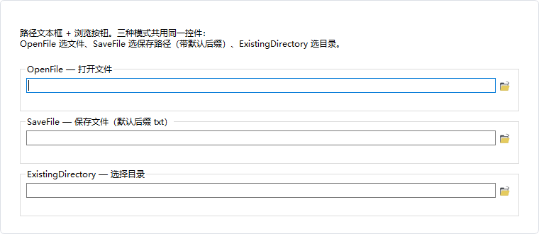

# File Path Editor

`DAFilePathEditWidget` provides a file path selection control, consisting of a LineEdit + a browse button, with support for file name filters.

## Preview



All three modes share one widget: `OpenFile` picks an existing file, `SaveFile` saves with a default suffix, and `ExistingDirectory` picks a directory. The button icon follows the mode, and the chosen path is returned through `selectedPath`.

## Key Features

- ✅ **Path input**: Type a path directly in the LineEdit
- ✅ **File selection**: Click the button to open a file dialog
- ✅ **Filters**: Supports setting file name filters
- ✅ **Drag & drop** (optional): drop a file/folder to fill the path, off by default
- ✅ **Validation state** (optional): validate on focus-out/browse/`validateNow()` and show a tick/cross, off by default
- ✅ **Recent paths** (optional): a 5-entry dropdown, off by default
- ✅ **Signal notification**: `selectedPath(QString)`

## Usage

### 1. Basic Usage

```cpp
#include "DAFilePathEditWidget.h"

auto *fileEdit = new DA::DAFilePathEditWidget(parent);

// Set file name filters
fileEdit->setNameFilters({
    "Text files (*.txt)",
    "Image files (*.png *.jpg *.bmp)",
    "All files (*.*)"
});

// Listen for path selection
QObject::connect(fileEdit, &DA::DAFilePathEditWidget::selectedPath,
    [](const QString& path) {
        qDebug() << "Selected file:" << path;
    });
```

### 2. Getting / Setting the Path

```cpp
// Set the current path
fileEdit->setFilePath("/home/user/document.txt");

// Get the current path
QString path = fileEdit->getFilePath();
```

!!! tip "Filter Format"
    Filters follow the Qt convention: `"Description (*.ext1 *.ext2)"`. Multiple filters can be set via `setNameFilters(QStringList)`.

### 3. Drag & Drop

```cpp
fileEdit->setDropEnabled(true);   // default false
```

- Dragging over the widget highlights the hint row (dynamic property `dragActive`). On drop, the **first local URL** fills the line edit and goes through the same finish path as the browse dialog: validate first when enabled, then emit `selectedPath`.
- Remote URLs (`http(s)://` etc.) are ignored; the line edit's existing text-drop behavior is untouched (the event filter only takes over `hasUrls()`).
- The hint row is 54px high, so place the widget in a `QVBoxLayout`; when drop is off the hint is hidden and the size matches the old widget.

### 4. Path Validation State

```cpp
fileEdit->setValidationEnabled(true);   // default false

// Validate now and get a synchronous answer (often used to enable an OK button)
bool ok = fileEdit->validateNow();

QObject::connect(fileEdit, &DA::DAFilePathEditWidget::validationChanged,
    [](bool valid) { /* the same result is emitted only once */ });
```

- Rules per mode: `OpenFile` requires an existing regular file; `ExistingDirectory` requires an existing directory; `SaveFile` **allows a missing file** and only requires the parent directory to exist and be writable (an existing target must not be a directory).
- Valid shows a green tick + `Path exists`; invalid shows a red cross + `Path not found`, and sets the dynamic property `invalid` on both the line edit and the status row. Styling stays with the caller:

  ```cpp
  fileEdit->setStyleSheet(
      "QLineEdit[invalid=\"true\"] { border: 1px solid #F56C6C; }");
  ```

- Empty path: hides the status row, returns `false`, emits no `validationChanged`.
- Validation runs on focus-out (`editingFinished`), after the browse dialog returns, and on `validateNow()`. Enabling it adds one status row, so size the container accordingly.

### 5. Recent Paths

```cpp
fileEdit->setRecentPaths({
    "D:/work/export.csv",   // most recent → oldest
    "D:/work/import.csv",
    "C:/Users/me/Documents"
});

QObject::connect(fileEdit, &DA::DAFilePathEditWidget::recentPathActivated,
    [](const QString& path) { qDebug() << "Recent path:" << path; });
```

- Input order is "most recent → oldest"; entries are deduplicated (case-sensitive) and truncated to 5. A non-empty list shows the dropdown button on the right; an empty list hides it.
- Activating an entry fills the path (validating too when enabled) and emits `recentPathActivated` then `selectedPath`.
- The widget **never** appends new picks automatically; persistence and when to update the list are the caller's responsibility.

## Core Properties & Methods

| Method | Description |
|--------|-------------|
| `setFilePath(QString)` | Set the file path |
| `getFilePath()` | Get the file path |
| `setNameFilter(QString)` | Set a single file name filter |
| `setNameFilters(QStringList)` | Set multiple file name filters |
| `setDropEnabled(bool)` / `isDropEnabled()` | File/folder drag & drop (default off) |
| `setValidationEnabled(bool)` / `isValidationEnabled()` | Path validation and status row (default off) |
| `validateNow()` | Validate now and return whether the path is usable |
| `validationChanged(bool)` | Validation-result-changed signal |
| `setRecentPaths(QStringList)` / `recentPaths()` | Recent paths (newest first, deduplicated, max 5) |
| `recentPathActivated(QString)` | A recent path was activated |

## References

- [DAPropertyItemWidget](property-item.md)
