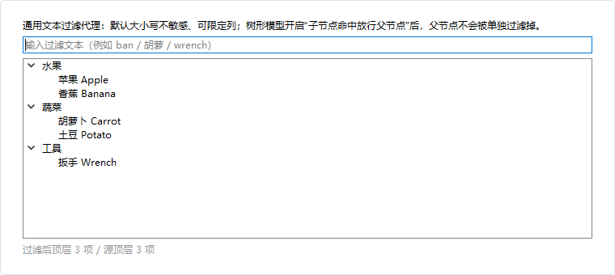

# DAStringFilterProxyModel

`DAStringFilterProxyModel` is a general text-filtering proxy for lists and trees: it matches `Qt::DisplayRole` (or a custom role), is case-insensitive by default, can be restricted to a column, and — for tree models — can keep the parents of matching children visible.

## Preview



The tree has three groups. Typing a filter (for example `ban`, `胡萝`, or `wrench`) keeps only matching leaves and their parent chain; clearing the input restores everything. The demo shows the filtered top-level count versus the source count below.

## Key Features

- ✅ **Display-text filtering**: `Qt::DisplayRole` by default; change it with `setFilterRole()`
- ✅ **Case policy**: `setFilterCaseSensitivity()`, insensitive by default
- ✅ **Single/all columns**: `setFilterColumn(-1)` matches all columns
- ✅ **Parent pass-through**: `setIncludeParentsOfMatches(true)` keeps parents of matching children
- ✅ **Reusable matching**: static `matchesText()` shares the exact semantics with views that cannot use a proxy

## Usage

```cpp
#include "DAStringFilterProxyModel.h"
#include <QStandardItemModel>
#include <QTreeView>

auto *model = new QStandardItemModel(parent);
auto *fruit = new QStandardItem("Fruit");
fruit->appendRow(new QStandardItem("Apple"));
fruit->appendRow(new QStandardItem("Banana"));
model->appendRow(fruit);

auto *proxy = new DA::DAStringFilterProxyModel(parent);
proxy->setSourceModel(model);
proxy->setIncludeParentsOfMatches(true);   // required for trees
proxy->setFilterCaseSensitivity(Qt::CaseInsensitive);

auto *view = new QTreeView(parent);
view->setModel(proxy);
view->setHeaderHidden(true);
view->expandAll();

// Update the filter text as the user types
QObject::connect(searchEdit, &QLineEdit::textChanged,
                 proxy, &DA::DAStringFilterProxyModel::setFilterText);
```

!!! warning "Enable includeParentsOfMatches for trees"
    The proxy checks each row on its own by default. If a parent's text does not contain the filter term, the parent is hidden and its children become unreachable. For tree data, set `setIncludeParentsOfMatches(true)`.

## Core Methods

| Method | Description |
|--------|-------------|
| `setFilterText(QString)` / `filterText()` | Filter text (empty = no filtering) |
| `setFilterCaseSensitivity(Qt::CaseSensitivity)` | Case policy |
| `setFilterColumn(int)` | Column to match (`-1` = all columns) |
| `setFilterRole(int)` | Data role to match (default `Qt::DisplayRole`) |
| `setIncludeParentsOfMatches(bool)` | Keep parents of matching children |
| `matchesText(text, filter, cs)` | Static matcher with identical semantics |

## References

- [DACheckListWidget](item-selection.md)
- Example path: `examples/all_widgets_demo` (Filter tab)
