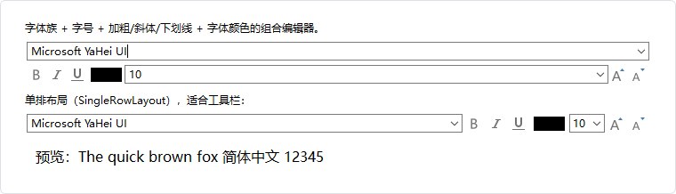

# Font Edit Panel

`DAFontEditPannelWidget` provides a complete font editing panel, including font selection, font size, bold/italic/underline toggles, and font color.

## Preview



The upper part is the default two-row layout (family/size on one row, bold/italic/underline plus color on the next); the lower part uses `SingleRowLayout`, which fits height-constrained toolbars. The bottom line is a live preview using the selected font and color.

## Key Features

- ✅ **Font selection**: QFontComboBox
- ✅ **Font size**: QSpinBox
- ✅ **Style toggles**: Bold, italic, underline
- ✅ **Font color**: DAColorPickerButton integration
- ✅ **Per-item preview** (optional): dropdown rows render in the current size/style, off by default
- ✅ **Recent fonts** (optional): a host-injected 5-entry entry point, absent by default
- ✅ **Signal notification**: `currentFontChanged`, `currentFontColorChanged`

## Usage

### 1. Basic Usage

```cpp
#include "DAFontEditPannelWidget.h"

auto *fontPanel = new DA::DAFontEditPannelWidget(parent);

// Set the current font
QFont font("Microsoft YaHei", 12);
font.setBold(true);
fontPanel->setCurrentFont(font);

// Set the font color
fontPanel->setCurrentFontColor(Qt::red);

// Get the current font
QFont currentFont = fontPanel->getCurrentFont();
```

### 2. Signal Handling

```cpp
// Font changed
QObject::connect(fontPanel, &DA::DAFontEditPannelWidget::currentFontChanged,
    [](const QFont& font) {
        qDebug() << "Font:" << font.family() << font.pointSize();
    });

// Font color changed
QObject::connect(fontPanel, &DA::DAFontEditPannelWidget::currentFontColorChanged,
    [](const QColor& color) {
        qDebug() << "Font color:" << color.name();
    });
```

### 3. Font Weight

```cpp
// Set the font weight (Qt6 QFont::Weight enum)
fontPanel->setFontWeight(QFont::DemiBold);
```

!!! warning "Qt5/Qt6 Weight Enum"
    `QFont::Weight` was redefined between Qt5 and Qt6. In Qt5, the enum uses `QFont::Light`, `QFont::Normal`, `QFont::DemiBold`, `QFont::Bold`, `QFont::Black`. In Qt6, weight is an integer (0–1000) with named constants like `QFont::Medium`. DAWidgets handles this difference internally — always use the `setFontWeight()` API rather than directly manipulating the QFont.

## Font Preview and Recent Families


### 1. Enabling Per-item Preview

```cpp
fontPanel->setFontPreviewEnabled(true);   // default false
```

- Each row of the font dropdown is rendered with "its own family + the panel's current size (clamped to 9–20pt) / bold / italic / underline".
- **Only the popup list is affected**: the collapsed text, `sizeHint()`, `minimumSizeHint()` and toolbar height stay the same. When turned off, the delegate is restored to Qt's native font delegate, pixel-identical to the default.
- Row height grows with the font size but is clamped to twice the base row height, so a 48pt row cannot push the popup off screen.
- Families that are not installed (a host history may point at an uninstalled font) fall back to the panel font instead of rendering a row of boxes.

### 2. Recent Fonts

```cpp
fontPanel->setMaxRecentFontCount(5);   // 1–20, default 5

// Input is "most recent → oldest"; duplicates are removed and the list is capped
fontPanel->setRecentFontFamilies({
    "Microsoft YaHei", "Arial", "Times New Roman"
});

// The library never records automatically: the host maintains the list and feeds it back
QObject::connect(fontPanel, &DA::DAFontEditPannelWidget::currentFontChanged,
    [fontPanel](const QFont& f) {
        QStringList recent = fontPanel->recentFontFamilies();
        recent.removeAll(f.family());
        recent.prepend(f.family());
        while (recent.size() > fontPanel->maxRecentFontCount())
            recent.removeLast();
        fontPanel->setRecentFontFamilies(recent);
    });
```

- A non-empty list shows the clock button next to the font dropdown; menu rows render in their own family, and choosing one changes only the family — the current point size is preserved.
- An empty list hides the button and leaves `sizeHint()` as if the feature did not exist.
- The library does **not** append automatically and never writes `QSettings`; persistence and timing are entirely the host's responsibility.

## Core Properties & Methods

| Method | Description |
|--------|-------------|
| `getCurrentFont()` / `setCurrentFont(QFont)` | Get/set the font |
| `getCurrentFontColor()` / `setCurrentFontColor(QColor)` | Get/set the font color |
| `getFontWeight()` / `setFontWeight(QFont::Weight)` | Get/set the font weight |
| `setFontPreviewEnabled(bool)` / `isFontPreviewEnabled()` | Per-item dropdown preview (default off) |
| `setMaxRecentFontCount(int)` / `maxRecentFontCount()` | Recent-font cap (default 5, 1–20) |
| `setRecentFontFamilies(QStringList)` / `recentFontFamilies()` | Recent families (newest first, deduplicated, capped) |

## References

- [Color Menu & Picker](color-menu.md)
- [Shape Edit Panel](shape-edit.md)
