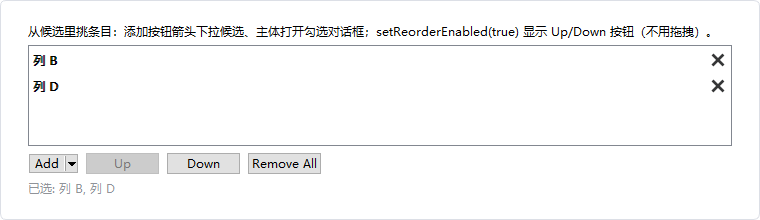
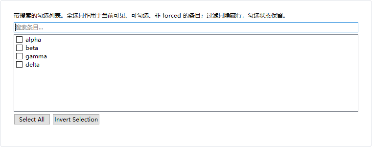
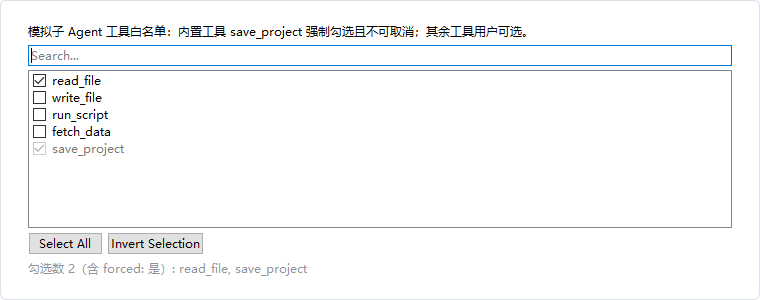
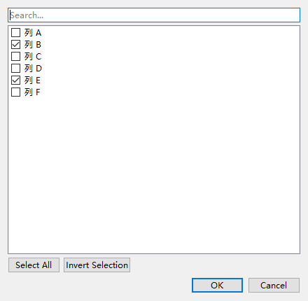
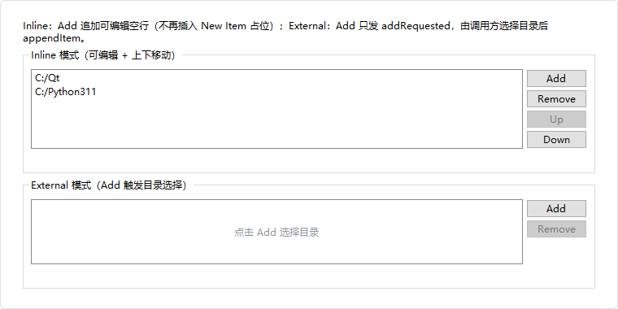
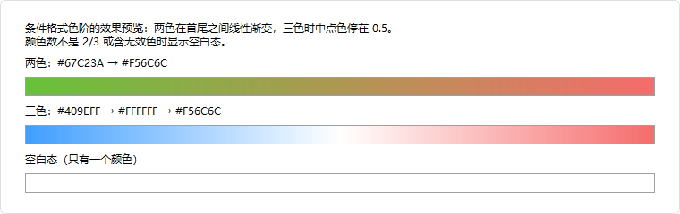

# Item Selection & Preview

This family targets "pick a few entries from a candidate set" and "preview an entry style": a checkable list, an item-pick dialog, a selected-item list editor, a plain string-list editor, and a color-scale preview bar. They only understand `DAItemEntry` (display text + identifying data) or plain strings, so they carry no business semantics and fit column pickers, field pickers, module paths, tool allow-lists, and similar scenarios.

## Preview



The most common combination: selected entries are listed with an inline remove button, the `Add` arrow opens a candidate menu while the body opens the pick dialog, and `Up/Down` buttons reorder rows without drag and drop.

## DAItemEntry

`DAItemEntry` is the shared data structure for all item-selection widgets:

```cpp
struct DAItemEntry
{
    QString text;    // display text
    QVariant data;   // identifying data; falls back to text equality when invalid
};
```

When candidates may have duplicate names (for example duplicate column headers), put the real identity (column index, field name, ...) in `data` to avoid ambiguity.

## DACheckListWidget



A checkable list with a search box. Filtering only hides rows and never changes check state; `Select All` touches only currently visible, checkable, non-forced entries.

```cpp
#include "DACheckListWidget.h"

auto *check = new DA::DACheckListWidget(parent);
check->setItems({ { "alpha", QVariant() }, { "beta", QVariant() } });
check->setSearchPlaceholderText("Search entries...");
check->setSelectAllVisible(true);
check->setInvertVisible(true);

QObject::connect(check, &DA::DACheckListWidget::checkedEntriesChanged, [check]() {
    qDebug() << "checked:" << check->checkedCount();
});
```

### Forced and disabled entries



A sub-agent tool allow-list is a typical example: the built-in `save_project` tool must always stay enabled, so `setEntryForcedChecked()` forces it on and `setEntryEnabled(false)` grays it out; the user cannot uncheck it.

```cpp
const DA::DAItemEntry forced { "save_project", QVariant() };
check->setEntryForcedChecked(forced, true);
check->setEntryEnabled(forced, false);
```

### Core methods

| Method | Description |
|--------|-------------|
| `setItems(QVector<DAItemEntry>)` | Set candidates (no signal) |
| `checkedEntries()` | Checked entries (including filtered-out, disabled, and forced) |
| `setEntryForcedChecked(e, bool)` | Force checked; the user cannot uncheck it |
| `setEntryEnabled(e, bool)` | Entry availability |
| `setEntryCheckable(e, bool)` | Whether the entry shows a checkbox |
| `setSearchVisible(bool)` / `setSelectAllVisible(bool)` / `setInvertVisible(bool)` | Toggle search and action buttons |

## DAItemListPickDialog



`DAItemListPickDialog` is the dialog shell around `DACheckListWidget`, suitable for "check a batch of entries, then confirm":

```cpp
#include "DAItemListPickDialog.h"

DA::DAItemListPickDialog dialog(parent);
dialog.setItems({ { "Column A", QVariant() }, { "Column B", QVariant() }, { "Column C", QVariant() } });
dialog.setCheckedEntries({ { "Column B", QVariant() } });
if (dialog.exec() == QDialog::Accepted) {
    const auto picked = dialog.checkedEntries();
    // ...
}
```

It ships with `Select All` / `Invert Selection` and `OK` / `Cancel`; filtering never loses check state.

## DAItemListEditWidget


The "selected items" editor: every row has an inline remove button, the `Add` arrow opens a candidate menu while the body opens `DAItemListPickDialog`, and `Remove All` asks for confirmation with a `QMessageBox` by default. `setReorderEnabled(true)` shows `Up/Down` buttons; `setDragReorderEnabled(true)` adds handle drag-and-drop, and both can be on at the same time.

```cpp
#include "DAItemListEditWidget.h"

auto *edit = new DA::DAItemListEditWidget(parent);
edit->setAvailableItems({ { "Column A", QVariant() }, { "Column B", QVariant() } });
edit->setSelectedItems({ { "Column B", QVariant() } });
edit->setReorderEnabled(true);

QObject::connect(edit, &DA::DAItemListEditWidget::selectedItemsChanged,
                 [edit]() { qDebug() << edit->selectedItems().size(); });
```

### Drag reordering and filtering

```cpp
edit->setDragReorderEnabled(true);   // 6-dot handle per row (default off)
edit->setFilterVisible(true);        // top filter box, hides rows only (default off)
edit->setEmptyText("No matching items");

// Two-click "Remove All": the first click only changes the label
edit->setConfirmClearEnabled(true);
edit->setConfirmClearInterval(2500);
edit->setConfirmClearText("Click again to clear");

QObject::connect(edit, &DA::DAItemListEditWidget::orderChanged,
                 [](const QVector<DA::DAItemEntry>& items) {
                     // Order changed (both Up/Down and drag); add/remove still emits selectedItemsChanged
                 });
```

- All three switches are off by default; without them the layout and behavior are unchanged (`Remove All` still shows the confirmation dialog).
- Dragging only passes the source row number and reuses the same move logic, so row widgets and `DAItemEntry::data` survive; dropping back at the same position emits nothing.
- Filtering matches like `DACheckListWidget`: trimmed, case-insensitive substring; it only hides rows, and `selectedItems()` always returns everything.
- With no entries, or when filtering hides everything, `emptyText` is shown and the list is hidden (the empty state is not a placeholder item).
- `orderChanged` only means reordering; the first clear click only changes the label and reverts after the timeout. `setSelectedItems()` also disarms it.

### Core methods

| Method | Description |
|--------|-------------|
| `setAvailableItems(QVector<DAItemEntry>)` | Candidate source for the add menu/dialog |
| `setSelectedItems(QVector<DAItemEntry>)` | Replace selection (no signal) |
| `selectedItems()` | Get selected entries in list order |
| `setReorderEnabled(bool)` | Show Up/Down buttons |
| `setDragReorderEnabled(bool)` | Handle drag reordering (default off) |
| `setFilterVisible(bool)` | Show the top filter box (default off) |
| `setEmptyText(QString)` | Empty-state text |
| `setConfirmClearEnabled(bool)` | Two-click clear instead of `QMessageBox` (default off) |
| `setConfirmClearInterval(int)` | Armed-state timeout in milliseconds |
| `orderChanged(QVector<DAItemEntry>)` | Order-changed signal (add/remove still uses `selectedItemsChanged`) |
| `setAddButtonText()` / `setRemoveAllButtonText()` | Override texts for i18n |

## DAStringListEditWidget



A plain `QStringList` editor with two add behaviors:

- `AddMode::Inline`: Add appends an empty editable row and starts editing;
- `AddMode::External`: Add only emits `addRequested()`, and the caller decides what to append (for example open a directory picker, then call `appendItem()`).

```cpp
#include "DAStringListEditWidget.h"

auto *list = new DA::DAStringListEditWidget(parent);
list->setAddMode(DA::DAStringListEditWidget::AddMode::Inline);
list->setReorderEnabled(true);
list->setMaxCount(10);
list->setItems({ "C:/Qt", "C:/Python311" });

QObject::connect(list, &DA::DAStringListEditWidget::itemsChanged,
                 [list]() { qDebug() << list->items(); });
```

### Core methods

| Method | Description |
|--------|-------------|
| `setItems(QStringList)` / `items()` | Replace / get the whole list |
| `appendItem(QString)` | Append one item (used with `addRequested`) |
| `setAddMode(AddMode)` | Inline / External |
| `setReorderEnabled(bool)` / `setRemoveEnabled(bool)` | Show Up/Down and Remove buttons |
| `setEditable(bool)` / `setMaxCount(int)` / `setPlaceholderText(QString)` | Editing, limit, and empty-state text |

## DAColorScalePreviewWidget



A preview bar for conditional-formatting color scales: two colors produce a start-to-end linear gradient, three colors place the middle color at 0.5, and any other count or an invalid color renders the blank state.

```cpp
#include "DAColorScalePreviewWidget.h"

auto *preview = new DA::DAColorScalePreviewWidget(parent);
preview->setColors({ QColor("#67C23A"), QColor("#F56C6C") });          // two colors
preview->setColors({ QColor("#409EFF"), QColor("#FFFFFF"),
                     QColor("#F56C6C") });                             // three colors
```

## References

- [DACollapse](collapse.md)
- [DAPropertyItemWidget](property-item.md)
- Example path: `examples/all_widgets_demo` (Item Selection tab)
