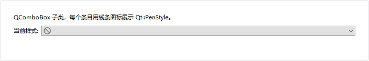
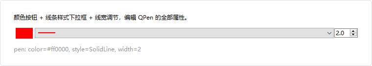

# Pen Style Editor

`DAPenStyleComboBox` is a `Qt::PenStyle` selection combo box, and `DAPenEditWidget` combines color + line style + line width into a complete pen editor.

## DAPenStyleComboBox



Every `Qt::PenStyle` gets a generated line icon; the current item shows both the icon and the style name, and switching emits `currentPenStyleChanged`.

### Key Features

- ✅ **All line styles**: Solid, dash, dot, dash-dot, etc.
- ✅ **Icon preview**: Dropdown items include line style icons
- ✅ **Static utilities**: `penStyleToString()`, `drawPenStyle()`, `generatePenIcon()`

### Usage

```cpp
#include "DAPenStyleComboBox.h"

auto *combo = new DA::DAPenStyleComboBox(parent);

// Set the current line style
combo->setCurrentPenStyle(Qt::DashLine);

// Get the current line style
Qt::PenStyle style = combo->getCurrentPenStyle();

// Listen for changes
QObject::connect(combo, &DA::DAPenStyleComboBox::currentPenStyleChanged,
    [](Qt::PenStyle style) {
        qDebug() << "Line style:" << style;
    });
```

## DAPenEditWidget



A complete pen editor: color picker, icon line style dropdown, and width control on one row. Any change emits `penChanged` with the full `QPen` description echoed below.

### Key Features

- ✅ **Color + line style + line width**: Complete pen property editing
- ✅ **Hideable style text**: `setLineStyleTextVisible(bool)`

### Usage

```cpp
#include "DAPenEditWidget.h"

auto *penEdit = new DA::DAPenEditWidget(parent);

// Set the current pen
QPen pen(Qt::blue, 2, Qt::DashDotLine);
penEdit->setCurrentPen(pen);

// Get the current pen
QPen currentPen = penEdit->getCurrentPen();

// Listen for changes
QObject::connect(penEdit, &DA::DAPenEditWidget::penChanged,
    [](const QPen& pen) {
        qDebug() << "Pen:" << pen.color() << pen.width() << pen.style();
    });
```

!!! info "Icon Color"
    The line style icons in `DAPenStyleComboBox` are drawn using the pen color set via `setPenColor()` and the line width set via `setPenLineWidth()`. This ensures the preview visually matches the actual pen.

## Core Properties & Methods

### DAPenStyleComboBox

| Method | Description |
|--------|-------------|
| `getCurrentPenStyle()` | Get the current line style |
| `setCurrentPenStyle(Qt::PenStyle)` | Set the line style |
| `setPen(QPen)` | Set line style and color from a QPen |
| `setPenColor(QColor)` | Set the icon color |
| `setPenLineWidth(int)` | Set the icon line width |
| `setStyleTextVisible(bool)` | Whether to show the style text |

### DAPenEditWidget

| Method | Description |
|--------|-------------|
| `getCurrentPen()` | Get the current pen |
| `setCurrentPen(QPen)` | Set the pen |
| `setLineStyleTextVisible(bool)` | Line style combo box text visibility |

## References

- [Brush Style Editor](brush-edit.md)
- [Color Menu & Picker](color-menu.md)
