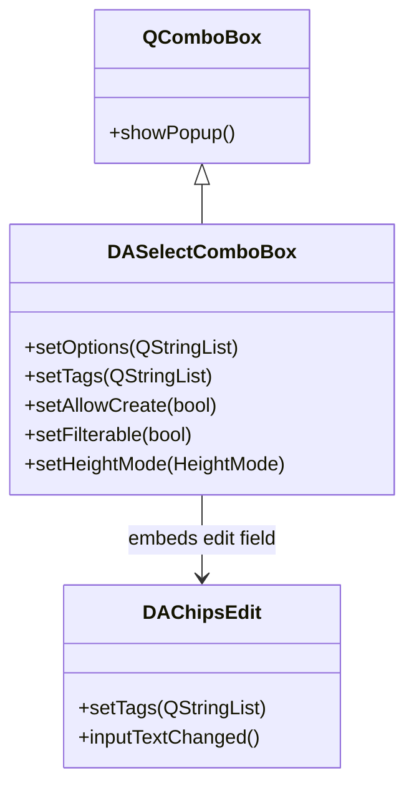

# DASelectComboBox

`DASelectComboBox` is a multi-tag dropdown selector that mirrors Element UI's `el-select` (`multiple + filterable + allow-create`). It inherits `QComboBox`, retaining the native arrow, border, and keyboard mnemonics, while replacing the edit field with `DAChipsEdit`.

## Key Features

- ✅ **Multi-tag selection**: Selected items are displayed as chips in the edit field
- ✅ **Filterable**: Type text to filter the candidate list (enabled by default)
- ✅ **Allow-create**: Can create new tags outside the candidate list
- ✅ **Default first option**: Automatically highlights the first matching item during filtering
- ✅ **Two height modes**: Grow with tags / fixed height with scrolling
- ✅ **QComboBox compatible**: Retains native arrow, border, and keyboard interaction

## Class Relationships



## Usage

The corresponding example is located at: `examples/selectcombobox_demo`.

### 1. Basic Usage

Create a multi-select dropdown, set the candidate list, and allow creating new tags:

```cpp
#include "DASelectComboBox.h"

auto *combo = new DA::DASelectComboBox(parent);

// Set candidate options
combo->setOptions({ "Apple", "Banana", "Orange", "Grape", "Watermelon" });

// Allow creating tags outside the list
combo->setAllowCreate(true);

// Set placeholder text
combo->setPlaceholder("Select or type a fruit...");

// Pre-select tags
combo->setTags({ "Apple", "Banana" });
```

### 2. Height Modes

`DASelectComboBox` provides two height modes to control behavior as tags increase:

```cpp
using namespace DA;

// Mode 1: Grow with tags (default)
// The control height increases as tags are added
combo->setHeightMode(DASelectComboBox::HeightMode::GrowWithTags);

// Mode 2: Fixed height with scrolling
// The control height stays fixed; the tag area scrolls
combo->setHeightMode(DASelectComboBox::HeightMode::FixedHeightScrollable);
combo->setFixedRowCount(3);  // Show exactly 3 rows
```

| Mode | Description | Use Case |
|------|-------------|----------|
| `GrowWithTags` | Control grows taller as tags increase | Few tags, layout allows growth |
| `FixedHeightScrollable` | Fixed height, tag area scrolls | Many tags possible, limited space |

### 3. Signal Handling

```cpp
// Tag list changed
QObject::connect(combo, &DA::DASelectComboBox::tagsChanged,
    [](const QStringList& tags) {
        qDebug() << "Current tags:" << tags;
    });

// User selected a candidate option
QObject::connect(combo, &DA::DASelectComboBox::optionSelected,
    [](const QString& option) {
        qDebug() << "Selected:" << option;
    });

// User created a new tag
QObject::connect(combo, &DA::DASelectComboBox::created,
    [](const QString& text) {
        qDebug() << "Created new tag:" << text;
    });
```

### 4. qss Styling

```css
DA--DASelectComboBox {
    border: 1px solid #dcdfe6;
    border-radius: 4px;
    padding: 2px 8px;
}
DA--DASelectComboBox::drop-down {
    width: 20px;
    border-left: 1px solid #dcdfe6;
}
/* Popup list item style */
QListView#DASelectComboBoxPopup {
    border: 1px solid #e4e7ed;
}
```

!!! warning "qss Pitfall"
    Styling `QComboBox::drop-down` via qss without providing a `::down-arrow` `image` will suppress the native arrow entirely. DAWidgets solves this by embedding a PNG arrow.

## Core Properties & Methods

### Q_PROPERTY

| Property | Type | Description |
|----------|------|-------------|
| `options` | `QStringList` | Candidate option list |
| `tags` | `QStringList` | Selected tag list |
| `allowCreate` | `bool` | Whether creating tags outside the list is allowed |
| `filterable` | `bool` | Whether input filtering is enabled |
| `placeholder` | `QString` | Placeholder text |
| `heightMode` | `HeightMode` | Height mode |
| `fixedRowCount` | `int` | Number of visible rows in fixed-height mode |

### Core Methods

| Method | Description |
|--------|-------------|
| `setOptions(QStringList)` | Set the candidate option list |
| `tags()` / `setTags(QStringList)` | Get/set selected tags |
| `setAllowCreate(bool)` | Enable/disable tag creation |
| `setFilterable(bool)` | Enable/disable filtering |
| `setHeightMode(HeightMode)` | Switch height mode |
| `clear()` | Clear all tags |

## References

- [DAChipsEdit](chips-edit.md)
- [DAChip](chip.md)
- Example path: `examples/selectcombobox_demo`
