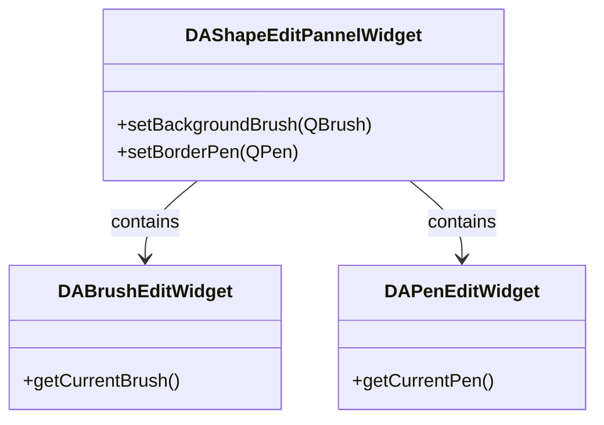

# Shape Edit Panel

`DAShapeEditPannelWidget` combines a brush editor and a pen editor to provide complete shape style editing (background brush + border pen).

## Key Features

- ✅ **Background brush**: Integrates `DABrushEditWidget`
- ✅ **Border pen**: Integrates `DAPenEditWidget`
- ✅ **Independent signals**: Brush and pen each have their own change signals

## Usage

```cpp
#include "DAShapeEditPannelWidget.h"

auto *shapePanel = new DA::DAShapeEditPannelWidget(parent);

// Set the background brush
QBrush brush(QColor("#4ECDC4"), Qt::SolidPattern);
shapePanel->setBackgroundBrush(brush);

// Set the border pen
QPen pen(Qt::darkCyan, 2, Qt::SolidLine);
shapePanel->setBorderPen(pen);

// Get current values
QBrush currentBrush = shapePanel->getBackgroundBrush();
QPen currentPen = shapePanel->getBorderPen();
```

### Signal Handling

```cpp
// Brush changed
QObject::connect(shapePanel, &DA::DAShapeEditPannelWidget::backgroundBrushChanged,
    [](const QBrush& brush) {
        qDebug() << "Background brush:" << brush.color().name();
    });

// Pen changed
QObject::connect(shapePanel, &DA::DAShapeEditPannelWidget::borderPenChanged,
    [](const QPen& pen) {
        qDebug() << "Border pen:" << pen.color().name() << pen.width();
    });
```

## Class Relationships



!!! tip "Composition Pattern"
    `DAShapeEditPannelWidget` is a thin composition wrapper — it does not duplicate brush/pen editing logic but simply hosts the two sub-widgets and forwards their signals. This keeps the API surface small while providing full editing capability.

## Core Properties & Methods

| Method | Description |
|--------|-------------|
| `getBackgroundBrush()` / `setBackgroundBrush(QBrush)` | Get/set the background brush |
| `getBorderPen()` / `setBorderPen(QPen)` | Get/set the border pen |

## References

- [Pen Style Editor](pen-edit.md)
- [Brush Style Editor](brush-edit.md)
- [Font Edit Panel](font-edit.md)
