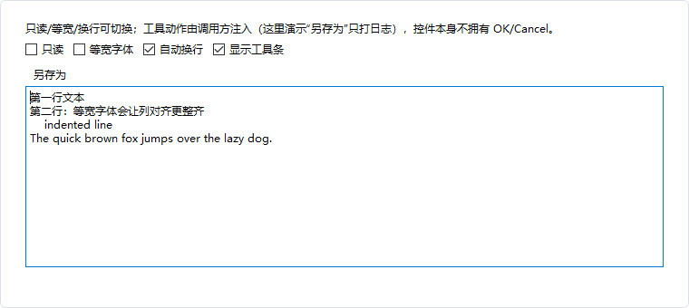

# DATextEditWidget

`DATextEditWidget` is a general-purpose text viewer/editor: it can toggle read-only, monospace, and line wrap, while toolbar actions are injected by the caller. It does not own `OK` / `Cancel`; wrap it in a `QDialog` when modal interaction is needed.

## Preview



The toolbar in the screenshot contains only the "Save As" action injected by the demo; the widget only displays it and forwards `triggered`. The four checkboxes below toggle read-only, monospace, line wrap, and toolbar visibility. Monospace keeps columns aligned, which suits logs and config snippets.

## Key Features

- ✅ **Read-only / editable toggle**: `setReadOnly()`
- ✅ **Monospace**: `setMonospace()`, ideal for logs and code
- ✅ **Line wrap**: `setLineWrapEnabled()`
- ✅ **Injectable tool actions**: `addToolAction(QAction*)`; the caller owns their lifetime
- ✅ **No business logic**: no built-in save/close behavior, easy to reuse in dialogs or dock panels

## Usage

```cpp
#include "DATextEditWidget.h"

auto *view = new DA::DATextEditWidget(parent);
view->setText("First line\nSecond line");
view->setPlaceholderText("Type text...");
view->setMonospace(true);
view->setLineWrapEnabled(true);
view->setReadOnly(true);

// Inject a tool action (the widget does not own it)
auto *saveAction = new QAction("Save As", view);
view->addToolAction(saveAction);
view->setToolbarVisible(true);

QObject::connect(saveAction, &QAction::triggered, []() {
    qDebug() << "Save As triggered";
});
QObject::connect(view, &DA::DATextEditWidget::textChanged, []() {
    qDebug() << "User edited the text";
});
```

!!! info "setText does not emit textChanged"
    `setText()` is for programmatic writes and does not emit `textChanged`; only user edits emit it, avoiding feedback loops in the caller.

## Core Properties & Methods

| Method | Description |
|--------|-------------|
| `setReadOnly(bool)` / `isReadOnly()` | Read-only state |
| `setMonospace(bool)` / `isMonospace()` | Monospace font |
| `setLineWrapEnabled(bool)` / `isLineWrapEnabled()` | Line wrap |
| `setText(QString)` / `text()` | Set/get text (`setText` emits no signal) |
| `setPlaceholderText(QString)` | Empty-state placeholder |
| `addToolAction(QAction*)` | Inject an action into the toolbar |
| `setToolbarVisible(bool)` / `isToolbarVisible()` | Toolbar visibility |

## References

- [DAUndoHistoryWidget](undo-overlay.md)
- Example path: `examples/all_widgets_demo` (Text tab)
