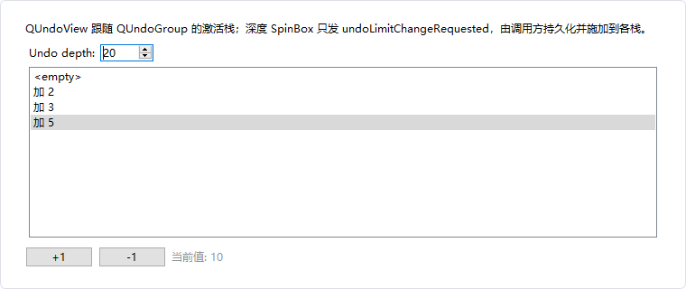
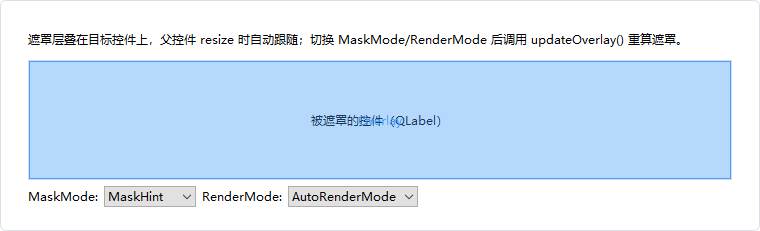

# Undo History & Overlay

`DAUndoHistoryWidget` is an undo history panel: a `QUndoView` following the active stack of a `QUndoGroup`, plus an undo-depth entry. `DAAbstractWidgetOverlay` is the abstract base for lightweight overlays drawn on top of a target widget.

## Preview



The history list comes from three commands pre-pushed by the demo; clicking any row moves back/forward to that state. The spin box at the top is the depth entry: changes only emit `undoLimitChangeRequested`, and persistence plus application to each stack stay in the caller.

## DAUndoHistoryWidget

### Key Features

- ✅ **Follows the active stack**: after `setUndoGroup(QUndoGroup*)`, it shows the current page's history
- ✅ **Click to undo/redo**: reuses `QUndoView` interaction
- ✅ **Depth entry**: `undoLimit()` / `setUndoLimit()`; spin-box changes only emit a signal
- ✅ **Clean layering**: the widget does not read configuration or walk data-page stacks

### Usage

```cpp
#include "DAUndoHistoryWidget.h"
#include <QUndoGroup>
#include <QUndoStack>

auto *stack = new QUndoStack(parent);
auto *group = new QUndoGroup(parent);
group->addStack(stack);
group->setActiveStack(stack);

auto *history = new DA::DAUndoHistoryWidget(parent);
history->setUndoGroup(group);

// User changed the depth: the caller persists it and applies it to each stack
QObject::connect(history, &DA::DAUndoHistoryWidget::undoLimitChangeRequested,
                 [](int limit) { qDebug() << "new undo depth:" << limit; });
```

### Core Methods

| Method | Description |
|--------|-------------|
| `setUndoGroup(QUndoGroup*)` / `undoGroup()` | Bind/get the undo group |
| `undoLimit()` / `setUndoLimit(int)` | Read/inject depth (`setUndoLimit` emits no signal) |
| `undoLimitChangeRequested(int)` | Emitted when the user changes the depth |

## DAAbstractWidgetOverlay



The overlay sits on top of a target widget (a QLabel in the screenshot) and follows its resize. `MaskMode` controls which region of the underlying window must repaint (`NoMask` / `MaskHint` / `AlphaMask`), and `RenderMode` controls whether the alpha buffer is reused; call `updateOverlay()` after switching.

### Key Features

- ✅ **Less repainting**: only the masked region of the target repaints
- ✅ **Three mask modes**: `NoMask`, `MaskHint` (default), `AlphaMask`
- ✅ **Three render modes**: `AutoRenderMode`, `CopyAlphaMask`, `DrawOverlay`
- ✅ **Subclasses only paint**: override `drawOverlay(QPainter*)`

### Usage

```cpp
#include "DAAbstractWidgetOverlay.h"

class SelectionOverlay : public DA::DAAbstractWidgetOverlay
{
public:
    explicit SelectionOverlay(QWidget *target)
        : DA::DAAbstractWidgetOverlay(target)
    {
        resize(target->size());
        show();
        raise();
    }

protected:
    void drawOverlay(QPainter *painter) const override
    {
        painter->fillRect(rect(), QColor(64, 158, 255, 90));
        painter->drawRect(rect().adjusted(1, 1, -2, -2));
    }
};

auto *overlay = new SelectionOverlay(targetWidget);
overlay->setMaskMode(DA::DAAbstractWidgetOverlay::MaskHint);
overlay->updateOverlay();
```

!!! info "An overlay is not a layout child"
    The overlay only paints on top of the target and does not participate in layout. After the target resizes, resize the overlay and call `updateOverlay()`.

## References

- [DATextEditWidget](text-edit.md)
- Example path: `examples/all_widgets_demo` (Utility tab)
