# 控件画廊

这一页集中展示 DAWidgets 全部演示窗口截图。截图不是手工维护的：它们由示例程序 `examples/all_widgets_demo` 的一条命令自动导出，控件或布局改动后重新跑一次即可同步。

```bash
# 在仓库根目录执行（Windows 下确保 Qt 的 bin 目录在 PATH 中）
dawidgets_all_widgets_demo --export-gallery docs/images/gallery
```

命令会输出四类图片：

| 目录 | 内容 |
|------|------|
| `all-widgets-demo.png` | 主窗口首屏 |
| `tabs/NN-<slug>.png` | 每个标签页一张 |
| `widgets/<scene-id>.png` | 每个控件场景一张（文档配图） |
| `widgets/*-popup.png` | 下拉弹层、颜色菜单、条目勾选对话框特写 |

## 主窗口

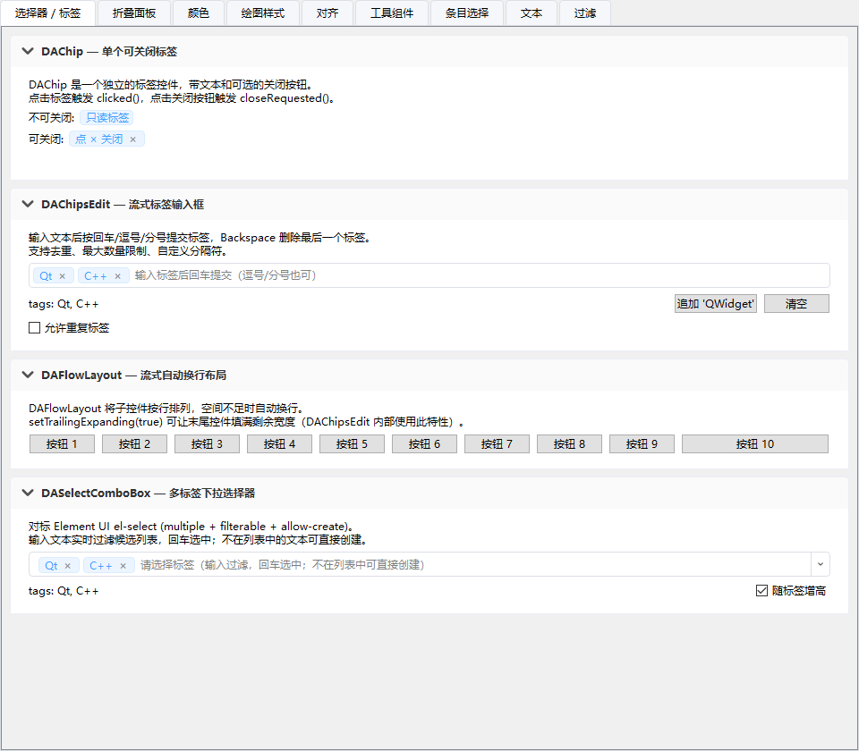

一个窗口内用 9 个标签页收拢全部控件，每个标签页内部又用 `DACollapseWidget` 按控件分组，既方便逐个体验，也方便截图归档。

## 选择器 / 标签


- [DAChip 标签胶囊](use-guide/chip.md)
- [DAChipsEdit 标签输入框](use-guide/chips-edit.md)
- [DAFlowLayout 流式布局](use-guide/flow-layout.md)
- [DASelectComboBox 下拉多选](use-guide/select-combobox.md)

## 折叠面板

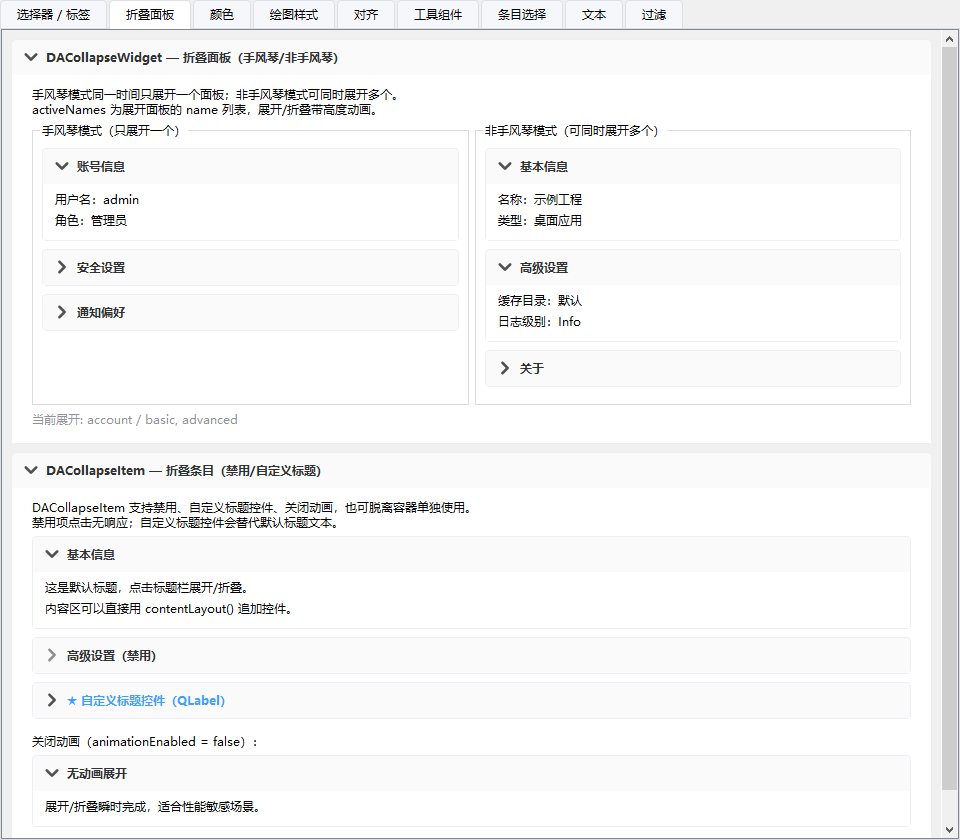

- [DACollapseWidget 折叠容器](use-guide/collapse.md)
- [DACollapseItem 折叠条目](use-guide/collapse-item.md)

## 颜色

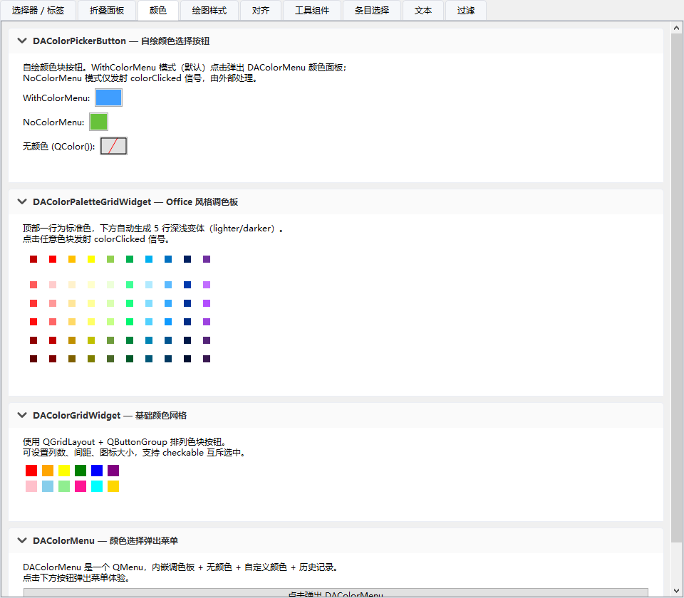

- [DAColorPickerButton 颜色拾取按钮](use-guide/color-menu.md#dacolorpickerbutton)
- [DAColorPaletteGridWidget 调色板](use-guide/color-grid.md#dacolorpalettegridwidget)
- [DAColorGridWidget 颜色网格](use-guide/color-grid.md#dacolorgridwidget)
- [DAColorMenu 颜色菜单](use-guide/color-menu.md#dacolormenu)

## 绘图样式

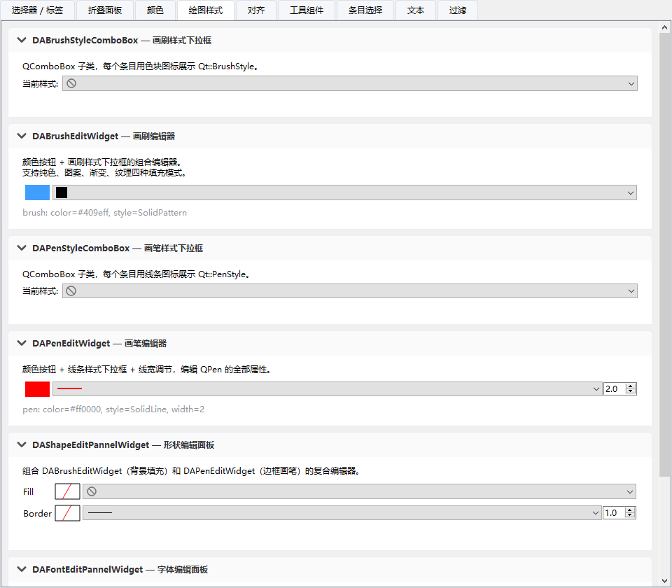

- [DABrushStyleComboBox 画刷样式下拉框](use-guide/brush-edit.md#dabrushstylecombobox)
- [DABrushEditWidget 画刷编辑器](use-guide/brush-edit.md#dabrusheditwidget)
- [DAPenStyleComboBox 画笔样式下拉框](use-guide/pen-edit.md#dapenstylecombobox)
- [DAPenEditWidget 画笔编辑器](use-guide/pen-edit.md#dapeneditwidget)
- [DAShapeEditPannelWidget 形状编辑面板](use-guide/shape-edit.md)
- [DAFontEditPannelWidget 字体编辑面板](use-guide/font-edit.md)

## 对齐

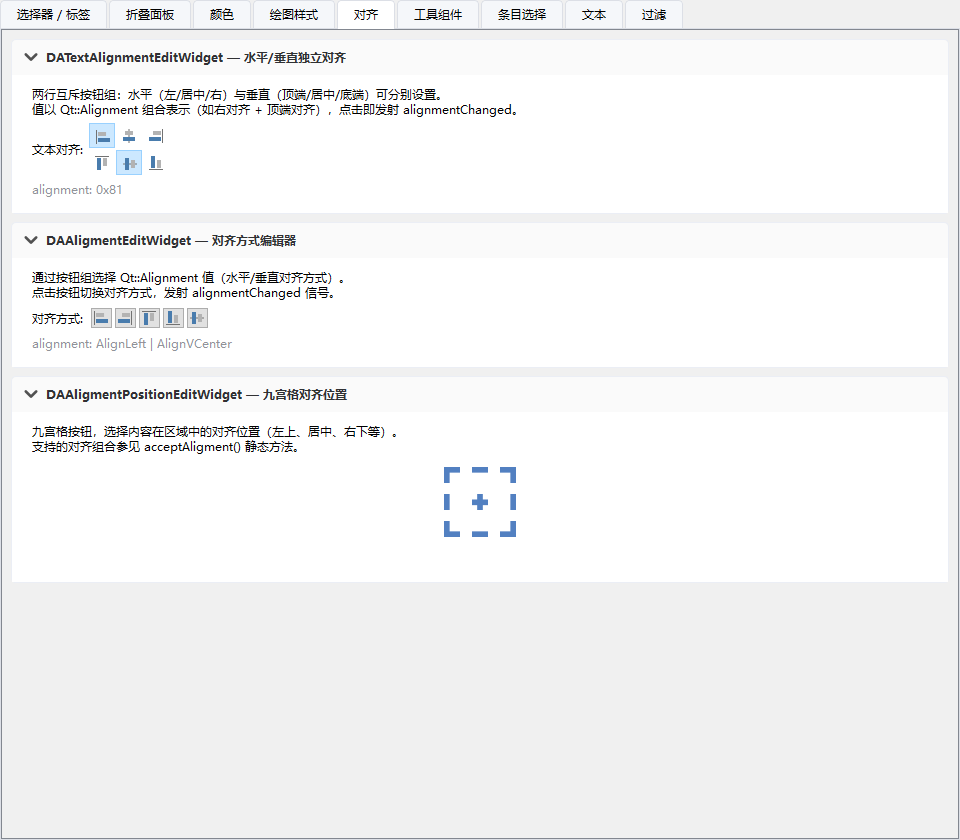

- [DATextAlignmentEditWidget 文本对齐](use-guide/alignment-edit.md#datextalignmenteditwidget)
- [DAAligmentEditWidget 对齐方式](use-guide/alignment-edit.md#daaligmenteditwidget)
- [DAAligmentPositionEditWidget 九宫格位置](use-guide/alignment-edit.md#daaligmentpositioneditwidget)

## 工具组件

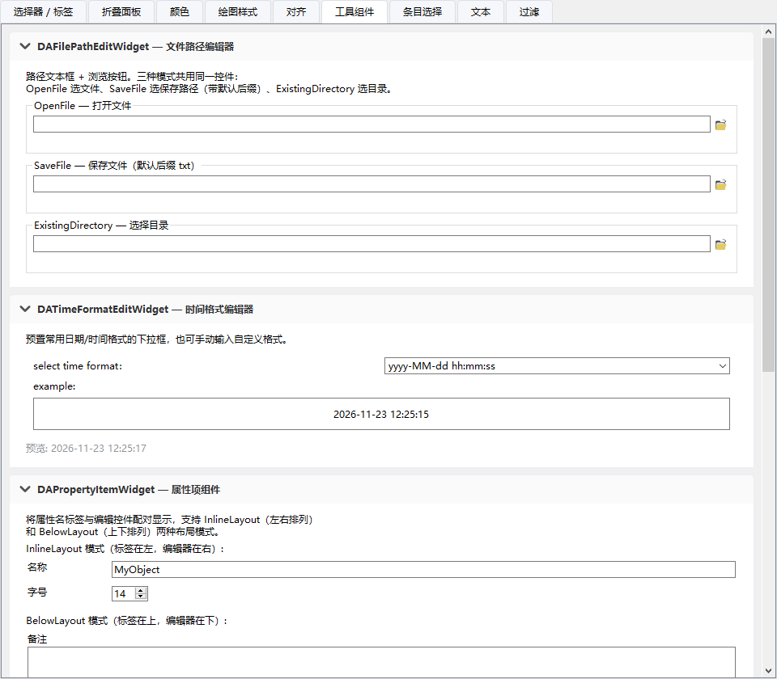

- [DAFilePathEditWidget 文件路径](use-guide/file-path-edit.md)
- [DATimeFormatEditWidget 时间格式](use-guide/time-format-edit.md)
- [DAPropertyItemWidget 属性项](use-guide/property-item.md)
- [DAUndoHistoryWidget 撤销历史](use-guide/undo-overlay.md#daundohistorywidget)
- [DAAbstractWidgetOverlay 遮罩层](use-guide/undo-overlay.md#daabstractwidgetoverlay)
- `DAWaitCursorScoped`：等待光标是交互态，静态截图无法体现，详见[光标守卫类](use-guide/cursor-scoped.md)

## 条目选择

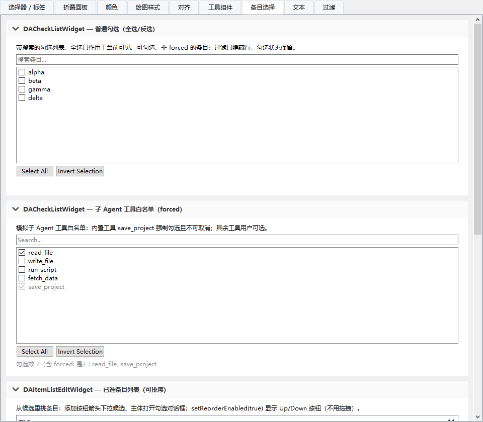

- [DACheckListWidget 勾选列表](use-guide/item-selection.md#dachecklistwidget)
- [DAItemListEditWidget 已选条目列表](use-guide/item-selection.md#daitemlisteditwidget)
- [DAItemListPickDialog 条目勾选对话框](use-guide/item-selection.md#daitemlistpickdialog)
- [DAStringListEditWidget 字符串列表](use-guide/item-selection.md#dastringlisteditwidget)
- [DAColorScalePreviewWidget 色阶预览](use-guide/item-selection.md#dacolorscalepreviewwidget)

## 文本

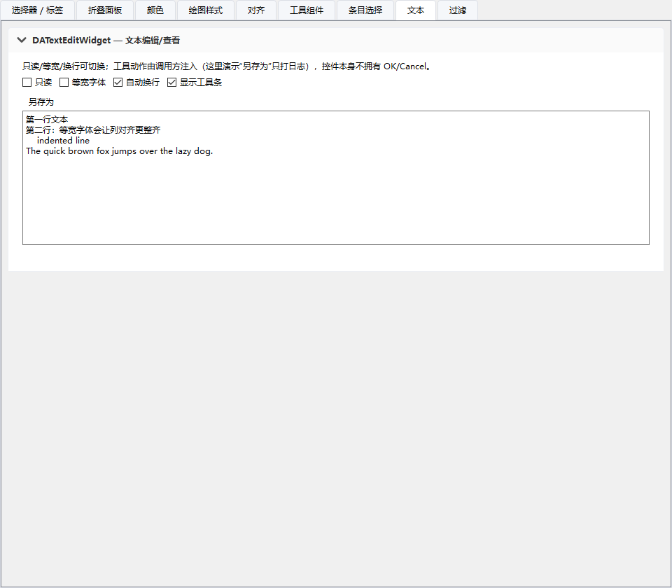

- [DATextEditWidget 文本编辑/查看](use-guide/text-edit.md)

## 过滤

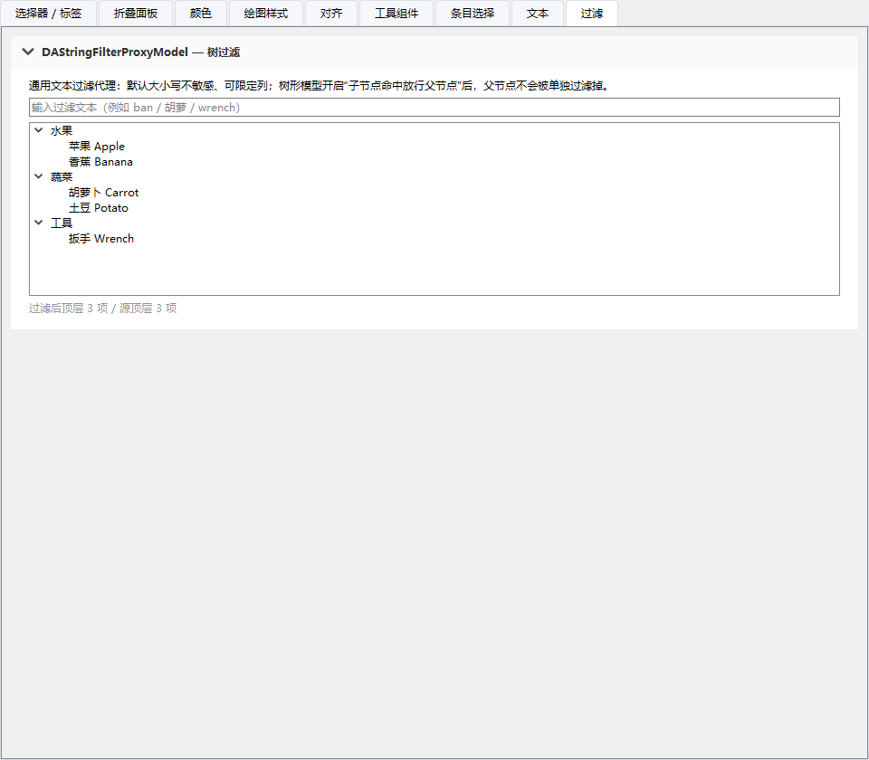

- [DAStringFilterProxyModel 文本过滤代理](use-guide/filter-proxy.md)

## 弹出层特写

有些控件的关键形态在弹出层里，单独导出：

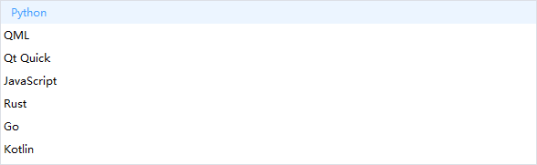

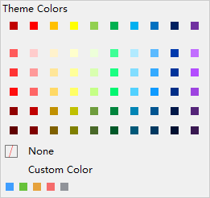

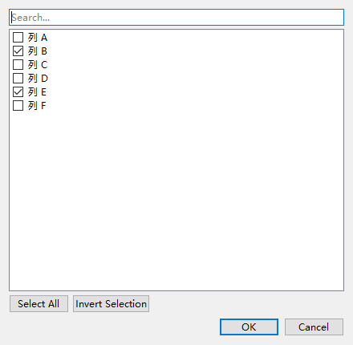

## 重新生成截图

截图由示例程序统一导出，不需要手动 PS：

```bash
# Windows（PowerShell）：把 Qt 的 bin 目录加入 PATH 后运行
$env:Path = "D:/Qt/6.7.3/msvc2019_64/bin;$env:Path"
./build/examples/all_widgets_demo/Release/dawidgets_all_widgets_demo.exe --export-gallery docs/images/gallery
```

`--export-gallery` 会遍历 `demoTabs()` 中的全部场景生成 `widgets/<id>.png`，再导出每个标签页与主窗口。新增控件时只需在对应 `Tab*.cpp` 的 `*Scenes()` 列表中追加一条 `DemoScene`，截图与演示界面会同时出现。
