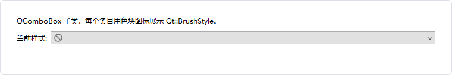
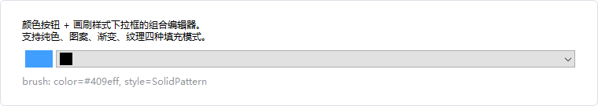

# 画刷样式编辑

`DABrushStyleComboBox` 是 Qt::BrushStyle 选择下拉框，`DABrushEditWidget` 组合颜色 + 样式的完整画刷编辑器，支持纯色/图案/渐变/纹理四种模式。

## DABrushStyleComboBox



上图的下拉框用色块图标展示 `Qt::BrushStyle`（纯色、各类图案），可以通过 `setBrushColor()` 指定图标颜色，并通过 `setShowNoBrushStyle(false)` 隐藏 `NoBrush` 选项。

### 核心特性

- ✅ **所有填充样式**：纯色及各种图案（`Qt::BDiagPattern` 等）
- ✅ **图标预览**：下拉项带填充样式图标
- ✅ **NoBrush 选项**：可通过 `setShowNoBrushStyle(false)` 隐藏

### 用法

```cpp
#include "DABrushStyleComboBox.h"

auto *combo = new DA::DABrushStyleComboBox(parent);
combo->setBrushColor(Qt::blue);  // 设置图标颜色

combo->setCurrentBrushStyle(Qt::Dense4Pattern);
Qt::BrushStyle style = combo->getCurrentBrushStyle();
```

## DABrushEditWidget



上图是画刷编辑器：左侧颜色按钮与右侧样式下拉框共同描述 `QBrush`，支持纯色、图案、渐变、纹理四种填充模式，变化时发射 `brushChanged`。

### 核心特性

- ✅ **四种模式**：纯色 / 图案 / 渐变 / 纹理
- ✅ **渐变类型**：线性 / 径向 / 锥形
- ✅ **纹理加载**：从 QPixmap 设置纹理画刷

### 用法

```cpp
#include "DABrushEditWidget.h"

auto *brushEdit = new DA::DABrushEditWidget(parent);

// 纯色模式
brushEdit->setCurrentBrush(QBrush(Qt::red, Qt::SolidPattern));

// 图案模式
brushEdit->setCurrentBrush(QBrush(Qt::green, Qt::Dense3Pattern));

// 渐变模式
QLinearGradient gradient(0, 0, 100, 100);
gradient.setColorAt(0, Qt::red);
gradient.setColorAt(1, Qt::blue);
brushEdit->setCurrentBrush(QBrush(gradient));

// 获取当前画刷
QBrush brush = brushEdit->getCurrentBrush();

// 监听变化
QObject::connect(brushEdit, &DA::DABrushEditWidget::brushChanged,
    [](const QBrush& brush) {
        qDebug() << "画刷:" << brush.color() << brush.style();
    });
```

## 核心方法

### DABrushStyleComboBox

| 方法 | 说明 |
|------|------|
| `getCurrentBrushStyle()` | 获取当前画刷样式 |
| `setBrushColor(QColor)` | 设置图标颜色 |
| `isColorBrush()` | 当前是否为纯色 |
| `setShowNoBrushStyle(bool)` | 是否显示 NoBrush |
| `setStyleTextVisible(bool)` | 样式文本可见性 |

### DABrushEditWidget

| 方法 | 说明 |
|------|------|
| `getCurrentBrush()` | 获取当前画刷 |
| `setCurrentBrush(QBrush)` | 设置画刷 |
| `getCurrentBrushStyle()` | 获取画刷样式 |
| `getCurrentBrushColor()` | 获取画刷颜色 |
| `setStyleTextVisible(bool)` | 样式文本可见性 |

## 参考

- [画笔样式编辑](pen-edit.md)
- [形状编辑面板](shape-edit.md)
