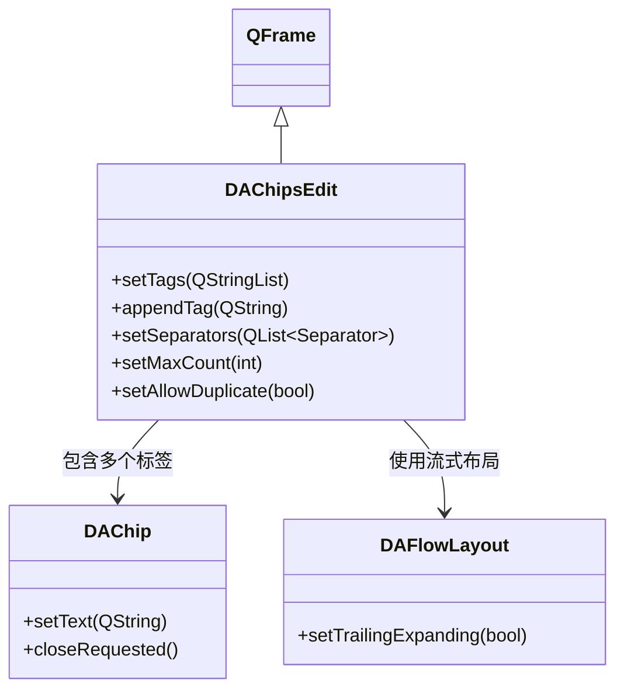

# DAChipsEdit 标签输入框

`DAChipsEdit` 是一个流式多标签输入框，可独立使用。用户通过回车或分隔符提交标签，Backspace 删除最后一个标签。支持去重、限量、自定义分隔符。

## 核心特性

**特性**

- ✅ **流式布局**：标签自动换行排列
- ✅ **多分隔符提交**：逗号、分号、空格、回车、Tab（枚举 + 字符串两种设置方式）
- ✅ **去重控制**：可禁止重复标签
- ✅ **数量限制**：可设置最大标签数
- ✅ **独立可用**：无需 DASelectComboBox 即可独立使用
- ✅ **扩展点**：暴露 `inputTextChanged` / `inputFocusChanged` / `inputKeyEvent` 供外部消费

## 类关系



## 用法

对应的示例位于：`examples/chipsedit_demo`。

### 1. 基本用法

```cpp
#include "DAChipsEdit.h"

auto *edit = new DA::DAChipsEdit(parent);

// 设置占位提示
edit->setPlaceholder("输入标签后回车...");

// 预设标签
edit->setTags({ "C++", "Qt", "Widgets" });

// 禁止重复
edit->setAllowDuplicate(false);

// 限制最多 5 个标签
edit->setMaxCount(5);
```

### 2. 自定义分隔符

`DAChipsEdit` 提供两种设置分隔符的方式：枚举重载（编译期类型安全）和字符串重载（运行时配置）。

```cpp
using namespace DA;

// 方式一：枚举重载（推荐 C++ 使用）
edit->setSeparators({
    DAChipsEdit::Separator::Comma,
    DAChipsEdit::Separator::Enter,
    DAChipsEdit::Separator::Semicolon
});

// 方式二：字符串重载（适合运行时配置）
edit->setSeparators(",;\n");  // 逗号、分号、换行
```

| 枚举值 | 对应字符 | 说明 |
|--------|---------|------|
| `Comma` | `,` | 逗号 |
| `Semicolon` | `;` | 分号 |
| `Space` | ` ` | 空格 |
| `Enter` | `\n` | 回车 |
| `Tab` | `\t` | Tab 键 |

### 3. 信号处理

```cpp
// 标签添加
QObject::connect(edit, &DA::DAChipsEdit::tagAdded,
    [](const QString& tag) {
        qDebug() << "添加标签:" << tag;
    });

// 标签移除
QObject::connect(edit, &DA::DAChipsEdit::tagRemoved,
    [](const QString& tag) {
        qDebug() << "移除标签:" << tag;
    });

// 标签列表变化
QObject::connect(edit, &DA::DAChipsEdit::tagsChanged,
    [](const QStringList& tags) {
        qDebug() << "当前标签:" << tags;
    });
```

### 4. 扩展点

`DAChipsEdit` 暴露三个扩展点供 `DASelectComboBox` 等外部消费者使用：

```cpp
// 输入框文本变化
QObject::connect(edit, &DA::DAChipsEdit::inputTextChanged,
    [](const QString& text) {
        // 可用于实现过滤逻辑
    });

// 输入框焦点变化
QObject::connect(edit, &DA::DAChipsEdit::inputFocusChanged,
    [](bool focused) {
        // 可用于控制弹出列表显隐
    });

// 按键事件拦截
QObject::connect(edit, &DA::DAChipsEdit::inputKeyEvent,
    [](QKeyEvent* event, bool* handled) {
        // 可拦截特定按键，设置 *handled = true 阻止默认处理
    });
```

## 核心属性与方法

### Q_PROPERTY

| 属性 | 类型 | 说明 |
|------|------|------|
| `tags` | `QStringList` | 标签列表 |
| `placeholder` | `QString` | 占位提示 |
| `allowCreate` | `bool` | 是否允许创建新标签 |
| `allowDuplicate` | `bool` | 是否允许重复标签 |
| `maxCount` | `int` | 最大标签数（0 = 无限） |

### 核心方法

| 方法 | 说明 |
|------|------|
| `setTags(QStringList)` | 设置标签列表 |
| `appendTag(QString)` | 追加单个标签 |
| `insertTag(int, QString)` | 在指定位置插入标签 |
| `removeTag(QString)` | 按文本移除标签 |
| `removeAt(int)` | 按索引移除标签 |
| `clear()` | 清除所有标签 |
| `setSeparators(QList<Separator>)` | 枚举方式设置分隔符 |
| `setSeparators(QString)` | 字符串方式设置分隔符 |
| `inputText()` | 获取当前输入框文本 |
| `clearInput()` | 清空输入框 |

## 参考

- [DASelectComboBox 下拉多选](select-combobox.md)
- [DAChip 标签胶囊](chip.md)
- [DAFlowLayout 流式布局](flow-layout.md)
- 示例路径：`examples/chipsedit_demo`
