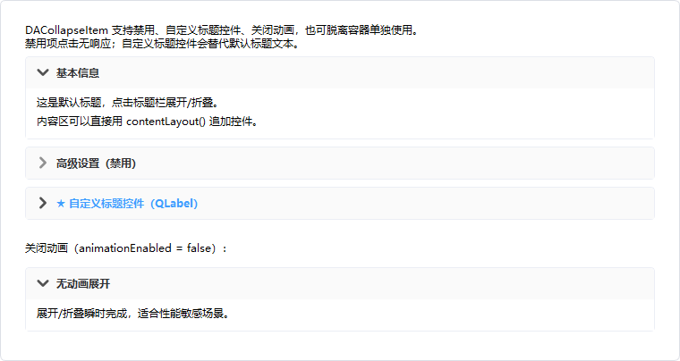

# DACollapseItem 折叠条目

`DACollapseItem` 是对标 Element UI `el-collapse-item` 的折叠条目。由标题栏和内容区两部分构成，点击标题栏在展开/折叠之间切换，支持动画过渡。

## 效果预览



截图依次演示了四种形态：默认标题的展开项、灰显且不可点击的禁用项、用 `setTitleWidget()` 替换的蓝色自定义标题，以及关闭动画后瞬时展开的条目。内容区可以直接用 `contentLayout()` 追加任意控件。

## 核心特性

**特性**

- ✅ **动画展开/折叠**：内容区从 0 高度动画过渡到自然高度
- ✅ **动画开关**：可通过 `setAnimationEnabled(false)` 关闭动画
- ✅ **自定义标题**：`setTitleWidget()` 用任意控件替代默认标题文本
- ✅ **自定义内容**：`setContentWidget()` 或 `contentLayout()` 管理内容
- ✅ **禁用状态**：`setDisabled(true)` 禁止折叠/展开
- ✅ **键盘可达**：配合容器的 `setKeyboardNavigation(true)`，标题可 Tab 聚焦、Enter/Space 开合
- ✅ **懒加载信号**：首次展开且内容为空时发 `contentRequested()`
- ✅ **异步高度刷新**：`refreshContentHeight()` 在内容到位后修正高度
- ✅ **qss 可定制**：完整的子控件 qss 选择器

## 用法

### 1. 基本用法

```cpp
#include "DACollapseItem.h"

auto *item = new DA::DACollapseItem("设置", parent);

// 向内容区添加控件
item->contentLayout()->addWidget(new QLabel("内容1"));
item->contentLayout()->addWidget(new QPushButton("按钮"));

// 展开
item->setExpanded(true);
```

### 2. 自定义标题

```cpp
auto *item = new DA::DACollapseItem(parent);

// 用自定义控件替代默认标题文本
auto *headerWidget = new QWidget;
auto *headerLayout = new QHBoxLayout(headerWidget);
headerLayout->addWidget(new QLabel("⚙"));
headerLayout->addWidget(new QLabel("高级设置"));
headerLayout->addStretch();
item->setTitleWidget(headerWidget);

item->setTitle("高级设置");  // 仍可用于 qss 和辅助功能
```

### 3. 动画控制

```cpp
// 关闭动画（某些场景需要即时切换）
item->setAnimationEnabled(false);

// 程序化展开/折叠
item->setExpanded(true);   // 展开
item->setExpanded(false);  // 折叠

// 查询当前状态
if (item->expanded()) {
    // ...
}
```

!!! warning "动画注意事项"
    动画通过 `maximumHeight` 属性实现。`QWIDGETSIZE_MAX` 哨兵值（65535）是已知的陷阱——折叠动画的起始值可能就是哨兵值导致动画无效，展开动画需正确设置目标高度。DAWidgets 已处理这些边界情况。

### 4. 禁用状态

```cpp
// 禁止用户点击折叠/展开
item->setDisabled(true);

// 视觉上会变灰（通过 qss 的 [disabled="true"] 选择器）
```

### 5. 信号处理

```cpp
QObject::connect(item, &DA::DACollapseItem::expandChanged,
    [](bool expanded) {
        qDebug() << (expanded ? "展开" : "折叠");
    });

// 首次展开且内容区为空:动画开始前通知,可在此同步装入内容
QObject::connect(item, &DA::DACollapseItem::contentRequested,
    [item]() {
        item->setContentWidget(new QLabel("首次展开时才创建的内容"));
        // 异步内容到位后:
        // item->refreshContentHeight();
    });
```

`contentRequested()` 每个条目最多发一次；内容区非空时不会发。`refreshContentHeight()` 在折叠态直接返回，展开态下若动画正在运行则更新动画终点，否则修正 `maximumHeight`。

## qss 子控件选择器

| 选择器 / objectName | 说明 |
|---------------------|------|
| `DA--DACollapseItem` | 条目外框 |
| `DA--DACollapseItem #header` | 标题栏区域（objectName，必须用 `#header`） |
| `#DACollapseItemTitle` | 标题文本 QLabel |
| `#DACollapseItemArrow` | 箭头图标 QLabel |
| `DA--DACollapseItem[disabled="true"]` | 禁用状态 |
| `DA--DACollapseItem[expanded="true"]` | 展开状态 |

## 核心属性与方法

### Q_PROPERTY

| 属性 | 类型 | 说明 |
|------|------|------|
| `title` | `QString` | 标题文本 |
| `name` | `QString` | 唯一标识（供 DACollapse 管理） |
| `disabled` | `bool` | 禁用状态 |
| `expanded` | `bool` | 展开/折叠状态 |
| `animationEnabled` | `bool` | 动画开关（默认开） |

### 核心方法

| 方法 | 说明 |
|------|------|
| `setTitleWidget(QWidget*)` | 设置自定义标题控件 |
| `setContentWidget(QWidget*)` | 设置内容控件 |
| `contentLayout()` | 获取内容区布局（QVBoxLayout*） |
| `setExpanded(bool)` | 展开/折叠 |
| `setAnimationEnabled(bool)` | 开关动画 |
| `headerWidget()` | 获取标题栏控件（键盘导航/自定义样式用） |
| `refreshContentHeight()` | 内容到位后刷新展开高度 |

## 参考

- [DACollapseWidget 折叠容器](collapse.md)
- 示例路径：`examples/all_widgets_demo`（各 tab 内均使用 `DACollapseWidget` 分区折叠）
