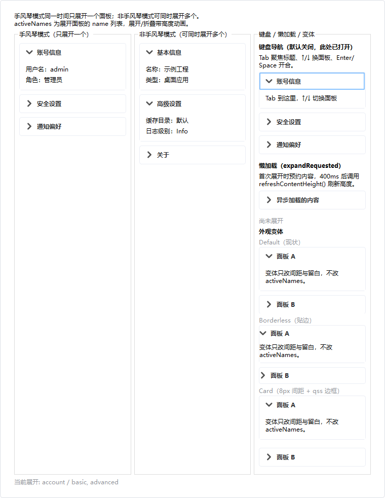
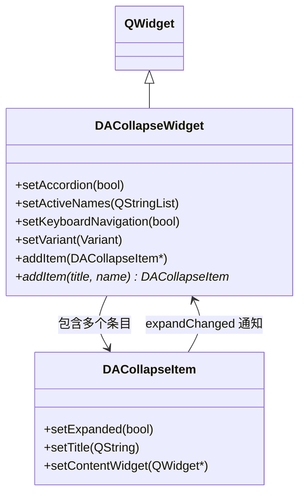

# DACollapseWidget 折叠容器

`DACollapseWidget` 是对标 Element UI `el-collapse` 的折叠面板容器。纵向排列多个 `DACollapseItem`，协调展开/折叠状态，支持手风琴模式和多展开模式。

## 效果预览



上图左侧是手风琴模式（展开「账号信息」时其余项自动收起），中间是非手风琴模式（「基本信息」和「高级设置」可同时展开），右侧演示键盘导航、`expandRequested` 懒加载与三种外观变体。每个面板的展开/收起都带高度动画，`activeNames` 会随交互同步变化。

## 核心特性

**特性**

- ✅ **手风琴模式**：同时只能展开一个面板
- ✅ **多展开模式**：默认模式，多个面板可同时展开
- ✅ **activeNames 管理**：通过 name 列表控制激活状态
- ✅ **便捷 API**：`addItem(title, name)` 一步创建条目
- ✅ **键盘导航**（可选）：Tab 聚焦、↑/↓ 换面板、Enter/Space 开合
- ✅ **懒加载钩子**：`expandRequested` 在首次展开前通知宿主
- ✅ **外观变体**：`Default` / `Borderless` / `Card` 三种间距与留白

## 类关系



## 用法

对应的示例位于：`examples/all_widgets_demo`（各 tab 内均使用 `DACollapseWidget` 分区折叠）。

### 1. 基本用法

```cpp
#include "DACollapseWidget.h"
#include "DACollapseItem.h"

auto *collapse = new DA::DACollapseWidget(parent);

// 便捷创建条目
auto *item1 = collapse->addItem("一致性", "1");
auto *item2 = collapse->addItem("反馈", "2");
auto *item3 = collapse->addItem("效率", "3");

// 为条目添加内容
item1->contentLayout()->addWidget(new QLabel("一致性内容"));
item2->contentLayout()->addWidget(new QLabel("反馈内容"));

// 默认展开第一个
collapse->setActiveNames({ "1" });
```

### 2. 手风琴模式

```cpp
// 启用手风琴模式 — 同时只能展开一个
collapse->setAccordion(true);

// 展开指定面板（手风琴模式下仅取首个生效）
collapse->setActiveNames({ "2" });
```

| 模式 | 说明 |
|------|------|
| 非手风琴（默认） | 多个面板可同时展开，`activeNames` 为完整列表 |
| 手风琴 | 同时只能展开一个，展开新面板时自动折叠其余，`activeNames` 取首个 |

### 3. 信号处理

```cpp
// 激活面板变化
QObject::connect(collapse, &DA::DACollapseWidget::activeNamesChanged,
    [](const QStringList& names) {
        qDebug() << "当前激活:" << names;
    });

// 手风琴模式切换
QObject::connect(collapse, &DA::DACollapseWidget::accordionChanged,
    [](bool on) {
        qDebug() << "手风琴模式:" << (on ? "开启" : "关闭");
    });
```

### 4. qss 样式定制

```css
DA--DACollapseWidget {
    border: none;
}
DA--DACollapseItem {
    border: 1px solid #ebeef5;
    border-radius: 4px;
}
DA--DACollapseItem #header {
    background: #fafafa;
    padding: 8px 12px;
}
DA--DACollapseItem #header:hover {
    background: #f5f7fa;
}
QLabel#DACollapseItemTitle {
    color: #303133;
    font-weight: bold;
}
QLabel#DACollapseItemArrow {
    color: #909399;
}
```

> `header` 是标题栏的 objectName，必须用 `#header` 命中；Qt 没有名为 `header` 的 `QStyle::SubControl`，`::header` 这类写法一直无效。

### 5. 键盘导航

```cpp
collapse->setKeyboardNavigation(true);  // 默认 false
```

| 按键 | 行为 |
|------|------|
| Tab | 依次聚焦每个标题（仅开启键盘导航时） |
| ↑ / ↓ | 在当前面板的上/下一个面板间移动焦点，跳过禁用项，到首尾不循环 |
| Enter / Space | 展开/折叠当前聚焦的面板 |

默认关闭时标题不进入 Tab 顺序，鼠标与程序化接口的行为完全不变。焦点态标题内缘会绘制 2px 半透明蓝色焦点环。若标题里有调用方自定义的可聚焦控件，它会先消费按键（属预期行为）。

### 6. 懒加载内容（expandRequested）

```cpp
auto *item = collapse->addItem("大数据表", "table");

QObject::connect(collapse, &DA::DACollapseWidget::expandRequested,
    [item](const QString &name) {
        // 在动画开始前同步提供内容
        item->setContentWidget(buildTable());
    });
```

- 信号在展开动画开始**之前**发出，且每个条目只发一次（条件是首次展开时内容区为空）。
- 宿主在槽内同步 `setContentWidget()` 时，展开高度直接等于内容自然高度。
- 异步加载时先放入占位控件，内容到位后再刷新高度：

```cpp
QTimer::singleShot(400, item, [item] {
    item->setContentWidget(buildTable());
    item->refreshContentHeight();  // 动画中更新终点，否则直接修正 maximumHeight
});
```

- 一次 `setActiveNames()` 可能连续触发多个条目的请求，槽应幂等。
- 本控件不提供骨架屏；内容始终为空时，展开高度只包含内容区留白。

### 7. 视觉变体（Variant）

```cpp
collapse->setVariant(DA::DACollapseWidget::Variant::Card);
```

| 变体 | 条目间距 | 标题内留白 | 内容内留白 | 库是否绘制边框 |
|------|---------|-----------|-----------|----------------|
| `Default` | 0 | 12 / 10 | 12 / 8 / 12 / 12 | 否 |
| `Borderless` | 0 | 0 / 8 | 0 / 4 / 0 / 8 | 否 |
| `Card` | 8 | 12 / 10 | 12 / 8 / 12 / 12 | 否（交给调用方 qss） |

`Card` 的边框由调用方提供：

```css
DA--DACollapseItem[daVariant="card"] {
    border: 1px solid #EBEEF5;
    border-radius: 4px;
}
```

`daVariant` 动态属性同时设在容器和每个条目上（值 `default` / `borderless` / `card`），后添加的条目会自动继承当前变体。变体只改间距与留白，不影响 `accordion` 与 `activeNames`。

## 核心属性与方法

### Q_PROPERTY

| 属性 | 类型 | 说明 |
|------|------|------|
| `accordion` | `bool` | 手风琴模式 |
| `activeNames` | `QStringList` | 激活面板 name 列表 |

### 核心方法

| 方法 | 说明 |
|------|------|
| `setAccordion(bool)` | 启用/禁用手风琴模式 |
| `setKeyboardNavigation(bool)` | 启用/关闭键盘导航（默认 `false`） |
| `isKeyboardNavigation()` | 键盘导航是否开启 |
| `setVariant(Variant)` | 设置外观变体（默认 `Default`） |
| `variant()` | 当前外观变体 |
| `activeNames()` / `setActiveNames(QStringList)` | 获取/设置激活面板 |
| `addItem(DACollapseItem*)` | 添加已有条目（接管所有权） |
| `addItem(title, name)` | 便捷创建并添加条目 |
| `item(name)` | 按 name 查找条目 |
| `items()` | 获取所有条目 |
| `removeItem(DACollapseItem*)` | 移除并销毁条目 |
| `clear()` | 清除所有条目 |

## 参考

- [DACollapseItem 折叠条目](collapse-item.md)
- 示例路径：`examples/all_widgets_demo`（各 tab 内均使用 `DACollapseWidget` 分区折叠）
