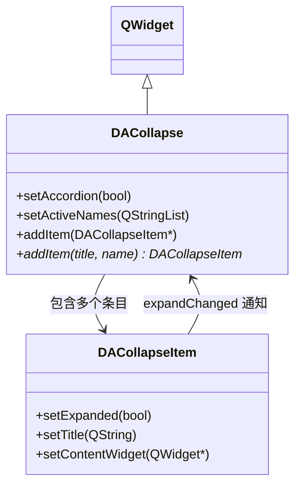

# DACollapse 折叠容器

`DACollapse` 是对标 Element UI `el-collapse` 的折叠面板容器。纵向排列多个 `DACollapseItem`，协调展开/折叠状态，支持手风琴模式和多展开模式。

## 核心特性

**特性**

- ✅ **手风琴模式**：同时只能展开一个面板
- ✅ **多展开模式**：默认模式，多个面板可同时展开
- ✅ **activeNames 管理**：通过 name 列表控制激活状态
- ✅ **便捷 API**：`addItem(title, name)` 一步创建条目

## 类关系



## 用法

对应的示例位于：`examples/collapse_demo`。

### 1. 基本用法

```cpp
#include "DACollapse.h"
#include "DACollapseItem.h"

auto *collapse = new DA::DACollapse(parent);

// 便捷创建条目
auto *item1 = collapse->addItem("一致性", "1");
auto *item2 = collapse->addItem("反馈", "2");
auto *item3 = collapse->addItem("效率", "3");

// 为条目添加内容
item1->contentLayout()->addWidget(new QLabel("一致性内容"));
item2->contentLayout()->addWidget(new QLabel("反馈内容"));

// 默认展开第一个
collapse->setActiveNames({ "1" });
```

### 2. 手风琴模式

```cpp
// 启用手风琴模式 — 同时只能展开一个
collapse->setAccordion(true);

// 展开指定面板（手风琴模式下仅取首个生效）
collapse->setActiveNames({ "2" });
```

| 模式 | 说明 |
|------|------|
| 非手风琴（默认） | 多个面板可同时展开，`activeNames` 为完整列表 |
| 手风琴 | 同时只能展开一个，展开新面板时自动折叠其余，`activeNames` 取首个 |

### 3. 信号处理

```cpp
// 激活面板变化
QObject::connect(collapse, &DA::DACollapse::activeNamesChanged,
    [](const QStringList& names) {
        qDebug() << "当前激活:" << names;
    });

// 手风琴模式切换
QObject::connect(collapse, &DA::DACollapse::accordionChanged,
    [](bool on) {
        qDebug() << "手风琴模式:" << (on ? "开启" : "关闭");
    });
```

### 4. qss 样式定制

```css
DACollapse {
    border: none;
}
DACollapseItem {
    border: 1px solid #ebeef5;
    border-radius: 4px;
    margin-bottom: 4px;
}
DACollapseItem::header {
    background: #fafafa;
    padding: 8px 12px;
}
DACollapseItem::header:hover {
    background: #f5f7fa;
}
QLabel#DACollapseItemTitle {
    color: #303133;
    font-weight: bold;
}
QLabel#DACollapseItemArrow {
    color: #909399;
}
```

## 核心属性与方法

### Q_PROPERTY

| 属性 | 类型 | 说明 |
|------|------|------|
| `accordion` | `bool` | 手风琴模式 |
| `activeNames` | `QStringList` | 激活面板 name 列表 |

### 核心方法

| 方法 | 说明 |
|------|------|
| `setAccordion(bool)` | 启用/禁用手风琴模式 |
| `activeNames()` / `setActiveNames(QStringList)` | 获取/设置激活面板 |
| `addItem(DACollapseItem*)` | 添加已有条目（接管所有权） |
| `addItem(title, name)` | 便捷创建并添加条目 |
| `item(name)` | 按 name 查找条目 |
| `items()` | 获取所有条目 |
| `removeItem(DACollapseItem*)` | 移除并销毁条目 |
| `clear()` | 清除所有条目 |

## 参考

- [DACollapseItem 折叠条目](collapse-item.md)
- 示例路径：`examples/collapse_demo`
