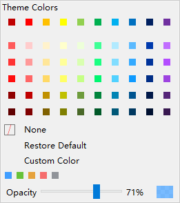
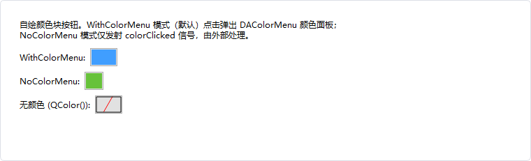

# 颜色菜单与拾取按钮

`DAColorMenu` 提供颜色选择菜单（主题色板 + 自定义色 + None），`DAColorPickerButton` 是自绘颜色块的颜色拾取按钮。

## DAColorMenu



上图为展开后的颜色菜单：顶部主题色板 → `None` → `Custom Color` → 最近自定义色记录。选择颜色后菜单自动关闭并发射 `selectedColor`；选择 `Custom Color` 会弹出 `QColorDialog`。

### 核心特性

- ✅ **完整菜单结构**：标题 → 主题色板 → "None" Action → "Custom Color" Action → 自定义色网格
- ✅ **None 颜色**：`enableNoneColorAction` 控制 None 选项
- ✅ **自定义色管理**：最多 10 个自定义色，FIFO 淘汰
- ✅ **透明度**（可选）：菜单内 alpha 滑杆 + 棋盘格预览，默认关闭
- ✅ **最近色**（可选）：最近 5 色、去重、置顶，支持方向键，默认关闭
- ✅ **恢复默认色**（可选）：`setDefaultColor()` 插入一条 Action，默认不出现
- ✅ **暴露子控件**：`colorPaletteGridWidget()`、`customColorsWidget()` 可直接访问

### 用法

```cpp
#include "DAColorMenu.h"

auto *menu = new DA::DAColorMenu(parent);

// 启用 None 颜色选项
menu->enableNoneColorAction(true);

// 监听颜色选择
QObject::connect(menu, &DA::DAColorMenu::selectedColor,
    [](const QColor& color) {
        if (color.isValid()) {
            qDebug() << "选择颜色:" << color.name();
        } else {
            qDebug() << "选择 None";
        }
    });

// 弹出菜单
menu->exec(QCursor::pos());
```

### 透明度（alpha）

```cpp
menu->setAlphaEnabled(true);   // 默认 false：不插滑杆，选中颜色逐位不变
menu->setAlpha(200);           // 0–255，滑杆与 alpha() 同步
QObject::connect(menu, &DA::DAColorMenu::alphaChanged,
    [](int a) { qDebug() << "alpha" << a; });
```

- 打开后菜单末尾出现「Opacity」行：滑杆（0–255）+ 百分比 + 棋盘格预览；选中任意颜色时把当前 alpha 写进该颜色。
- `alphaChanged` 只在拖动/`setAlpha()` 值变化时发射，**不是**"选完了"；`selectedColor` 仍是唯一确认信号。
- 不透明度滑杆是独立入口，不依赖 `QColorDialog` 的 alpha 通道（部分平台原生对话框不显示 alpha）；对话框返回的 alpha 会回写滑杆。
- 关闭开关后 `selectedColor` 的颜色与改动前完全一致（不会补 255 或改写 alpha）。

### 最近颜色与键盘导航

```cpp
menu->setRecentColors({ QColor(64,158,255), QColor(103,194,58),
                        QColor(245,108,108), QColor(230,162,60) });
// 之后每次选色：最近优先、去重、最多 5 条
```

- 调用 `setRecentColors()` 即把原来的「10 条 FIFO 自定义色」切换为「最近 5 条、置顶、去重」；不调用时保持旧行为。
- 色块支持键盘操作：方向键在当前网格内移动（±1 / ±列数，越界停住），`Enter` 取色，`Space` 由 `QToolButton` 自带；上下移动只在同一段网格内生效（主色行与色阶行之间不跨段）。
- 色块图标支持棋盘格底（`DAColorGridWidget::setAlphaBackgroundEnabled(true)`），半透明色能看出"透"；最近色网格会自动打开它。

### 恢复默认色

```cpp
menu->setDefaultColor(QColor("#409EFF"));  // 品牌色
menu->setDefaultColor(QColor());           // 无效色 = 移除入口
```

- 设置后菜单插入 `Restore Default`，点击直接发出该颜色，**alpha 恒为 255**，且不会写入最近色列表。
- 未调用时菜单项数量与顺序与改动前一致。

## DAColorPickerButton



上图依次展示三种状态：带菜单的蓝色色块、无菜单的绿色色块，以及 `QColor()` 无效色（红色斜线）。前两种点击行为不同，无效色会通过 `paintNoneColor()` 的语义绘制为「无颜色」。

### 核心特性

- ✅ **自绘颜色块**：在按钮上绘制当前颜色
- ✅ **无效色显示**：无效色（`QColor()`）显示红色斜杠
- ✅ **两种模式**：`WithColorMenu`（内置颜色菜单）/ `NoColorMenu`（纯显示）
- ✅ **静态方法**：`paintNoneColor()` 可供其他控件绘制 None 色块

### 用法

```cpp
#include "DAColorPickerButton.h"

// 方式一：带内置颜色菜单
auto *btn = new DA::DAColorPickerButton(parent);
btn->setColorToolButtonStyle(DA::DAColorPickerButton::ColorToolButtonStyle::WithColorMenu);
btn->setColor(Qt::red);

// 监听颜色变化
QObject::connect(btn, &DA::DAColorPickerButton::colorChanged,
    [](const QColor& color) {
        qDebug() << "颜色变化:" << color.name();
    });

// 方式二：纯显示（不弹菜单）
auto *display = new DA::DAColorPickerButton(parent);
display->setColorToolButtonStyle(DA::DAColorPickerButton::ColorToolButtonStyle::NoColorMenu);
display->setColor(Qt::blue);
```

### 自定义颜色菜单

```cpp
auto *btn = new DA::DAColorPickerButton(parent);

// 获取或创建颜色菜单
DA::DAColorMenu *menu = btn->colorMenu();
if (!menu) {
    menu = btn->createColorMenu();
}

// 自定义主题色板
menu->colorPaletteGridWidget()->setColorList({
    QColor("#FF6B6B"), QColor("#4ECDC4"), QColor("#45B7D1"),
    QColor("#FFA07A"), QColor("#98D8C8"), QColor("#F7DC6F")
});
```

## 核心方法

### DAColorMenu

| 方法 | 说明 |
|------|------|
| `enableNoneColorAction(bool)` | 启用/禁用 None 选项 |
| `setAlphaEnabled(bool)` / `isAlphaEnabled()` | 透明度行开关（默认关闭） |
| `alpha()` / `setAlpha(int)` | 当前 alpha（0–255） |
| `alphaChanged(int)` | alpha 变化信号（随拖动高频） |
| `setRecentColors(QList<QColor>)` / `recentColors()` | 启用最近色策略（最近优先、去重、最多 5） |
| `setDefaultColor(QColor)` / `defaultColor()` | 设置/移除恢复默认色入口 |
| `colorPaletteGridWidget()` | 获取主题色板控件 |
| `customColorsWidget()` | 获取自定义色网格控件 |

### DAColorPickerButton

| 方法 | 说明 |
|------|------|
| `color()` / `setColor(QColor)` | 获取/设置颜色 |
| `setColorToolButtonStyle(Style)` | 设置按钮模式 |
| `colorMenu()` | 获取颜色菜单（可能为 null） |
| `createColorMenu()` | 创建颜色菜单 |
| `margins` | 颜色块边距 |
| `paintNoneColor(QPainter, rect)` | 静态方法，绘制 None 色块 |

## 参考

- [颜色网格与调色板](color-grid.md)
- [画笔样式编辑](pen-edit.md)
