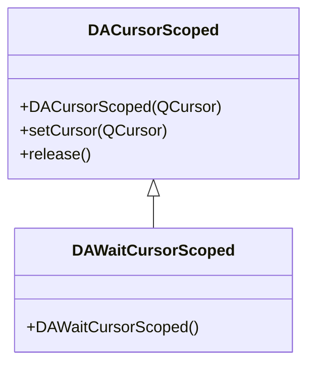

# 光标守卫类

`DACursorScoped` 和 `DAWaitCursorScoped` 是 RAII 风格的光标管理类，确保作用域结束时光标自动恢复，即使发生异常也安全。

## 核心特性

**特性**

- ✅ **RAII 守卫**：作用域结束自动恢复光标
- ✅ **异常安全**：即使中途抛出异常也能正确恢复
- ✅ **便捷宏**：`DA_WAIT_CURSOR_SCOPED()` 一行启用等待光标
- ✅ **自定义光标**：`DACursorScoped` 支持任意 `QCursor`

## 类关系



## 用法

### 1. 等待光标（最常用）

使用宏在耗时操作期间显示等待光标：

```cpp
#include "DAWaitCursorScoped.h"

void MyWidget::doHeavyWork()
{
    DA_WAIT_CURSOR_SCOPED();  // 进入等待光标作用域

    // 耗时操作...
    performCalculation();
    loadData();

    // 函数返回时自动恢复光标，即使抛出异常也安全
}
```

### 2. 自定义光标

```cpp
#include "DACursorScoped.h"

void MyWidget::doWork()
{
    // 使用自定义光标
    DA::DACursorScoped guard(Qt::PointingHandCursor);

    // ... 操作 ...

    // 作用域结束自动恢复
}
```

### 3. 手动释放

```cpp
DA::DAWaitCursorScoped guard;

// 前半段操作...

guard.release();  // 手动释放，提前恢复光标

// 后半段操作（光标已恢复）
```

## 核心方法

### DACursorScoped

| 方法 | 说明 |
|------|------|
| `DACursorScoped(QCursor)` | 构造时设置光标 |
| `setCursor(QCursor)` | 更改光标 |
| `release()` | 手动释放，提前恢复 |

### DAWaitCursorScoped

| 方法/宏 | 说明 |
|---------|------|
| `DAWaitCursorScoped()` | 构造为 `Qt::WaitCursor` |
| `DA_WAIT_CURSOR_SCOPED()` | 便捷宏，创建匿名实例 |

## 参考

- 头文件：`src/DACursorScoped.h`、`src/DAWaitCursorScoped.h`
