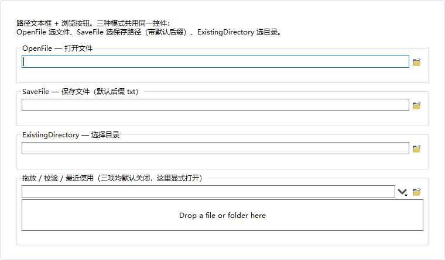

# 文件路径编辑器

`DAFilePathEditWidget` 提供文件路径选择控件，由 LineEdit + 打开按钮组成，支持文件过滤器。

## 效果预览



截图中三种模式共用同一控件：`OpenFile` 选择已有文件、`SaveFile` 带默认后缀保存、`ExistingDirectory` 选择目录。右侧按钮的图标会随模式切换，选择结果通过 `selectedPath` 信号返回。

## 核心特性

**特性**

- ✅ **路径输入**：LineEdit 直接输入路径
- ✅ **文件选择**：点击按钮弹出文件对话框
- ✅ **过滤器**：支持设置文件名过滤器
- ✅ **拖放**（可选）：文件/目录拖入即填值，默认关闭
- ✅ **校验状态**（可选）：失焦/浏览/`validateNow()` 校验并显示绿勾/红叉，默认关闭
- ✅ **最近路径**（可选）：最近 5 条下拉，默认关闭
- ✅ **信号通知**：`selectedPath(QString)`

## 用法

### 1. 基本用法

```cpp
#include "DAFilePathEditWidget.h"

auto *fileEdit = new DA::DAFilePathEditWidget(parent);

// 设置文件过滤器
fileEdit->setNameFilters({
    "文本文件 (*.txt)",
    "图片文件 (*.png *.jpg *.bmp)",
    "所有文件 (*.*)"
});

// 监听路径选择
QObject::connect(fileEdit, &DA::DAFilePathEditWidget::selectedPath,
    [](const QString& path) {
        qDebug() << "选择的文件:" << path;
    });
```

### 2. 获取/设置路径

```cpp
// 设置当前路径
fileEdit->setFilePath("/home/user/document.txt");

// 获取当前路径
QString path = fileEdit->getFilePath();
```

### 3. 拖放文件/目录

```cpp
fileEdit->setDropEnabled(true);   // 默认 false
```

- 拖到控件上时提示条高亮（动态属性 `dragActive`），松手取**第一个本地 URL** 填入输入框，并走与浏览对话框相同的收尾：启用校验时先校验，再发 `selectedPath`。
- 远程 URL（`http(s)://` 等）忽略；输入框既有的文本拖入能力不受影响（事件过滤器只接管 `hasUrls()`）。
- 提示条固定 54px 高，建议把控件放进 `QVBoxLayout`；关闭拖放时提示条隐藏，尺寸与旧版一致。

### 4. 路径校验状态

```cpp
fileEdit->setValidationEnabled(true);   // 默认 false

// 立即校验并拿同步结果（宿主常用于控制 OK 按钮）
bool ok = fileEdit->validateNow();

QObject::connect(fileEdit, &DA::DAFilePathEditWidget::validationChanged,
    [](bool valid) { /* 同一结果连续校验只发一次 */ });
```

- 判据按模式区分：`OpenFile` 必须是已存在的普通文件；`ExistingDirectory` 必须是已存在的目录；`SaveFile` **允许文件不存在**，只要求父目录存在且可写（已存在的目标不能是目录）。
- 合法显示绿勾 + `Path exists`，非法显示红叉 + `Path not found`，同时给输入框和状态行设置动态属性 `invalid`，配色交给调用方：

  ```cpp
  fileEdit->setStyleSheet(
      "QLineEdit[invalid=\"true\"] { border: 1px solid #F56C6C; }");
  ```

- 空路径：隐藏状态行、返回 `false`、不发 `validationChanged`。
- 校验时机：输入框失焦（`editingFinished`）、浏览对话框返回、`validateNow()`；启用后控件会多一行状态，注意容器高度。

### 5. 最近使用路径

```cpp
fileEdit->setRecentPaths({
    "D:/work/export.csv",   // 最近 → 最旧
    "D:/work/import.csv",
    "C:/Users/me/Documents"
});

QObject::connect(fileEdit, &DA::DAFilePathEditWidget::recentPathActivated,
    [](const QString& path) { qDebug() << "最近路径:" << path; });
```

- 入参按「最近 → 最旧」，去重（大小写敏感）并截断到 5 条；非空时右侧出现下拉按钮，空列表时按钮隐藏。
- 点选历史项会填值（启用校验时同时校验），依次发 `recentPathActivated` 与 `selectedPath`。
- 控件**不会**自动把新选路径追加进列表，持久化与写入时机由调用方负责。

## 核心方法

| 方法 | 说明 |
|------|------|
| `setFilePath(QString)` | 设置文件路径 |
| `getFilePath()` | 获取文件路径 |
| `setNameFilter(QString)` | 设置单个文件过滤器 |
| `setNameFilters(QStringList)` | 设置多个文件过滤器 |
| `setDropEnabled(bool)` / `isDropEnabled()` | 文件/目录拖放（默认关闭） |
| `setValidationEnabled(bool)` / `isValidationEnabled()` | 路径校验与状态行（默认关闭） |
| `validateNow()` | 立即校验并返回是否合法 |
| `validationChanged(bool)` | 校验结果变化信号 |
| `setRecentPaths(QStringList)` / `recentPaths()` | 最近路径（最近优先、去重、最多 5） |
| `recentPathActivated(QString)` | 最近路径被选中 |

## 参考

- [DAPropertyItemWidget 属性项](property-item.md)
