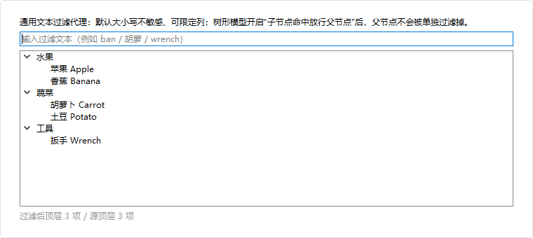
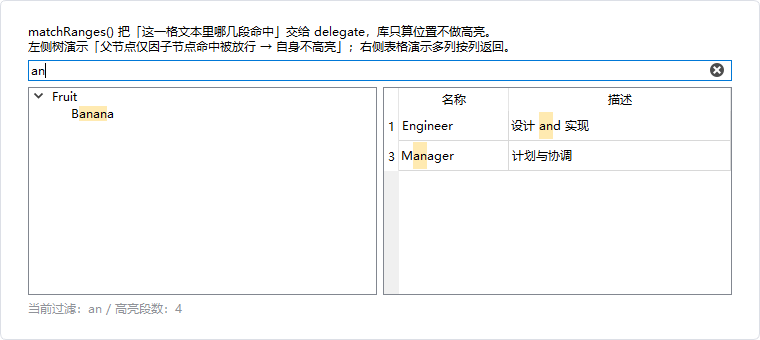

# DAStringFilterProxyModel 文本过滤代理

`DAStringFilterProxyModel` 是面向列表/树的通用文本过滤代理：按 `Qt::DisplayRole`（可改为其它角色）匹配，默认大小写不敏感，可限定列；树形模型开启「子节点命中放行父节点」后，父节点不会因为自身不匹配而被过滤掉。

## 效果预览



上图中的树有三组节点，输入过滤文本（例如 `ban`、`胡萝`、`wrench`）后，只有命中的叶子节点及其父节点保留；清空输入即恢复全部。演示程序在下方实时显示过滤后顶层项数与源模型顶层项数。

## 核心特性

**特性**

- ✅ **按展示文本过滤**：默认 `Qt::DisplayRole`，可用 `setFilterRole()` 改为自定义角色
- ✅ **大小写策略**：`setFilterCaseSensitivity()`，默认不敏感
- ✅ **单列/所有列**：`setFilterColumn(-1)` 表示所有列参与匹配
- ✅ **树形父节点放行**：`setIncludeParentsOfMatches(true)` 保留命中子节点的父链
- ✅ **可复用匹配函数**：静态 `matchesText()` 供未挂代理的视图复用同一套语义
- ✅ **命中区间输出**：`matchRanges()` / `matchRangesIn()`，配合 delegate 自行高亮

## 用法

```cpp
#include "DAStringFilterProxyModel.h"
#include <QStandardItemModel>
#include <QTreeView>

auto *model = new QStandardItemModel(parent);
auto *fruit = new QStandardItem("水果");
fruit->appendRow(new QStandardItem("苹果 Apple"));
fruit->appendRow(new QStandardItem("香蕉 Banana"));
model->appendRow(fruit);

auto *proxy = new DA::DAStringFilterProxyModel(parent);
proxy->setSourceModel(model);
proxy->setIncludeParentsOfMatches(true);   // 树形模型必须开启，否则父节点被过滤
proxy->setFilterCaseSensitivity(Qt::CaseInsensitive);

auto *view = new QTreeView(parent);
view->setModel(proxy);
view->setHeaderHidden(true);
view->expandAll();

// 输入框变化时更新过滤文本
QObject::connect(searchEdit, &QLineEdit::textChanged,
                 proxy, &DA::DAStringFilterProxyModel::setFilterText);
```

!!! warning "树形模型记得开启 includeParentsOfMatches"
    代理默认只检查每一行自身；如果父节点文本不包含过滤词，父节点会被隐藏，子节点也就无法显示。树形数据请设置 `setIncludeParentsOfMatches(true)`。

## 匹配区间与高亮



### 区间语义

```cpp
// 某一格文本里命中过滤词的区间；元素为 (start, length)
const QVector<QPair<int,int>> ranges = proxy->matchRanges(proxy->index(row, column));

// 不挂代理的视图可直接用纯文本版本
const auto same = DA::DAStringFilterProxyModel::matchRangesIn(text, filter, Qt::CaseInsensitive);
```

- `start` / `length` 是 **UTF-16 code unit** 下标，`text.mid(start, length)` 就是命中段。
- 区间从左到右、**互不重叠**：`"aaaa"` + `"aa"` 得到 `{(0,2),(2,2)}`，不是三段。
- **空过滤返回空数组**（整屏不高亮），而 `matchesText()` 对空过滤返回 `true`（全部放行）——「放行」与「高亮」是两件事。
- `setFilterColumn(n)` 时只有该列有区间；无效索引或不属于本代理的索引返回空。
- 树形模式下，父节点仅因子节点命中被放行时，**它自己的区间为空**（父行文本确实没命中）。
- 区间基于 `filterRole` 的文本；只有该文本与 `DisplayRole` 显示文本一致时，下标才能直接拿去画，否则会错位。

### 最小 delegate 示例

```cpp
class HighlightDelegate : public QStyledItemDelegate
{
public:
    explicit HighlightDelegate(DA::DAStringFilterProxyModel* proxy)
        : mProxy(proxy) {}

    void paint(QPainter* painter, const QStyleOptionViewItem& option,
               const QModelIndex& index) const override
    {
        const auto ranges = mProxy->matchRanges(index);
        QStyleOptionViewItem opt(option);
        initStyleOption(&opt, index);

        // 空区间 / 选中 / 超宽：回退原生绘制
        if (ranges.isEmpty() || (opt.state & QStyle::State_Selected)) {
            QStyledItemDelegate::paint(painter, option, index);
            return;
        }

        const QString text = opt.text;
        opt.text.clear();
        opt.widget->style()->drawControl(QStyle::CE_ItemViewItem, &opt, painter, opt.widget);
        const QRect r = opt.widget->style()->subElementRect(
            QStyle::SE_ItemViewItemText, &opt, opt.widget);
        const QFontMetrics fm(opt.font);
        const int baseline = r.top() + (r.height() - fm.height()) / 2 + fm.ascent();

        int x = r.left() + 2, last = 0;
        for (const auto& hit : ranges) {
            const QString before = text.mid(last, hit.first - last);
            painter->drawText(QPoint(x, baseline), before);
            x += fm.horizontalAdvance(before);
            painter->fillRect(QRect(x, r.top() + 1,
                                    fm.horizontalAdvance(text.mid(hit.first, hit.second)),
                                    r.height() - 2),
                              QColor(255, 214, 102, 130));   // 命中段底色
            painter->drawText(QPoint(x, baseline), text.mid(hit.first, hit.second));
            x += fm.horizontalAdvance(text.mid(hit.first, hit.second));
            last = hit.first + hit.second;
        }
        painter->drawText(QPoint(x, baseline), text.mid(last));
    }

private:
    DA::DAStringFilterProxyModel* mProxy;
};

view->setItemDelegate(new HighlightDelegate(proxy));
```

- 完整实现（含基线、裁剪与回退路径）见 demo 的 `filter-highlight` 场景；库内**不**提供高亮 delegate，样式、选中配色与省略号留给调用方。
- 每次 `paint()` 现算区间即可：`setFilterText()` 会触发 `invalidateFilter()`，视图随之重绘。

## 核心方法

| 方法 | 说明 |
|------|------|
| `setFilterText(QString)` / `filterText()` | 过滤文本（空串 = 不过滤） |
| `setFilterCaseSensitivity(Qt::CaseSensitivity)` | 大小写策略 |
| `setFilterColumn(int)` | 参与匹配的列（`-1` = 所有列） |
| `setFilterRole(int)` | 匹配使用的数据角色（默认 `Qt::DisplayRole`） |
| `setIncludeParentsOfMatches(bool)` | 子节点命中时放行父节点 |
| `matchesText(text, filter, cs)` | 静态匹配函数，语义与代理一致 |
| `matchRanges(proxyIndex)` | 某一格的命中区间 `(start, length)`，供 delegate 高亮 |
| `matchRangesIn(text, filter, cs)` | 纯文本区间；空过滤返回空数组 |

## 参考

- [DACheckListWidget 勾选列表](item-selection.md)
- 示例路径：`examples/all_widgets_demo`（过滤 tab）
