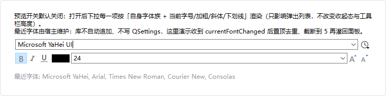

# 字体编辑面板

`DAFontEditPannelWidget` 提供完整的字体编辑面板，包含字体选择、字号、粗体/斜体/下划线、字体颜色。

## 效果预览


截图上半部分是默认的双行布局（字体族/字号一行，粗斜体下划线与颜色一行），下半部分是 `SingleRowLayout` 单行布局，适合嵌进工具栏等高度受限的位置；最底部是应用当前字体后的实时预览。

## 核心特性

**特性**

- ✅ **字体选择**：QFontComboBox
- ✅ **字号设置**：QSpinBox
- ✅ **样式开关**：粗体、斜体、下划线
- ✅ **字体颜色**：DAColorPickerButton 集成
- ✅ **每项预览**（可选）：下拉项按当前字号/风格渲染，默认关闭
- ✅ **最近字体**（可选）：宿主注入的最近 5 条入口，默认不出现
- ✅ **信号通知**：`currentFontChanged`、`currentFontColorChanged`

## 用法

### 1. 基本用法

```cpp
#include "DAFontEditPannelWidget.h"

auto *fontPanel = new DA::DAFontEditPannelWidget(parent);

// 设置当前字体
QFont font("Microsoft YaHei", 12);
font.setBold(true);
fontPanel->setCurrentFont(font);

// 设置字体颜色
fontPanel->setCurrentFontColor(Qt::red);

// 获取当前字体
QFont currentFont = fontPanel->getCurrentFont();
```

### 2. 信号处理

```cpp
// 字体变化
QObject::connect(fontPanel, &DA::DAFontEditPannelWidget::currentFontChanged,
    [](const QFont& font) {
        qDebug() << "字体:" << font.family() << font.pointSize();
    });

// 字体颜色变化
QObject::connect(fontPanel, &DA::DAFontEditPannelWidget::currentFontColorChanged,
    [](const QColor& color) {
        qDebug() << "字体颜色:" << color.name();
    });
```

### 3. 字重设置

```cpp
// 设置字重（Qt6 的 QFont::Weight 枚举）
fontPanel->setFontWeight(QFont::DemiBold);
```

## 字体预览与最近字体



### 1. 开启每项预览

```cpp
fontPanel->setFontPreviewEnabled(true);   // 默认 false
```

- 打开后字体下拉的每一项按「自身字体族 + 面板当前字号（clamp 到 9–20pt）/加粗/斜体/下划线」渲染。
- **只影响弹出列表**：收起态文本、`sizeHint()`、`minimumSizeHint()` 与工具栏高度都不变；关闭后委托精确还给 Qt 原生的字体委托，像素与默认完全一致。
- 行高随字号增长，但会被 clamp 到基准行高的 2 倍，避免 48pt 的行把弹层撑出屏幕。
- 未安装的字体族（宿主历史记录可能指向已卸载字体）退回面板字体渲染，不会出现整行方块。

### 2. 最近字体

```cpp
fontPanel->setMaxRecentFontCount(5);   // 1–20，默认 5

// 入参「最近 → 最旧」，内部去重并按上限截断
fontPanel->setRecentFontFamilies({
    "Microsoft YaHei", "Arial", "Times New Roman"
});

// 库不自动记录：宿主自己维护列表再灌回来
QObject::connect(fontPanel, &DA::DAFontEditPannelWidget::currentFontChanged,
    [fontPanel](const QFont& f) {
        QStringList recent = fontPanel->recentFontFamilies();
        recent.removeAll(f.family());
        recent.prepend(f.family());
        while (recent.size() > fontPanel->maxRecentFontCount())
            recent.removeLast();
        fontPanel->setRecentFontFamilies(recent);
    });
```

- 列表非空时字体下拉右侧出现时钟按钮；菜单每项用自身字体族渲染，点选只改字体族，字号仍由面板当前值决定。
- 空列表时按钮隐藏，`sizeHint()` 与未启用该功能时一致。
- 库内**不**自动追加、不写 `QSettings`；持久化与写入时机完全由宿主负责。

## 核心方法

| 方法 | 说明 |
|------|------|
| `getCurrentFont()` / `setCurrentFont(QFont)` | 获取/设置字体 |
| `getCurrentFontColor()` / `setCurrentFontColor(QColor)` | 获取/设置颜色 |
| `getFontWeight()` / `setFontWeight(QFont::Weight)` | 获取/设置字重 |
| `setFontPreviewEnabled(bool)` / `isFontPreviewEnabled()` | 字体下拉每项预览（默认关闭） |
| `setMaxRecentFontCount(int)` / `maxRecentFontCount()` | 最近字体上限（默认 5，1–20） |
| `setRecentFontFamilies(QStringList)` / `recentFontFamilies()` | 最近字体列表（最近优先、去重、截断） |

## 参考

- [颜色菜单与拾取按钮](color-menu.md)
- [形状编辑面板](shape-edit.md)
