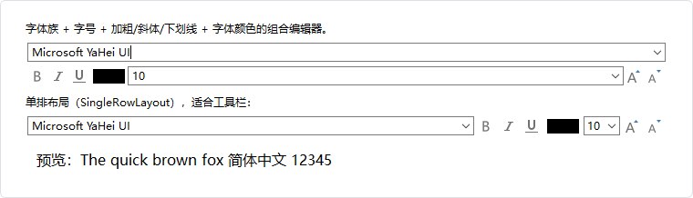

# 字体编辑面板

`DAFontEditPannelWidget` 提供完整的字体编辑面板，包含字体选择、字号、粗体/斜体/下划线、字体颜色。

## 效果预览



截图上半部分是默认的双行布局（字体族/字号一行，粗斜体下划线与颜色一行），下半部分是 `SingleRowLayout` 单行布局，适合嵌进工具栏等高度受限的位置；最底部是应用当前字体后的实时预览。

## 核心特性

**特性**

- ✅ **字体选择**：QFontComboBox
- ✅ **字号设置**：QSpinBox
- ✅ **样式开关**：粗体、斜体、下划线
- ✅ **字体颜色**：DAColorPickerButton 集成
- ✅ **信号通知**：`currentFontChanged`、`currentFontColorChanged`

## 用法

### 1. 基本用法

```cpp
#include "DAFontEditPannelWidget.h"

auto *fontPanel = new DA::DAFontEditPannelWidget(parent);

// 设置当前字体
QFont font("Microsoft YaHei", 12);
font.setBold(true);
fontPanel->setCurrentFont(font);

// 设置字体颜色
fontPanel->setCurrentFontColor(Qt::red);

// 获取当前字体
QFont currentFont = fontPanel->getCurrentFont();
```

### 2. 信号处理

```cpp
// 字体变化
QObject::connect(fontPanel, &DA::DAFontEditPannelWidget::currentFontChanged,
    [](const QFont& font) {
        qDebug() << "字体:" << font.family() << font.pointSize();
    });

// 字体颜色变化
QObject::connect(fontPanel, &DA::DAFontEditPannelWidget::currentFontColorChanged,
    [](const QColor& color) {
        qDebug() << "字体颜色:" << color.name();
    });
```

### 3. 字重设置

```cpp
// 设置字重（Qt6 的 QFont::Weight 枚举）
fontPanel->setFontWeight(QFont::DemiBold);
```

## 核心方法

| 方法 | 说明 |
|------|------|
| `getCurrentFont()` / `setCurrentFont(QFont)` | 获取/设置字体 |
| `getCurrentFontColor()` / `setCurrentFontColor(QColor)` | 获取/设置颜色 |
| `getFontWeight()` / `setFontWeight(QFont::Weight)` | 获取/设置字重 |

## 参考

- [颜色菜单与拾取按钮](color-menu.md)
- [形状编辑面板](shape-edit.md)
