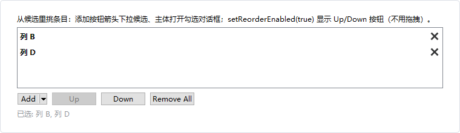
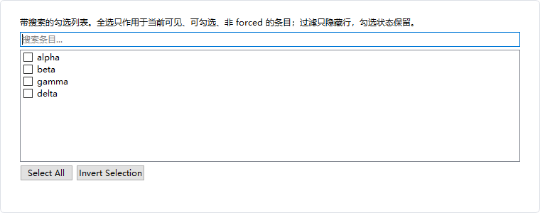
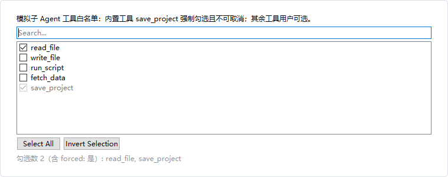
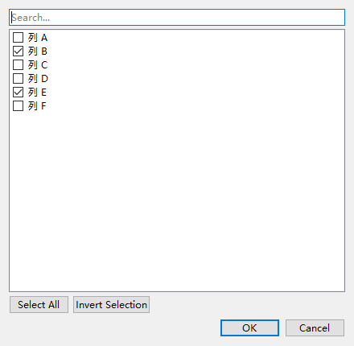
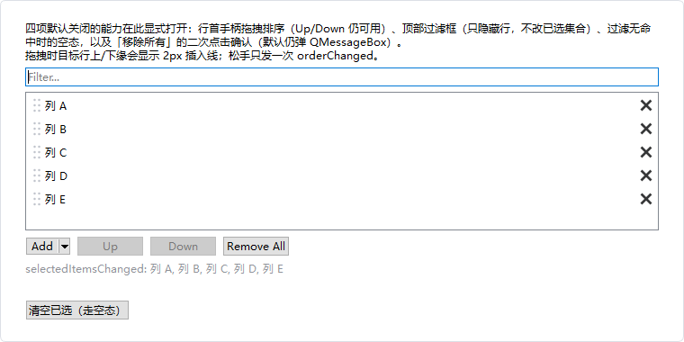
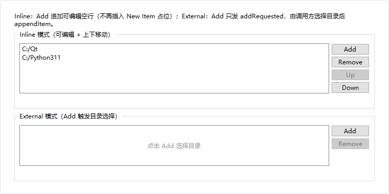
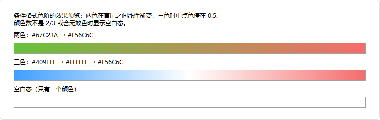

# 条目选择与预览

这一组控件面向「从一组候选中挑选若干条」以及「预览条目样式」的场景：勾选列表、条目勾选对话框、已选条目列表编辑器、纯字符串列表编辑器，以及色阶渐变预览条。它们只认 `DAItemEntry`（展示文本 + 标识数据）或纯字符串，不绑定任何业务语义，因此列选择、字段选择、模块路径、工具白名单等场景都可以复用。

## 效果预览



上图是条目选择家族最常用的组合：已选条目逐行展示、行尾可直接删除，底部 `Add` 按钮的箭头下拉候选菜单、主体打开勾选对话框，`Up/Down` 按钮用于排序。

## DAItemEntry

`DAItemEntry` 是所有条目选择控件的通用数据结构：

```cpp
struct DAItemEntry
{
    QString text;    // 展示文本
    QVariant data;   // 标识数据，无效时按 text 判同
};
```

当候选里存在同名条目（例如重名列）时，用 `data` 携带真实标识（列索引、字段名等）即可避免混淆。

## DACheckListWidget



带搜索框的勾选列表。搜索只隐藏行，不改变勾选状态；`Select All` 只作用于当前可见、可勾选、非 forced 的条目。

```cpp
#include "DACheckListWidget.h"

auto *check = new DA::DACheckListWidget(parent);
check->setItems({ { "alpha", QVariant() }, { "beta", QVariant() } });
check->setSearchPlaceholderText("搜索条目...");
check->setSelectAllVisible(true);
check->setInvertVisible(true);

QObject::connect(check, &DA::DACheckListWidget::checkedEntriesChanged, [check]() {
    qDebug() << "已勾选:" << check->checkedCount();
});
```

### 强制勾选与禁用



子 Agent 工具白名单是一个典型例子：内置工具 `save_project` 必须始终可用，因此用 `setEntryForcedChecked()` 强制勾选、`setEntryEnabled(false)` 置灰，用户无法取消。

```cpp
const DA::DAItemEntry forced { "save_project", QVariant() };
check->setEntryForcedChecked(forced, true);
check->setEntryEnabled(forced, false);
```

### 核心方法

| 方法 | 说明 |
|------|------|
| `setItems(QVector<DAItemEntry>)` | 设置候选条目（不发信号） |
| `checkedEntries()` | 获取勾中条目（含被过滤/禁用/forced 的） |
| `setEntryForcedChecked(e, bool)` | 强制勾选，用户不可取消 |
| `setEntryEnabled(e, bool)` | 条目是否可用 |
| `setEntryCheckable(e, bool)` | 条目是否显示复选框 |
| `setSearchVisible(bool)` / `setSelectAllVisible(bool)` / `setInvertVisible(bool)` | 控制搜索框与操作按钮显隐 |

## DAItemListPickDialog



`DAItemListPickDialog` 是 `DACheckListWidget` 的对话框壳，适合「一次性勾选一批条目再确认」：

```cpp
#include "DAItemListPickDialog.h"

DA::DAItemListPickDialog dialog(parent);
dialog.setItems({ { "列 A", QVariant() }, { "列 B", QVariant() }, { "列 C", QVariant() } });
dialog.setCheckedEntries({ { "列 B", QVariant() } });
if (dialog.exec() == QDialog::Accepted) {
    const auto picked = dialog.checkedEntries();
    // ...
}
```

对话框默认带 `Select All` / `Invert Selection` 与 `OK` / `Cancel`；搜索过滤不会丢失已勾选状态。

## DAItemListEditWidget




「已选条目」列表编辑器：每行一个删除按钮，`Add` 按钮的箭头弹出候选菜单、主体打开 `DAItemListPickDialog`，`Remove All` 默认带 `QMessageBox` 二次确认；`setReorderEnabled(true)` 显示 `Up/Down` 按钮，`setDragReorderEnabled(true)` 另开行首手柄拖拽，两者可以同时开启。

```cpp
#include "DAItemListEditWidget.h"

auto *edit = new DA::DAItemListEditWidget(parent);
edit->setAvailableItems({ { "列 A", QVariant() }, { "列 B", QVariant() } });
edit->setSelectedItems({ { "列 B", QVariant() } });
edit->setReorderEnabled(true);

QObject::connect(edit, &DA::DAItemListEditWidget::selectedItemsChanged,
                 [edit]() { qDebug() << edit->selectedItems().size(); });
```

### 拖拽排序与过滤

```cpp
edit->setDragReorderEnabled(true);   // 行首 6 点手柄，拖动排序（默认关闭）
edit->setFilterVisible(true);        // 顶部过滤框，只隐藏行（默认关闭）
edit->setEmptyText("没有匹配的条目");

// 「移除所有」改成两次点击：第一次只换文案，2.5s 内再点才清空
edit->setConfirmClearEnabled(true);
edit->setConfirmClearInterval(2500);
edit->setConfirmClearText("再次点击清空");

QObject::connect(edit, &DA::DAItemListEditWidget::orderChanged,
                 [](const QVector<DA::DAItemEntry>& items) {
                     // 顺序变化（Up/Down 与拖拽都会发）；增删仍走 selectedItemsChanged
                 });
```

- 三项开关默认关闭，不调用时布局、行为与旧版本一致（`Remove All` 仍弹确认框）。
- 拖拽只传源行号并复用同一套移动逻辑，行控件与 `DAItemEntry::data` 都不会丢；落到原位置不发信号。
- 过滤语义与 `DACheckListWidget` 一致：去首尾空白、大小写不敏感、子串匹配；只隐藏行，`selectedItems()` 始终返回全部条目。
- 0 条已选或过滤无命中时显示 `emptyText` 并隐藏列表（空态不是占位 item）。
- `orderChanged` 只表示顺序；首次点击清空只切换按钮文案，超时自动还原。`setSelectedItems()` 也会复位武装态。

### 核心方法

| 方法 | 说明 |
|------|------|
| `setAvailableItems(QVector<DAItemEntry>)` | 设置候选（添加菜单/对话框的数据源） |
| `setSelectedItems(QVector<DAItemEntry>)` | 整体替换已选（不发信号） |
| `selectedItems()` | 获取已选条目（列表顺序） |
| `setReorderEnabled(bool)` | 显示 Up/Down 按钮 |
| `setDragReorderEnabled(bool)` | 行首手柄拖拽排序（默认关闭） |
| `setFilterVisible(bool)` | 显示顶部过滤框（默认关闭） |
| `setEmptyText(QString)` | 空态文案 |
| `setConfirmClearEnabled(bool)` | 两次点击清空替代 `QMessageBox`（默认关闭） |
| `setConfirmClearInterval(int)` | 武装态自动还原时间（毫秒） |
| `orderChanged(QVector<DAItemEntry>)` | 顺序变化信号（增删仍走 `selectedItemsChanged`） |
| `setAddButtonText()` / `setRemoveAllButtonText()` | 覆盖默认文案（i18n） |

## DAStringListEditWidget



纯 `QStringList` 编辑器，两种 Add 行为：

- `AddMode::Inline`：Add 追加一行空字符串并立即进入编辑；
- `AddMode::External`：Add 只发射 `addRequested()`，由调用方决定追加什么（例如先弹目录选择框，再 `appendItem()`）。

```cpp
#include "DAStringListEditWidget.h"

auto *list = new DA::DAStringListEditWidget(parent);
list->setAddMode(DA::DAStringListEditWidget::AddMode::Inline);
list->setReorderEnabled(true);
list->setMaxCount(10);
list->setItems({ "C:/Qt", "C:/Python311" });

QObject::connect(list, &DA::DAStringListEditWidget::itemsChanged,
                 [list]() { qDebug() << list->items(); });
```

### 核心方法

| 方法 | 说明 |
|------|------|
| `setItems(QStringList)` / `items()` | 整体设置 / 获取列表 |
| `appendItem(QString)` | 追加一条（External 模式配合 `addRequested`） |
| `setAddMode(AddMode)` | Inline / External |
| `setReorderEnabled(bool)` / `setRemoveEnabled(bool)` | Up/Down、Remove 按钮显隐 |
| `setEditable(bool)` / `setMaxCount(int)` / `setPlaceholderText(QString)` | 编辑、上限与空状态提示 |

## DAColorScalePreviewWidget



条件格式色阶的效果预览条：传入 2 个颜色时在首尾之间线性渐变，传入 3 个颜色时中点色停在 0.5；颜色数不是 2/3 或含无效色时显示空白态。

```cpp
#include "DAColorScalePreviewWidget.h"

auto *preview = new DA::DAColorScalePreviewWidget(parent);
preview->setColors({ QColor("#67C23A"), QColor("#F56C6C") });          // 两色
preview->setColors({ QColor("#409EFF"), QColor("#FFFFFF"),
                     QColor("#F56C6C") });                             // 三色
```

## 参考

- [DACollapse 折叠容器](collapse.md)
- [DAPropertyItemWidget 属性项](property-item.md)
- 示例路径：`examples/all_widgets_demo`（条目选择 tab）
