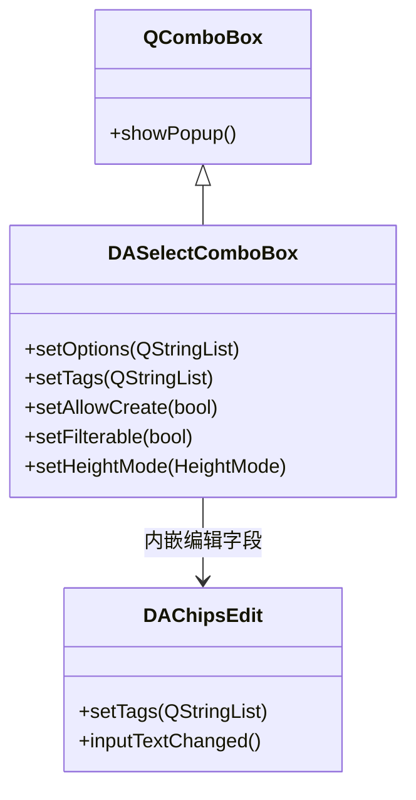

# DASelectComboBox 下拉多选

`DASelectComboBox` 是对标 Element UI `el-select`（`multiple + filterable + allow-create`）的多标签下拉选择框。继承 `QComboBox`，保留原生箭头/边框/键盘助记符，将编辑字段替换为 `DAChipsEdit`。

## 核心特性

**特性**

- ✅ **多标签选择**：选中项以标签（Chip）形式展示在编辑栏
- ✅ **可筛选**：输入文本过滤候选列表（默认开启）
- ✅ **允许创建**：可创建候选列表外的新标签
- ✅ **默认首选**：筛选时自动高亮第一个匹配项
- ✅ **两种高度模式**：随标签增长 / 固定高度滚动
- ✅ **QComboBox 兼容**：保留原生箭头、边框、键盘交互

## 类关系



## 用法

对应的示例位于：`examples/all_widgets_demo`（选择器/标签 tab）。

### 1. 基本用法

创建一个多选下拉框，设置候选列表并允许创建新标签：

```cpp
#include "DASelectComboBox.h"

auto *combo = new DA::DASelectComboBox(parent);

// 设置候选选项
combo->setOptions({ "苹果", "香蕉", "橙子", "葡萄", "西瓜" });

// 允许创建列表外的标签
combo->setAllowCreate(true);

// 设置占位提示
combo->setPlaceholder("选择或输入水果...");

// 预选标签
combo->setTags({ "苹果", "香蕉" });
```

### 2. 高度模式

`DASelectComboBox` 提供两种高度模式控制标签增多时的行为：

```cpp
using namespace DA;

// 模式一：随标签增长（默认）
// 控件高度随标签数量增加而增高
combo->setHeightMode(DASelectComboBox::HeightMode::GrowWithTags);

// 模式二：固定高度滚动
// 控件高度固定，标签区域可滚动
combo->setHeightMode(DASelectComboBox::HeightMode::FixedHeightScrollable);
combo->setFixedRowCount(3);  // 固定显示 3 行
```

| 模式 | 说明 | 适用场景 |
|------|------|---------|
| `GrowWithTags` | 标签增多时控件增高 | 标签数量较少，布局允许增高 |
| `FixedHeightScrollable` | 固定高度，标签区滚动 | 标签数量可能很多，空间有限 |

### 3. 信号处理

```cpp
// 标签列表变化
QObject::connect(combo, &DA::DASelectComboBox::tagsChanged,
    [](const QStringList& tags) {
        qDebug() << "当前标签:" << tags;
    });

// 用户选中一个候选选项
QObject::connect(combo, &DA::DASelectComboBox::optionSelected,
    [](const QString& option) {
        qDebug() << "选中:" << option;
    });

// 用户创建了一个新标签
QObject::connect(combo, &DA::DASelectComboBox::created,
    [](const QString& text) {
        qDebug() << "创建新标签:" << text;
    });
```

### 4. qss 样式定制

```css
DA--DASelectComboBox {
    border: 1px solid #dcdfe6;
    border-radius: 4px;
    padding: 2px 8px;
}
DA--DASelectComboBox::drop-down {
    width: 20px;
    border-left: 1px solid #dcdfe6;
}
/* 弹出列表项样式 */
QListView#DASelectComboBoxPopup {
    border: 1px solid #e4e7ed;
}
```

!!! warning "qss 注意事项"
    样式化 `QComboBox::drop-down` 时如果不提供 `::down-arrow` 的 `image`，会完全抑制原生箭头。DAWidgets 通过内嵌 PNG 箭头解决此问题。

## 核心属性与方法

### Q_PROPERTY

| 属性 | 类型 | 说明 |
|------|------|------|
| `options` | `QStringList` | 候选选项列表 |
| `tags` | `QStringList` | 已选标签列表 |
| `allowCreate` | `bool` | 是否允许创建列表外标签 |
| `filterable` | `bool` | 是否启用输入过滤 |
| `placeholder` | `QString` | 占位提示文本 |
| `heightMode` | `HeightMode` | 高度模式 |
| `fixedRowCount` | `int` | 固定高度模式下的显示行数 |

### 核心方法

| 方法 | 说明 |
|------|------|
| `setOptions(QStringList)` | 设置候选选项列表 |
| `tags()` / `setTags(QStringList)` | 获取/设置已选标签 |
| `setAllowCreate(bool)` | 启用/禁用创建功能 |
| `setFilterable(bool)` | 启用/禁用过滤功能 |
| `setHeightMode(HeightMode)` | 切换高度模式 |
| `clear()` | 清除所有标签 |

## 参考

- [DAChipsEdit 标签输入框](chips-edit.md)
- [DAChip 标签胶囊](chip.md)
- 示例路径：`examples/all_widgets_demo`（选择器/标签 tab）
