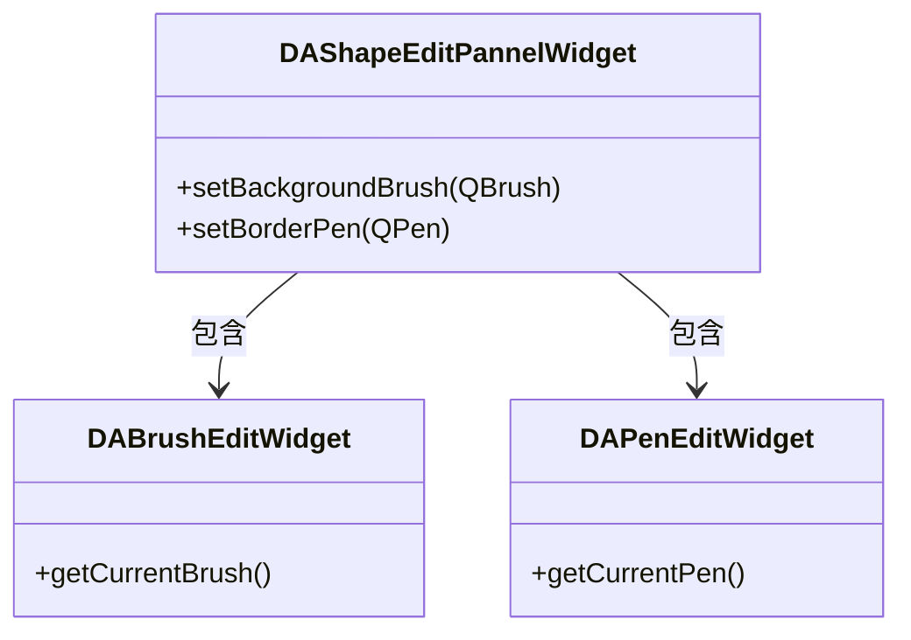

# 形状编辑面板

`DAShapeEditPannelWidget` 组合画刷编辑器和画笔编辑器，提供完整的形状样式编辑（背景画刷 + 边框画笔）。

## 核心特性

**特性**

- ✅ **背景画刷**：集成 `DABrushEditWidget`
- ✅ **边框画笔**：集成 `DAPenEditWidget`
- ✅ **独立信号**：画刷和画笔各自有变化信号

## 用法

```cpp
#include "DAShapeEditPannelWidget.h"

auto *shapePanel = new DA::DAShapeEditPannelWidget(parent);

// 设置背景画刷
QBrush brush(QColor("#4ECDC4"), Qt::SolidPattern);
shapePanel->setBackgroundBrush(brush);

// 设置边框画笔
QPen pen(Qt::darkCyan, 2, Qt::SolidLine);
shapePanel->setBorderPen(pen);

// 获取当前值
QBrush currentBrush = shapePanel->getBackgroundBrush();
QPen currentPen = shapePanel->getBorderPen();
```

### 信号处理

```cpp
// 画刷变化
QObject::connect(shapePanel, &DA::DAShapeEditPannelWidget::backgroundBrushChanged,
    [](const QBrush& brush) {
        qDebug() << "背景画刷:" << brush.color().name();
    });

// 画笔变化
QObject::connect(shapePanel, &DA::DAShapeEditPannelWidget::borderPenChanged,
    [](const QPen& pen) {
        qDebug() << "边框画笔:" << pen.color().name() << pen.width();
    });
```

## 类关系



## 核心方法

| 方法 | 说明 |
|------|------|
| `getBackgroundBrush()` / `setBackgroundBrush(QBrush)` | 获取/设置背景画刷 |
| `getBorderPen()` / `setBorderPen(QPen)` | 获取/设置边框画笔 |

## 参考

- [画笔样式编辑](pen-edit.md)
- [画刷样式编辑](brush-edit.md)
- [字体编辑面板](font-edit.md)
