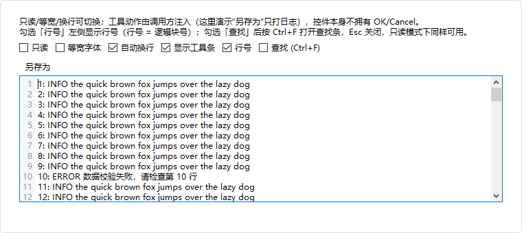

# DATextEditWidget 文本编辑/查看

`DATextEditWidget` 是一个通用文本查看/编辑控件：可切换只读、等宽字体、自动换行，工具条动作由调用方注入。控件本身不拥有 `OK` / `Cancel`，需要模态交互时由调用方套一个 `QDialog` 壳。

## 效果预览



截图中的工具条只有一个由外部注入的「另存为」动作，控件只负责展示与转发 `triggered`；下方四个复选框分别演示只读、等宽、换行与工具条显隐。文本区使用等宽字体时列对齐更整齐，适合查看日志、配置片段等。

## 核心特性

**特性**

- ✅ **只读/编辑切换**：`setReadOnly()`
- ✅ **等宽字体**：`setMonospace()`，适合日志与代码
- ✅ **自动换行**：`setLineWrapEnabled()`
- ✅ **可注入工具动作**：`addToolAction(QAction*)`，动作生命周期由调用方管理
- ✅ **行号栏**（可选）：左侧显示行号，默认关闭
- ✅ **查找条**（可选）：`Ctrl+F` 打开、Enter/按钮环绕查找、全部命中高亮，默认关闭
- ✅ **不绑定业务**：不内置保存/关闭逻辑，方便复用到对话框或停靠面板

## 用法

```cpp
#include "DATextEditWidget.h"

auto *view = new DA::DATextEditWidget(parent);
view->setText("第一行文本\n第二行文本");
view->setPlaceholderText("输入文本...");
view->setMonospace(true);
view->setLineWrapEnabled(true);
view->setReadOnly(true);

// 注入一个工具动作（控件不拥有它，生命周期由调用方负责）
auto *saveAction = new QAction("另存为", view);
view->addToolAction(saveAction);
view->setToolbarVisible(true);

QObject::connect(saveAction, &QAction::triggered, []() {
    qDebug() << "另存为被触发";
});
QObject::connect(view, &DA::DATextEditWidget::textChanged, []() {
    qDebug() << "用户编辑了文本";
});
```

!!! info "setText 不发射 textChanged"
    `setText()` 用于程序化写入，不会触发 `textChanged`；只有用户编辑才会发射，避免调用方回环刷新。

### 行号栏

```cpp
view->setLineNumbersVisible(true);   // 默认 false
```

- 行号画在编辑器左侧，随滚动同步，宽度按总行数位数自动重算（`setMonospace()` 换字体后也会重算）。
- **行号 = 文档块号**：自动换行开启时，一个逻辑行折成多行仍只显示一个行号。
- 关闭后 `viewportMargins` 归零，不占任何宽度。

### 查找条

```cpp
view->setFindEnabled(true);        // 默认 false：允许 Ctrl+F
view->showFindBar("ERROR");        // 直接打开并预填关键词
view->setFindBarVisible(false);    // 直接隐藏
```

- `setFindEnabled(true)` 后焦点在本控件内按 `Ctrl+F` 打开查找条；`Esc` 关闭并把焦点还给编辑器。
- 查找条含输入框、上一个/下一个、`n / m` 计数、区分大小写与关闭按钮；命中会全部高亮，当前命中颜色更深。
- 支持环绕：最后一个命中再点下一个回到第一个；`m == 0` 时计数为 `0 / 0`，输入框设置 `invalid` 动态属性。
- **只读模式同样可用**（只移动光标与高亮，不修改文本）。
- 宿主若也要用 `Ctrl+F`，调用 `setFindEnabled(false)` 让出快捷键即可。
- 查找与行号都是纯视图状态，不新增信号；`textChanged()` 仍只由用户编辑发射。

## 核心属性与方法

| 方法 | 说明 |
|------|------|
| `setReadOnly(bool)` / `isReadOnly()` | 只读状态 |
| `setMonospace(bool)` / `isMonospace()` | 等宽字体 |
| `setLineWrapEnabled(bool)` / `isLineWrapEnabled()` | 自动换行 |
| `setText(QString)` / `text()` | 设置/获取文本（`setText` 不发信号） |
| `setPlaceholderText(QString)` | 空文本占位提示 |
| `addToolAction(QAction*)` | 向工具条注入动作 |
| `setToolbarVisible(bool)` / `isToolbarVisible()` | 工具条显隐 |
| `setLineNumbersVisible(bool)` / `lineNumbersVisible()` | 左侧行号栏（默认关闭） |
| `setFindEnabled(bool)` / `findEnabled()` | 允许 `Ctrl+F`（默认关闭） |
| `setFindBarVisible(bool)` / `findBarVisible()` | 查找条显隐 |
| `showFindBar(QString)` / `hideFindBar()` | 打开（可预填） / 关闭查找条 |
| `setFindCaseSensitive(bool)` / `findCaseSensitive()` | 查找是否区分大小写 |

## 参考

- [DAUndoHistoryWidget 撤销历史](undo-overlay.md)
- 示例路径：`examples/all_widgets_demo`（文本 tab）
