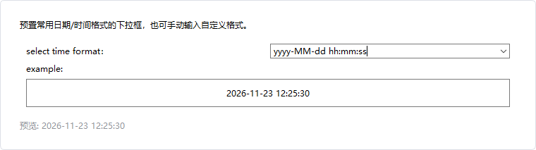

# 时间格式编辑器

`DATimeFormatEditWidget` 提供时间格式设置控件，允许用户选择或输入时间显示格式。

## 效果预览



上图的下拉框提供常用日期/时间格式预设，也可以直接编辑格式字符串；演示程序用当前时间按所选格式实时渲染预览，便于确认格式效果。

## 核心特性

**特性**

- ✅ **格式预设**：提供常用时间格式预设
- ✅ **自定义输入**：支持手动输入格式字符串
- ✅ **信号通知**：格式变化时发射信号

## 用法

```cpp
#include "DATimeFormatEditWidget.h"

auto *timeEdit = new DA::DATimeFormatEditWidget(parent);

// 设置时间格式
timeEdit->setTimeFormatText("yyyy-MM-dd HH:mm:ss");

// 获取当前格式
QString format = timeEdit->getTimeFormat();
```

## 核心方法

| 方法 | 说明 |
|------|------|
| `getTimeFormat()` | 获取当前时间格式字符串 |
| `setTimeFormatText(QString)` | 设置时间格式字符串 |

## 参考

- [DAPropertyItemWidget 属性项](property-item.md)
