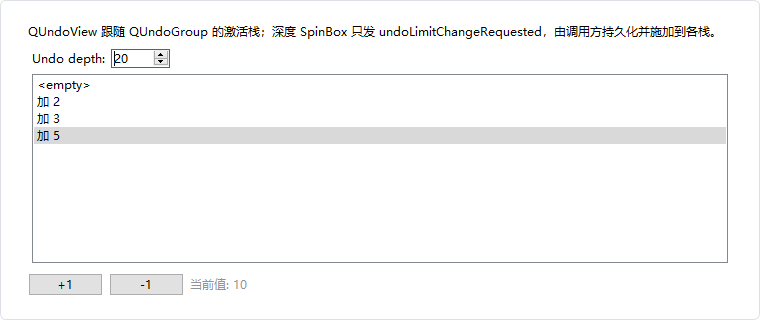
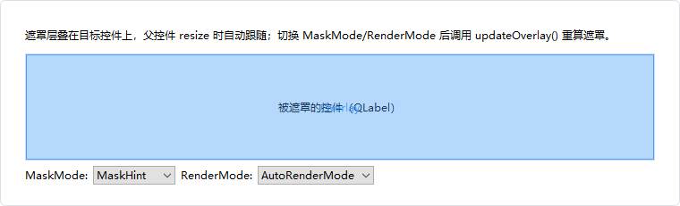

# 撤销历史与遮罩层

`DAUndoHistoryWidget` 是撤销历史面板：用 `QUndoView` 跟随 `QUndoGroup` 的激活栈，并附带撤销深度调节入口。`DAAbstractWidgetOverlay` 是控件遮罩层抽象基类，用于在目标控件上叠加轻量绘制。

## 效果预览



上图的历史列表来自演示程序预先压入的三条命令，点击任意条即可回退/前进到该状态；顶部 SpinBox 是撤销深度入口，修改后只发射 `undoLimitChangeRequested`，真正的持久化与施加由调用方完成。

## DAUndoHistoryWidget

### 核心特性

- ✅ **跟随激活栈**：`setUndoGroup(QUndoGroup*)` 后自动显示当前激活页面的历史
- ✅ **点击回退/前进**：复用 `QUndoView` 的交互
- ✅ **深度调节入口**：`undoLimit()` / `setUndoLimit()`，SpinBox 变化只发信号
- ✅ **分层清晰**：控件不读配置、不遍历各数据页撤销栈

### 用法

```cpp
#include "DAUndoHistoryWidget.h"
#include <QUndoGroup>
#include <QUndoStack>

auto *stack = new QUndoStack(parent);
auto *group = new QUndoGroup(parent);
group->addStack(stack);
group->setActiveStack(stack);

auto *history = new DA::DAUndoHistoryWidget(parent);
history->setUndoGroup(group);

// 用户调整深度：调用方写配置并施加到各栈
QObject::connect(history, &DA::DAUndoHistoryWidget::undoLimitChangeRequested,
                 [](int limit) { qDebug() << "新的撤销深度:" << limit; });
```

### 核心方法

| 方法 | 说明 |
|------|------|
| `setUndoGroup(QUndoGroup*)` / `undoGroup()` | 绑定/获取撤销组 |
| `undoLimit()` / `setUndoLimit(int)` | 读取/注入深度（`setUndoLimit` 不发信号） |
| `undoLimitChangeRequested(int)` | 用户修改深度时发射 |

## DAAbstractWidgetOverlay



遮罩层叠在目标控件（截图中的 QLabel）上，父控件 resize 时自动跟随。`MaskMode` 决定下层窗口需要重绘的区域（`NoMask` / `MaskHint` / `AlphaMask`），`RenderMode` 决定是否复用 alpha 缓冲；切换后调用 `updateOverlay()` 重算。

### 核心特性

- ✅ **减少重绘**：只让下层窗口重绘遮罩区域
- ✅ **三种遮罩模式**：`NoMask`、`MaskHint`（默认）、`AlphaMask`
- ✅ **三种渲染模式**：`AutoRenderMode`、`CopyAlphaMask`、`DrawOverlay`
- ✅ **子类只实现绘制**：重写 `drawOverlay(QPainter*)`

### 用法

```cpp
#include "DAAbstractWidgetOverlay.h"

class SelectionOverlay : public DA::DAAbstractWidgetOverlay
{
public:
    explicit SelectionOverlay(QWidget *target)
        : DA::DAAbstractWidgetOverlay(target)
    {
        resize(target->size());
        show();
        raise();
    }

protected:
    void drawOverlay(QPainter *painter) const override
    {
        painter->fillRect(rect(), QColor(64, 158, 255, 90));
        painter->drawRect(rect().adjusted(1, 1, -2, -2));
    }
};

auto *overlay = new SelectionOverlay(targetWidget);
overlay->setMaskMode(DA::DAAbstractWidgetOverlay::MaskHint);
overlay->updateOverlay();
```

!!! info "遮罩层不是子控件的替代品"
    遮罩层只负责在目标控件上叠加绘制，不参与布局；目标控件 resize 后需要同步 `resize()` 并调用 `updateOverlay()`。

## 参考

- [DATextEditWidget 文本编辑](text-edit.md)
- 示例路径：`examples/all_widgets_demo`（工具组件 tab）
