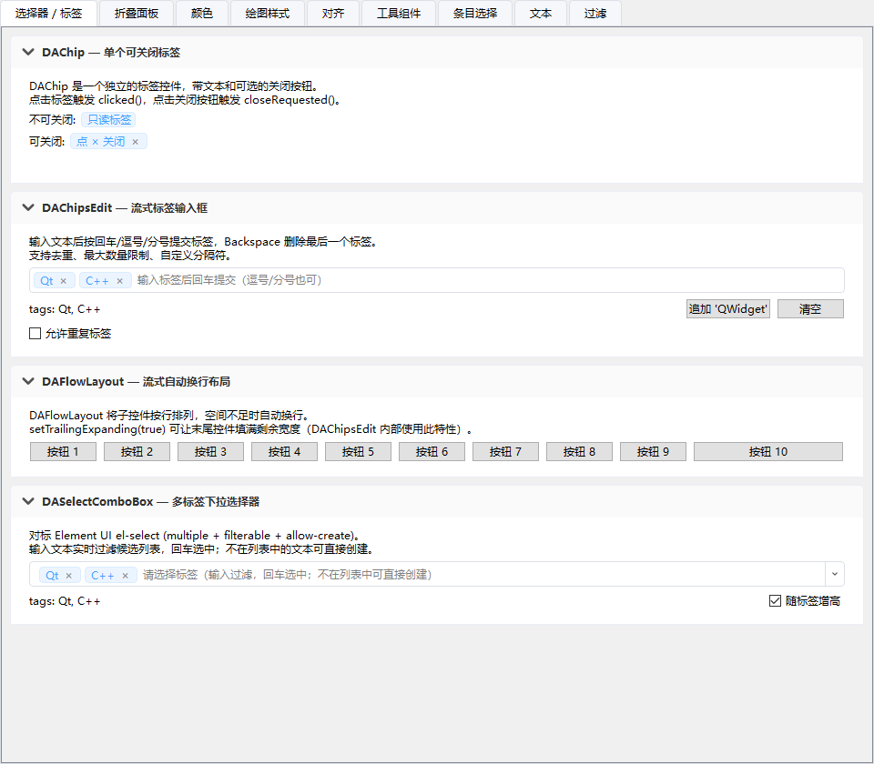

# All Widgets Demo

DAWidgets 全控件演示程序：一个窗口内用 9 个标签页展示全部公开控件，每个标签页内部再用 `DACollapseWidget` 分组。



## 界面结构

| 标签页 | 展示的控件 |
|--------|------------|
| 选择器 / 标签 | `DAChip`、`DAChipsEdit`、`DAFlowLayout`、`DASelectComboBox` |
| 折叠面板 | `DACollapseWidget`（手风琴 / 非手风琴）、`DACollapseItem`（禁用 / 自定义标题 / 关闭动画） |
| 颜色 | `DAColorPickerButton`、`DAColorPaletteGridWidget`、`DAColorGridWidget`、`DAColorMenu` |
| 绘图样式 | `DABrushStyleComboBox`、`DABrushEditWidget`、`DAPenStyleComboBox`、`DAPenEditWidget`、`DAShapeEditPannelWidget`、`DAFontEditPannelWidget` |
| 对齐 | `DATextAlignmentEditWidget`、`DAAligmentEditWidget`、`DAAligmentPositionEditWidget` |
| 工具组件 | `DAFilePathEditWidget`、`DATimeFormatEditWidget`、`DAPropertyItemWidget`、`DAUndoHistoryWidget`、`DAAbstractWidgetOverlay`、`DAWaitCursorScoped` |
| 条目选择 | `DACheckListWidget`（普通 / forced）、`DAItemListEditWidget`、`DAItemListPickDialog`、`DAStringListEditWidget`、`DAColorScalePreviewWidget` |
| 文本 | `DATextEditWidget` |
| 过滤 | `DAStringFilterProxyModel` |

标签页与场景定义在各 `Tab*.cpp` 的 `*Scenes()` 列表中，`DemoScene.cpp` 汇总顺序；新增控件时追加一条 `DemoScene` 即可同时出现在演示界面和截图导出中。

## 构建与运行

```powershell
cmake -S . -B build -DCMAKE_PREFIX_PATH="<Qt 安装路径>" -DDAWIDGETS_BUILD_DEMO=ON
cmake --build build --config Release --parallel

# Windows 下运行前把 Qt 的 bin 目录加入 PATH
$env:Path = "D:/Qt/6.7.3/msvc2019_64/bin;$env:Path"
./build/examples/all_widgets_demo/Release/dawidgets_all_widgets_demo.exe
```

## 一键导出截图

`--export-gallery` 会遍历全部场景，导出主窗口、每个标签页、每个控件场景，以及下拉弹层/颜色菜单/条目对话框的特写：

```powershell
dawidgets_all_widgets_demo --export-gallery docs/images/gallery
```

输出结构：

```text
docs/images/gallery/
├── all-widgets-demo.png          # 主窗口首屏
├── tabs/
│   ├── 01-selector.png
│   ├── 02-collapse.png
│   └── ...
└── widgets/
    ├── chip.png                  # 每个场景一张
    ├── select-combobox-popup.png # 弹出层特写
    └── ...
```

英文文档使用同一批图片，导出后同步到 `docs/en/images/gallery/`。

| 选项 | 说明 |
|------|------|
| `--export-gallery [目录]` | 导出全部截图，默认 `docs/images/gallery` |
| `--shot <png> [tabIndex]` | 只截取指定标签页后退出 |
| `--help` | 打印命令行帮助 |

## 说明

- 截图里的界面文案为中文；控件本身不内嵌文案，集成方可自行翻译。
- 演示程序是控制台程序（`WIN32_EXECUTABLE OFF`），便于在命令行查看导出日志。
